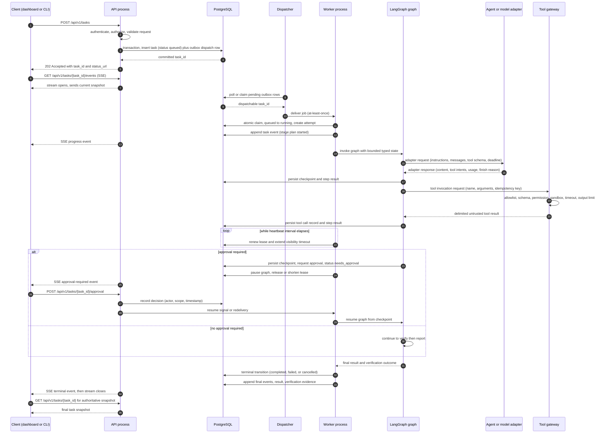
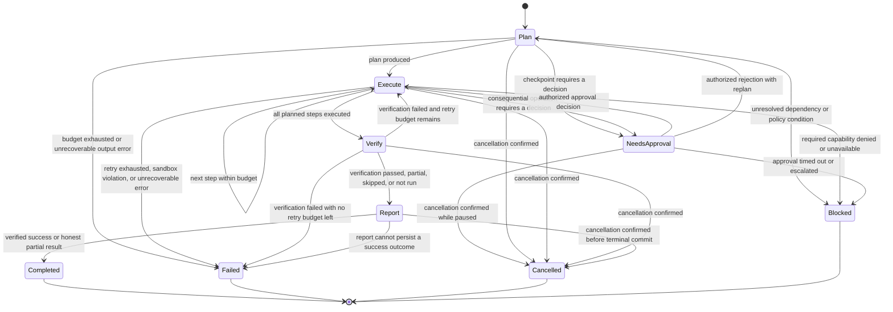

# Agent Runtime Specification

**Status:** Design specification only. **Not implemented.**

> **Repository reality:** DevFlow AI is currently a documentation-only repository. There is **no application code, no dependency manifest, no test suite, and no CI**. Nothing in this document exists as a module, class, function, queue, table, or configuration key. Every interface, field, signature, bound, and diagram below is a **design specification to be implemented and verified later**. Treat every `text`, `python`, `json`, and `mermaid` block as a **sketch or contract proposal**, never as a description of working software.
>
> Numeric values and technology choices that the owner has not approved are explicitly marked **Proposed** or **Unresolved decision**. No performance number, benchmark, or test result exists for this project, and none is claimed here.

## 1. Status and scope

### 1.1 What this document owns

This document is the authoritative source for:

- Agent and model **adapter interfaces**.
- **Workflow state** shape and the bounded graph stages.
- **Execution boundaries and budgets** for a single task (steps, tools, time, retries, output, concurrency).
- **Failure handling and recovery** semantics in the worker.
- **Idempotency and duplicate-delivery** requirements for worker handlers.
- **Cancellation** and **approval pause/resume** mechanics at the graph level.
- **Checkpointing** requirements and their limits.
- **Tool invocation contract** from the graph's point of view.
- **Model/provider configuration and routing** surface.
- **Agent outcome evaluation** criteria and **worker observability** fields.

### 1.2 What this document does not own

| Subject | Authoritative document |
|---|---|
| System components, boundaries, data flow, performance/reliability/security architecture | [`../ARCHITECTURE.md`](../ARCHITECTURE.md) |
| Externally observable task states and transitions, error semantics | [`../SPEC.md`](../SPEC.md) |
| API routes, error envelope, versioning, SSE protocol | [`API_CONTRACTS.md`](API_CONTRACTS.md) |
| Data model, migrations, indexing, retention, ownership | [`DATABASE.md`](DATABASE.md) |
| Security requirements and threat analysis | [`SECURITY.md`](SECURITY.md), [`THREAT_MODEL.md`](THREAT_MODEL.md) |
| Test levels, quality gates, measurement protocol | [`TESTING.md`](TESTING.md) |
| Performance budgets and benchmark protocol | [`PERFORMANCE.md`](PERFORMANCE.md) |
| Product scope, non-goals, acceptance criteria | [`../PRD.md`](../PRD.md) |
| Milestone sequence and exit criteria | [`../PLAN.md`](../PLAN.md) |

### 1.3 Relationship to `ARCHITECTURE.md`

[`../ARCHITECTURE.md`](../ARCHITECTURE.md) describes the worker and LangGraph at a **high level**: a separately managed worker consumes accepted tasks, keeps planning/execution/verification/reporting as explicit stages, bounds concurrency, and states that worker delivery may be at-least-once with idempotent handlers.

This document **does not contradict** that. It supplies the detailed runtime contract underneath those statements:

- The exact boundary between the API process, the dispatch layer, the worker, the graph, the adapters, the tool gateway, and sandboxed execution (§2).
- The adapter interface that hides provider APIs from domain and workflow code (§3, §4).
- The typed workflow state, the stage contract, and where approval and cancellation interrupt them (§5, §8, §9).
- Concrete proposed bounds where `ARCHITECTURE.md` says "bounded" without a number (§6).
- The mechanics behind "handlers must be idempotent" and "checkpoints do not guarantee queue delivery" (§7, §11).

Where this document refines a high-level statement, it says so explicitly. Where it proposes a number or technology, it is marked **Proposed** or **Unresolved decision** until the owner approves it, and any approval must be reflected back into the owning document. Per [`../ARCHITECTURE.md`](../ARCHITECTURE.md) §4, the worker consumes accepted tasks; this document never grants the API process permission to run a graph.

### 1.4 Free-first inference strategy (owner-approved)

The owner has approved this ordering as **direction**; it is not yet implemented:

1. Begin with a deterministic **mock** model/agent adapter so workflow, lifecycle, error, retry, approval, and progress behavior can be exercised with zero inference cost.
2. Add a **local** provider (for example Ollama) behind the same adapter interface.
3. Treat **hosted free tiers** only as optional adapters. Core architecture must not depend on any provider's free tier, quota, rate limit, or continued availability.

Orchestration must remain decoupled from the model provider: swapping a provider must not require rewriting the task domain or the LangGraph workflow.

---

## 2. Runtime roles and separation

Each role below is a **distinct responsibility with a distinct failure domain**. Collapsing two roles into one process is an implementation choice that must not collapse the boundary between them.

| Role | Owns | Must never |
|---|---|---|
| **API process** | Authentication, authorization, validation, task creation, dispatch-intent persistence, task reads, approval and cancellation intake, SSE fan-out | Run a graph, call a model, execute a tool, hold a request open for agent work |
| **Queue / dispatch layer** | Durable handoff of accepted tasks to workers, visibility/lease semantics, delivery attempts | Be the only durable record of a task |
| **Worker process** | Claiming jobs, invoking the graph, heartbeating/lease renewal, persisting events, applying terminal transitions, graceful shutdown | Serve client HTTP traffic; assume exactly-once delivery |
| **LangGraph graph definition** | Stage sequence, routing between stages, checkpointing, pause/resume decisions, budget accounting within a task | Perform I/O directly against providers, databases, or the host shell |
| **Agent/model adapters** | Translating a provider-neutral request into a provider call and normalizing the result and errors | Make authorization decisions; enforce policy; decide approvals |
| **Tool gateway** | Allowlist enforcement, schema validation, permission checks, sandbox routing, timeouts, output limits, audit events | Trust model output as authorization; let a tool result change its own permissions |
| **Sandboxed execution** | Running shell/filesystem/repository operations under restricted filesystem and network scope | Grant unrestricted host access to an agent by default |

### 2.1 Separation rules

- The API process performs only bounded work: validate, persist the task and dispatch intent, return `202 Accepted`. It never awaits graph completion ([`../ARCHITECTURE.md`](../ARCHITECTURE.md) §2, [`../SPEC.md`](../SPEC.md) "Worker semantics").
- The graph calls **adapters** and the **tool gateway**, never a provider SDK or the host shell directly. This is what makes the mock adapter a first-class citizen rather than a test hack.
- Only the **domain/lifecycle layer** applies task state transitions. Adapters and tools return data; they do not transition tasks.
- Only an **authorized human decision** resumes a task paused in `needs_approval` (§9). Model output and tool results can request an approval; they can never grant one.

### 2.2 Full-task sequence

The diagram shows one task from submission to terminal state, including the dispatch hop, worker execution, adapter/tool interaction, persisted events, and the SSE path to the client. It assumes an outbox-style dispatch, which is **Proposed** (see §16).



Notes on the diagram:

- The SSE leg is server-to-client only; the client always confirms final state through the task snapshot endpoint, because a transient stream is not the record of truth.
- The dispatcher is a logical role. It may be a separate process, a database poller, or a durable job mechanism; that is **Unresolved decision** (§16).
- The approval branch may occur at more than one checkpoint. The graph's persisted state decides which checkpoint is pending.

---

## 3. Agent adapter interface

### 3.1 Purpose

An **agent/model adapter** is the only component that knows a provider's wire format. Domain code, lifecycle code, verification code, and the graph itself depend on the adapter interface, not on a provider SDK. This is the mechanism that keeps orchestration decoupled from the model provider.

> The code below is an **interface sketch** written in Python-flavored typing to make the contract concrete. It is **not implemented code**, contains no provider integration, and may be revised during Milestone 5. Field names are contractual intent; exact naming is subject to [`../CODE_STYLE.md`](../CODE_STYLE.md) conventions.

### 3.2 Request type

An adapter request must carry everything needed to reproduce and bound a single model call, and nothing that the adapter could misuse as authority.

```python
# INTERFACE SKETCH ONLY - no such module exists in this repository.
# Illustrative typing, not an implementation and not a provider integration.

from dataclasses import dataclass, field
from typing import Any, Literal, Mapping, Sequence, Protocol

Role = Literal["system", "developer", "user", "assistant", "tool"]


@dataclass(frozen=True)
class AdapterMessage:
    """One turn of history. Content is data, never an instruction to the runtime."""
    role: Role
    content: str
    # Names of any tool calls this assistant turn requested, for replay fidelity.
    tool_call_refs: Sequence[str] = ()


@dataclass(frozen=True)
class ToolSchemaDeclaration:
    """A tool the model may *ask* for. Declaring it here grants no permission."""
    name: str
    description: str
    parameters_json_schema: Mapping[str, Any]
    # Gateway-side fact: whether invocation of this tool will require approval.
    requires_approval: bool = False


@dataclass(frozen=True)
class GenerationParameters:
    """Bounded generation settings. Values come from configuration, not the model."""
    max_output_tokens: int
    temperature: float
    top_p: float | None = None
    stop_sequences: Sequence[str] = ()
    seed: int | None = None          # Deterministic mode uses a fixed seed.
    deterministic: bool = False


@dataclass(frozen=True)
class DeadlineToken:
    """Cooperative deadline and cancellation handle passed to every adapter call."""
    deadline_monotonic: float        # Absolute monotonic deadline for this call.
    cancel_requested: "CancellationView"
    correlation_id: str              # Trace/correlation identifier, never a secret.


@dataclass(frozen=True)
class AdapterRequest:
    """Provider-neutral request. Contains no credentials and no authorization claim."""
    request_id: str
    system_instructions: str
    developer_instructions: str
    messages: Sequence[AdapterMessage]
    tool_declarations: Sequence[ToolSchemaDeclaration]
    parameters: GenerationParameters
    deadline: DeadlineToken
    # Opaque, non-secret provider hints derived from configuration (for example a
    # local model tag). The adapter must ignore unknown keys rather than fail hard.
    provider_hints: Mapping[str, str] = field(default_factory=dict)
```

Contract requirements for the request:

- **Instructions are separated from content.** System and developer instructions are distinct fields from message history so that prompt-injection defenses can reason about provenance.
- **Tool declarations are declarations only.** Passing a schema to a model never authorizes a call; the tool gateway authorizes (§12).
- **No credentials.** Adapters receive no API keys, tokens, or database handles through the request object. Credentials are read from the runtime's secret configuration.
- **Deadline and cancellation travel with the call.** Adapters are expected to honor both rather than rely on caller-side timeouts alone.

### 3.3 Response type

```python
# INTERFACE SKETCH ONLY.

FinishReason = Literal[
    "stop",            # Model produced a normal completion.
    "length",          # Hit max_output_tokens; output is truncated and must be treated as partial.
    "tool_calls",      # Model requested one or more tool invocations.
    "cancelled",       # Adapter observed cancellation and stopped deliberately.
    "deadline",        # Adapter observed the deadline and stopped deliberately.
    "error",           # Provider returned an error; see normalized error.
]


@dataclass(frozen=True)
class ToolCallIntent:
    """A *request* to use a tool. Not authorization, not a side effect, not a result."""
    intent_id: str
    tool_name: str
    arguments: Mapping[str, Any]
    raw_arguments_text: str | None = None   # Preserved for audit and re-validation.


@dataclass(frozen=True)
class UsageMetadata:
    """Usage is reported even when the provider does not bill per token."""
    input_tokens: int | None = None
    output_tokens: int | None = None
    total_tokens: int | None = None
    output_bytes: int | None = None
    estimated_cost_micros: int | None = None   # None when cost is unknown or zero-rated.
    cost_basis: Literal["provider_reported", "estimated", "not_applicable", "unknown"] = "unknown"


@dataclass(frozen=True)
class NormalizedAdapterError:
    """Every adapter failure is normalized to this shape before leaving the adapter."""
    code: str                      # Stable machine-readable code from the runtime taxonomy.
    message: str                   # Human-readable; must not include secrets.
    retryable: bool
    provider_status: int | None = None
    provider_error_code: str | None = None


@dataclass(frozen=True)
class AdapterResponse:
    """Provider-neutral response. Content is untrusted data."""
    request_id: str
    content: str
    tool_call_intents: Sequence[ToolCallIntent]
    usage: UsageMetadata
    finish_reason: FinishReason
    provider_metadata: Mapping[str, str]     # Provider ID, model tag, latency class. No secrets.
    error: NormalizedAdapterError | None = None
```

Contract requirements for the response:

- **`content` is untrusted.** It is data for the graph and the verifier, never a command, never an approval, never an authorization.
- **`tool_call_intents` are requests.** The graph must route each intent to the tool gateway, which independently validates and authorizes (§12).
- **`finish_reason == "length"` means partial output.** The graph must not treat truncated output as a complete answer.
- **`finish_reason` values `cancelled` and `deadline` are successful returns of a failed attempt**, not exceptions, so that the graph can distinguish "we stopped this" from "the provider broke".
- **Errors are normalized before crossing the boundary.** The graph never sees a raw SDK exception or raw provider payload.

### 3.4 Adapter protocol and required properties

```python
# INTERFACE SKETCH ONLY.

class AgentAdapter(Protocol):
    """Structural contract every provider adapter must satisfy."""

    adapter_id: str                     # Stable ID, safe for logs and metrics.
    provider_id: str                    # Provider family, safe for logs.
    supports_streaming: bool
    supports_cancellation: bool
    supports_deadline: bool
    deterministic_mode: bool            # True only for adapters that guarantee reproducibility.

    async def invoke(self, request: AdapterRequest) -> AdapterResponse:
        """Perform one bounded model call. Must not raise raw provider exceptions."""
        ...

    async def invoke_stream(self, request: AdapterRequest):
        """Yield incremental deltas, then a final AdapterResponse. Optional if unsupported."""
        ...

    def declared_limits(self) -> Mapping[str, int]:
        """Return the adapter's self-declared ceilings (tokens, output bytes, concurrency)."""
        ...
```

| Required property | Meaning | Why it matters |
|---|---|---|
| **Deterministic mode** | With `deterministic=True`, identical requests yield identical responses for the same adapter version and seed | Makes workflow, retry, idempotency, and approval tests reproducible with zero inference cost |
| **Streaming support** | Can emit incremental deltas plus a terminal response, or declare `supports_streaming = False` | Progress reporting must degrade gracefully rather than break on non-streaming providers |
| **Cancellation support** | Observes the cancellation view and stops promptly, returning `finish_reason="cancelled"` | Cancellation must not depend on killing a worker process |
| **Deadline enforcement** | Honors `deadline.deadline_monotonic` per call and returns `finish_reason="deadline"` | Prevents a single slow provider call from consuming the whole task budget |
| **Bounded output** | Enforces `max_output_tokens` and reports `output_bytes`, truncating rather than growing unbounded | Output size is both a cost and a memory/denial-of-service control |
| **Error normalization** | Maps every provider failure to `NormalizedAdapterError` with a stable code and `retryable` flag | Retry, block, and dead-letter decisions must not be provider-specific |
| **Usage/cost reporting** | Reports token counts and, when known, cost or an explicit `unknown`/`not_applicable` basis | Budgets and circuit breakers need a usage signal even for free or local providers |

**Adapters hold no authorization authority.** An adapter must not: decide whether a tool may run; decide whether an approval is satisfied; read or write task state; grant permissions; or widen its own limits. An adapter that returned "approved" would be a security defect, not a feature. Authorization lives in the API/domain layer and the tool gateway.

---

## 4. Provider adapter implementations (planned)

All three families implement the same `AgentAdapter` interface. Selection is configuration-driven (§13), never a code branch in domain logic.

### 4.1 `mock` — deterministic, seeded, no network

- **Status:** planned. This is the **default adapter for tests and for the first vertical slice** ([`../PLAN.md`](../PLAN.md) Milestone 5; [`TESTING.md`](TESTING.md) "Prefer deterministic tests with fake model/tool adapters").
- **Behavior:** returns scripted or seeded responses, including deliberately scripted tool-call intents, invalid output, timeouts, rate-limit errors, and cancellation acknowledgements.
- **Guarantees required:** no network access, no credentials, reproducible output for a fixed seed and scenario name, and configurable latency simulation for timeout/lease tests.
- **Why first:** it exercises lifecycle, retry, backoff, idempotency, approval pause/resume, cancellation, checkpoint recovery, and SSE progress without inference cost or provider availability risk.

### 4.2 `local` — Ollama or equivalent

- **Status:** planned, and deliberately unspecified. **No specific model, runtime build, or quantization is approved by this document.**
- **Owner/environment concerns, not architectural facts:** available hardware, GPU/CPU mix, memory ceiling, achievable tokens per second, context window, model quality, and model licensing. These change per machine and must be recorded as environment facts when measured, not assumed.
- **Implications to design for:** slower and more variable latency than hosted providers, possible load-induced failures, possible cold-start delay on first call, and no cost-per-token signal (cost basis `not_applicable`).
- **Deadlines matter more here.** Per-call deadlines and the task wall-clock budget must tolerate a slow local model without stalling the queue.

### 4.3 `hosted` — optional free-tier adapters

- **Status:** optional and unapproved as a default. **Unresolved decision** whether hosted providers are permitted at all (§16).
- **Warning:** free-tier rate limits, quotas, model availability, and terms can change or disappear without notice. **No free tier may become an architectural dependency.** The system must remain fully functional with `mock` plus `local` alone: no retry policy, queue design, scheduler, or stage contract may assume a hosted free tier exists.
- Hosted adapters sit behind the same interface and therefore must also honor deterministic-mode reporting honestly (typically `deterministic_mode = False`), cancellation, deadlines, bounded output, and usage reporting.
- Rate-limit and quota failures map to the normalized `rate_limited` / `quota_exceeded` taxonomy entries (§10), which are handled with backoff and budget checks, not with provider-specific logic.

### 4.4 Configuration keys (placeholders only)

Environment-based selection. **Only placeholder names appear here; no real values, tokens, endpoints, or model tags are recorded in this repository.** The exact names are a **Proposed** surface to be finalized in Milestone 1 alongside the `.env.example` with placeholders only ([`SECURITY.md`](SECURITY.md)).

```text
DEVFLOW_AGENT_ADAPTER=mock|local|hosted        # Placeholder name; value is an environment choice.
DEVFLOW_ADAPTER_DEFAULT_ID=<adapter-id>
DEVFLOW_MOCK_SEED=<integer>                    # Deterministic mode seed.
DEVFLOW_MOCK_SCENARIO=<scenario-name>
DEVFLOW_LOCAL_ENDPOINT=<placeholder-url>       # Example only; no real value is committed.
DEVFLOW_LOCAL_MODEL_TAG=<placeholder-tag>      # Not an approved model choice.
DEVFLOW_HOSTED_ENABLED=false                   # Default off until the owner approves hosted use.
DEVFLOW_HOSTED_CREDENTIAL_REF=<secret-ref>     # Reference to a secret, never the secret itself.
DEVFLOW_MAX_OUTPUT_TOKENS=<integer>
DEVFLOW_REQUEST_TIMEOUT_SECONDS=<integer>
```

Rules:

- Secrets are resolved from the environment or a secret manager, never from tracked files ([`SECURITY.md`](SECURITY.md)).
- Missing or invalid adapter configuration is a **startup/configuration failure**, not a silent fallback to a hosted provider.
- Configuration is validated once at worker startup; an unknown `DEVFLOW_AGENT_ADAPTER` value must fail fast rather than guess.

---

## 5. Workflow state and stages

### 5.1 Typed graph state

Graph state must be **typed, serializable, bounded, and free of secrets**. Anything that cannot be serialized cannot be checkpointed, and anything unbounded will eventually break checkpointing or memory limits.

```python
# INTERFACE SKETCH ONLY - the shape of the LangGraph state, not existing code.

@dataclass
class GraphState:
    # Identity and attempt model
    task_id: str
    attempt: int                            # Monotonic attempt number for this task.
    stage: Stage                            # plan | execute | verify | report
    step_index: int                         # Bounded by max_steps_per_task (section 6).

    # Planning
    plan: Sequence[PlanStep]                # Bounded list; each step has a goal and a status.
    plan_revision: int

    # Execution
    step_results: Sequence[StepResult]      # Bounded; newest-first truncation with a cap.
    tool_calls: Sequence[ToolCallRecord]    # Bounded; includes idempotency keys and outcomes.

    # Verification
    verification: Sequence[VerificationResult]
    verification_status: Literal["not_run", "passed", "failed", "partial", "skipped"]

    # Approval
    approval_checkpoints: Sequence[ApprovalCheckpoint]   # requested, decided, timed out
    pending_approval: ApprovalCheckpoint | None

    # Errors and budgets
    errors: Sequence[NormalizedFailure]     # Bounded; classified per section 10.
    budgets_consumed: BudgetCounters        # steps, tool calls, tokens, bytes, wall-clock, cost

    # Control flags
    cancel_requested: bool
    cancel_confirmed: bool
    deadline_exceeded: bool
    correlation_id: str
```

Explicit rules:

- **No secrets.** No credentials, tokens, connection strings, or raw environment values may appear in graph state. A checkpoint is persisted data and inherits the retention/privacy decisions in [`DATABASE.md`](DATABASE.md) and [`SECURITY.md`](SECURITY.md).
- **Bounded collections.** `plan`, `step_results`, `tool_calls`, `verification`, and `errors` each have a configured maximum length; older entries are summarized or dropped with a recorded truncation marker rather than growing without limit.
- **Untrusted content is labeled.** Any model output, tool output, or retrieved content stored in state is stored as delimited untrusted data (§12), not as instructions.
- **Redaction by default.** Raw prompts or repository content are not stored in graph state by default; if a future feature needs them, it requires an explicit retention decision ([`SECURITY.md`](SECURITY.md), [`../ARCHITECTURE.md`](../ARCHITECTURE.md) §12).

### 5.2 Stage contract

The graph has exactly four bounded stages. Stage order is fixed for the first implementation: `plan` → `execute` → `verify` → `report`. Looping back from `verify` to `execute` is allowed only within the step and retry budgets (§6), and must be counted as consumed budget.

| Stage | Purpose | Inputs | Outputs | Failure modes | May pause for approval |
|---|---|---|---|---|---|
| `plan` | Produce a bounded, inspectable plan before any side effects | Task request, authorized context, tool allowlist summary, remaining budgets | `plan` with bounded steps, `plan_revision`, intended tool categories | Invalid or oversized model output; deadline exceeded; budget exhausted before a plan exists; policy denial for a requested capability | Yes — a pre-execution plan approval checkpoint is **Proposed** (not owner-approved) |
| `execute` | Carry out one plan step at a time within bounds, requesting tools through the gateway | `plan`, current `step_index`, prior `step_results`, remaining budgets | `StepResult`, `ToolCallRecord` entries, updated `budgets_consumed` | Adapter errors (transient, rate limit, timeout), invalid model output, tool errors, sandbox violations, policy denials, approval-required operations, budget exhausted | Yes — the primary approval checkpoint before consequential operations |
| `verify` | Independently check the step or task outcome against declared evidence | `step_results`, verification configuration, bounded tool access for checks | `VerificationResult` entries, `verification_status` | Checks fail; checks cannot run (missing capability or denied tool); verification timeout; flaky-vs-real distinction unavailable | Generally no; an approval may be required before running a check that itself has side effects |
| `report` | Persist the honest final result, evidence, and terminal transition | Accumulated state, `verification_status`, `errors`, `budgets_consumed` | Terminal task transition, result payload, final event(s) | Report persistence failure (retryable); partial evidence | No — a task leaves `report` in a terminal state, not `needs_approval` |

Stage invariants:

- Entering a stage records an event and a checkpoint boundary.
- A stage cannot loop forever: each loop consumes step/retry budget and must terminate in a budget-exhausted failure if the bound is reached.
- Verification must report what actually ran. `verification_status = "not_run"` or `"skipped"` is an honest outcome and must be surfaced, never silently upgraded to `"passed"` ([`../PRD.md`](../PRD.md) PR-009, [`../ARCHITECTURE.md`](../ARCHITECTURE.md) §10).

### 5.3 Stage flow, approval pause, and cancellation exits



Notes:

- `Blocked` is non-terminal in the lifecycle and may return to `queued` after the blocking condition is resolved ([`../SPEC.md`](../SPEC.md)).
- `Completed`, `Failed`, and `Cancelled` are terminal. The graph must never silently reopen a terminal task; a retry is a new attempt or an explicit controlled transition ([`../SPEC.md`](../SPEC.md)).
- Every transition records actor, timestamp, from/to state, reason, and attempt.

---

## 6. Execution bounds and budgets

Every value in this section is a **Proposed default requiring owner confirmation**. None has been approved, measured, or validated by a test run. They exist so that implementation has a starting contract rather than an accidental absence of limits.

**Unbounded loops, unbounded retries, and unbounded spend are treated as security issues (denial-of-wallet and denial-of-service), not as tuning preferences.** See [`THREAT_MODEL.md`](THREAT_MODEL.md) and [`SECURITY.md`](SECURITY.md).

| Bound | Proposed default | Rationale |
|---|---:|---|
| Max steps per task | **Proposed** 20 | A coding task that needs more than a few dozen steps is usually mis-scoped; a hard ceiling converts a runaway plan into a bounded, reviewable failure |
| Max tool calls per step | **Proposed** 5 | Bounds the side-effect surface and the cost of a single misbehaving step |
| Max tool calls per task | **Proposed** 40 | Keeps total external interaction proportional to the step budget and limits blast radius |
| Max wall-clock per stage | **Proposed** plan 60 s; execute 900 s; verify 600 s; report 60 s | Stages have very different expected durations; a single global timeout would either throttle planning or let execution run away |
| Max wall-clock per task | **Proposed** 1800 s | Upper bound on worker occupancy per task; enables queue fairness and predictable lease behavior |
| Max retries per step | **Proposed** 3 | Enough to absorb transient provider/tool faults without amplifying an outage |
| Retry backoff | **Proposed** exponential from 1 s, factor 2, cap 30 s, full jitter | Jitter prevents synchronized retry storms across workers and duplicate deliveries |
| Max input tokens per model call | **Proposed** 32 000 | Context growth is the primary cost and latency driver; must be an explicit ceiling, not an emergent value |
| Max output tokens per model call | **Proposed** 4 096 | Bounds response latency, memory, and parse cost; exceeding it yields `finish_reason="length"` |
| Max output bytes per task (accumulated) | **Proposed** 2 000 000 | Prevents a long task from accumulating unbounded state, logs, or results |
| Max parallel tool calls | **Proposed** 2 | Tool calls may touch shared resources; concurrency must stay small and explicit |
| Max concurrent jobs per worker | **Proposed** 4 | Bounded worker concurrency per [`../ARCHITECTURE.md`](../ARCHITECTURE.md) §4; must be tuned against measured CPU/IO, not guessed |
| Heartbeat interval | **Proposed** 15 s | Short enough to detect a dead worker promptly relative to the lease |
| Job lease / visibility timeout | **Proposed** 120 s (>= 4x heartbeat) | Tolerates transient stalls and GC pauses without prematurely redelivering a live job |
| Max claim attempts per job before dead-letter | **Proposed** 5 | Distinguishes "unlucky worker" from "poison job" |
| Global spend circuit breaker | **Proposed**: per-task cost cap, per-window cost cap, and a step-rate cap; breaker opens when exceeded | Denial-of-wallet protection must exist even when the default adapter costs nothing, so that enabling a paid adapter cannot silently remove the control |
| Circuit breaker behavior when open | **Proposed**: stop claiming new work; let in-flight tasks reach a checkpoint and pause; surface an operator-visible condition | Failing closed is safer than continuing to spend, but must not corrupt in-flight state |

Budget enforcement rules:

1. **Check before acting.** A stage must check remaining budget before issuing a model call or a tool call, not only after it returns.
2. **Count atomically.** Budget consumption is recorded with the step result so that a redelivered attempt does not double-count a completed step (§7).
3. **Degrade honestly.** Reaching a bound produces an explicit `budget_exhausted` failure with the consumed counters attached, never a truncated success.
4. **Bounds are configuration, not code.** Values are loaded and validated at startup; a missing bound is a configuration error, because a default of "unlimited" is not acceptable.
5. **Bounds are per attempt plus per task.** A retry must consume task-level budget, or retries become an unbounded loop around the step limit.

---

## 7. Idempotency and duplicate delivery

Worker delivery may be **at-least-once**. The system must never promise exactly-once execution. The API-side or dispatch-side guarantee is *durable intent and eventual delivery*, not single delivery ([`../ARCHITECTURE.md`](../ARCHITECTURE.md) §4, [`../SPEC.md`](../SPEC.md)).

### 7.1 Idempotency keys

Every unit of work that can be delivered more than once carries a deterministic key derived from durable identity, not from wall-clock time or random values:

```text
attempt_key      = task_id + attempt
step_key         = task_id + attempt + step_index
tool_call_key    = task_id + attempt + step_index + tool_name + call_ordinal_in_step
notification_key = task_id + attempt + event_sequence
```

Because these keys are deterministic, a redelivered job computes the same key and can detect that the work is already done.

### 7.2 Durable step-result records

The handler records a **step result** as a durable row keyed by `step_key`, containing the step status, the produced output reference, the budget counters consumed by that step, and the terminal outcome of any tool call it made.

Processing rule for a redelivered job:

1. Claim the job and load the durable attempt record.
2. For the step about to run, read the `step_key` record.
3. If the record exists and is in a **successful terminal** state, skip re-execution and reuse the recorded result.
4. If the record exists and is in a **failed non-retryable** state, do not retry it; continue the established failure path.
5. If no record exists, execute the step and write the record **in the same transaction** as the state advancement.

### 7.3 Deduplicating tool invocations with external side effects

Model calls are naturally safe to repeat (worst case they cost tokens). Tools are not: a commit, a file write, an issue comment, or a deployment can double-apply.

Rules:

- The tool gateway receives `tool_call_key` with every invocation and records the invocation outcome durably.
- A repeated invocation with the same key returns the **recorded** outcome rather than re-executing, when the gateway has the capability to do so safely.
- When a tool cannot be made idempotent (for example an external API with no idempotency support), the gateway must mark it as **non-idempotent**, which forces approval and forbids automatic retry after an ambiguous outcome. An ambiguous outcome is reported as such; it is never assumed to have succeeded.
- Non-idempotent tools are the exception, not the default, and each one requires an explicit decision.

### 7.4 State transition rules under redelivery

- **Re-delivery must not double-apply a state transition.** A transition is applied only if the attempt record shows it has not already been applied; the lifecycle layer rejects a repeated identical transition rather than emitting a duplicate event.
- **Terminal states are absorbing.** A redelivered job for a task already in `completed`, `failed`, or `cancelled` acknowledges the delivery and exits without further work ([`../SPEC.md`](../SPEC.md)).
- **Events are keyed.** Each durable event carries a sequence/identity so that a duplicate append is detectable and does not create a duplicated client-visible event.
- **Approvals are keyed and scoped.** The same approval decision applied twice is a no-op; a different decision after a decision has been recorded is rejected.
- **Cancellation is idempotent.** Repeating a cancellation request is harmless; only the first confirmed transition emits the terminal event.

### 7.5 Interaction with the attempt model

The attempt number is the anchor of idempotency:

- A new attempt is a **new attempt number**, and therefore new step keys. This is how a legitimate retry differs from a duplicate delivery of the same attempt.
- Two concurrent deliveries of the *same* attempt must not both execute a step; the durable step record plus an atomic claim prevents double execution.
- Attempt history is retained so that a recovery can explain what was already done ([`../SPEC.md`](../SPEC.md), [`DATABASE.md`](DATABASE.md)).

---

## 8. Cancellation

Cancellation is **cooperative**. A cancellation request is a durable signal that the worker observes at defined check points. It is not a process kill, and it does not imply that execution has already stopped.

### 8.1 Two distinct states

| Concept | Meaning | Visible where |
|---|---|---|
| **Cancel requested** | A durable flag is set; the worker may not have observed it yet | API acknowledges acceptance of the cancellation request ([`../SPEC.md`](../SPEC.md) `POST /api/v1/tasks/{task_id}/cancel`) |
| **Cancel confirmed** | The worker observed the flag, stopped or checkpointed in-flight work, and applied the transition to `cancelled` | Task status becomes `cancelled`; terminal event emitted |

Conflating these two is a correctness and UX defect. The UI/CLI must be able to show "cancellation requested, not yet confirmed" ([`../PRD.md`](../PRD.md) PR-015, [`TESTING.md`](TESTING.md)).

### 8.2 Check points

The cancellation flag is inspected at every boundary where the graph can stop safely without corrupting state:

- Before claiming the next step of a stage.
- Before each model call and each tool call (delivered through the request's cancellation view).
- After each model call and each tool call returns.
- Before applying a state transition.
- On each heartbeat/lease renewal, in case the signal arrived through a different channel.
- Immediately before the terminal transition in `report`, so a late cancellation cannot be silently swallowed.

Additionally, cancellation may be delivered out-of-band (for example by setting the durable flag and letting the next check observe it). Either mechanism must converge on the same durable flag; the flag is the truth, not an in-memory event.

### 8.3 Aborting in-flight calls

- **Model call:** the adapter receives the cancellation view and is expected to return promptly with `finish_reason="cancelled"`. If the adapter cannot abort, the call is allowed to reach its deadline and the result is discarded.
- **Tool call:** the tool gateway applies its own timeout and, where the sandbox supports it, terminates the underlying operation. Side effects already committed must be described accurately in the audit record; cancellation does not pretend to undo them.
- **A slow abort cannot block cancellation forever.** If neither the adapter nor the gateway can stop within the configured grace period, the worker checkpoints what it knows, records the ambiguity, and proceeds with confirmation using the best available information.

### 8.4 Cancellation at each stage

| Stage | Behavior on confirmed cancellation |
|---|---|
| `plan` | Stop before producing or persisting a plan; transition to `cancelled`. Nothing side-effecting has happened. |
| `execute` | Stop at the next check point; persist the partial step results already recorded; do not start a new step or tool call; transition to `cancelled` with partial results marked incomplete. |
| `verify` | Stop before starting a new check; skip remaining checks; report `verification_status` honestly as `partial` or `not_run`; transition to `cancelled`. |
| `report` | If a terminal success transition has already been committed, cancellation is rejected with a clear error because the task is terminal. If not yet committed, transition to `cancelled` instead of the pending outcome. |
| `needs_approval` | Cancellation while paused is accepted; the pending approval is closed as `cancelled_by_request`; the task transitions to `cancelled` without resuming the graph. |

Cancellation never produces a fabricated success, and never reports `completed` for work that was stopped.

---

## 9. Approval pause and resume

### 9.1 How the graph suspends

When a stage reaches a checkpoint that policy marks as requiring a human decision, the graph:

1. Persists a checkpoint of the full bounded graph state (§11) — not just a pointer.
2. Persists an `ApprovalCheckpoint` record: what action is proposed, its scope, the tool and arguments (bounded and redacted as policy requires), the requesting stage and step, the deadline for a decision, and the state version it applies to.
3. Sets `pending_approval` in state and transitions the task to `needs_approval` via the domain lifecycle layer.
4. Emits the event so SSE clients see the approval requirement, then pauses processing.

The worker must not hold a lease open indefinitely while waiting for a human. **Proposed** behavior: on pause, the worker checkpoints and releases the job so the lease does not expire into a spurious redelivery; the resume path re-delivers or explicitly signals the job. Pausing strategy is an **Unresolved decision** tied to the dispatch mechanism (§16).

### 9.2 What is persisted

- The checkpointed graph state at the pause boundary.
- The approval checkpoint record with its identity, scope, requested action, and decision deadline.
- The state version the decision applies to, so a stale decision cannot resume a different state.
- The task-level transition history entry (`running` → `needs_approval`) with actor, timestamp, and reason.

### 9.3 How the decision is delivered back

1. An authenticated, authorized client posts a decision to the approval endpoint ([`../SPEC.md`](../SPEC.md), [`API_CONTRACTS.md`](API_CONTRACTS.md)).
2. The API validates that the task is actually awaiting **that** decision (correct task, not terminal, not already decided, matching state version).
3. The decision is recorded durably with the human actor identity, timestamp, decision, and scope ([`SECURITY.md`](SECURITY.md)).
4. The worker resumes the graph from the persisted checkpoint — via an explicit signal or via re-delivery, depending on the dispatch design.
5. The resumed graph re-validates that the decision it is acting on is the persisted one, then continues or takes the rejection path.

### 9.4 Approval outcomes and timeout

**Owner-approved 2026-10-13** ([`decisions/0010-approval-outcome-transitions.md`](decisions/0010-approval-outcome-transitions.md)). This section previously proposed `blocked` for timeout; that proposal was **not** accepted and is superseded below. It is retained in the ADR's alternatives for history.

- Each approval checkpoint has a decision deadline. **Accepted default: 24 hours**, configurable by task type.
- **On rejection**, the task transitions `needs_approval → failed` with `terminal_reason = approval_rejected`.
- **On expiry**, the task transitions `needs_approval → failed` with `terminal_reason = approval_expired`. Expiry is observable as its own outcome rather than hidden inside a generic failure.
- Treating an approval timeout as an implicit **approval** is **forbidden**. Silence is never consent. A fall-through to `running` on timeout is a security defect, not a convenience.
- **`blocked` remains reachable from `needs_approval`**, but only for a **non-approval** policy condition at the gate (for example a required capability or the sandbox being unavailable). It must never be used to represent a declined or expired decision: a decision *was* made (or the window closed), whereas `blocked` asserts that an external condition prevents progress and may later resolve.
- **A rejection or expiry permanently refuses the gated action for that attempt.** The model cannot re-request the same action within the attempt and have it execute. Any further attempt is a **new attempt or a new task** with a new approval requirement — an approval is bound to a specific action scope, attempt, and state version, and is **single-use**, never inherited.

**Distinguishing rule for implementers:** if the gate closed because a *human answered* or the *deadline passed*, the outcome is `failed` with the matching `terminal_reason`. If the gate could not even be presented or evaluated because of an environmental or policy condition, the outcome is `blocked`. When in doubt, `failed` is the safe default — it cannot accidentally authorize execution.

### 9.5 The approval invariant

> **Only an authorized human decision resumes a paused task.**

Concretely:

- Model output cannot approve anything. A model that emits text resembling an approval is producing untrusted data, and that text must not be parsed as a decision.
- A tool result cannot approve anything, including a tool whose name contains "approve" or "confirm".
- A prompt, retrieved document, repository file, or comment cannot approve anything; retrieved content may inform a human's decision but cannot grant permission ([`SECURITY.md`](SECURITY.md), [`../PROJECT_CONTEXT.md`](../PROJECT_CONTEXT.md) §6).
- Approval requires an authenticated human actor with authorization over the task; the decision and actor are audited.
- There must be no alternate API or CLI path that reaches the same consequential action without the gate; this is an explicit security-review item in [`SECURITY.md`](SECURITY.md).

---

## 10. Failure handling and recovery

### 10.1 Failure taxonomy

Twelve classified failures. Each maps to exactly one primary handling action. The classification is the runtime's contract with the retry engine; provider-specific error strings never reach this decision.

| # | Failure | Retryable | Handling action | Notes |
|---|---|---|---|---|
| 1 | `transient_provider_error` | Yes | Retry with exponential backoff and jitter, up to the per-step retry budget | Also covers adapter-level connection resets and malformed transient responses |
| 2 | `rate_limited` | Yes | Retry with backoff honoring any advertised retry hint; if the hinted delay exceeds the stage budget, treat as budget exhaustion instead of sleeping past the deadline | Never busy-loop |
| 3 | `timeout` | Yes | Retry once by default, then fail the step; the per-call deadline maps here, and a task-level deadline maps to `budget_exhausted` | Distinguish a single slow call from an exhausted task budget |
| 4 | `invalid_model_output` | Conditional (bounded) | Retry with an explicit repair instruction, up to a smaller repair budget (**Proposed** 1 repair attempt), then fail the step | Never accept unparseable output as a result; truncated output (`finish_reason="length"`) counts here when the task required complete output |
| 5 | `tool_error` | Depends on the tool's declared class | Retryable tools retry with backoff; non-idempotent tools do not auto-retry after an ambiguous outcome | The gateway declares retryability per tool |
| 6 | `sandbox_violation` | No | Fail fast and dead-letter; emit a security-relevant audit event | A blocked filesystem/network attempt is a policy event, not a flake; never retried into a loop |
| 7 | `policy_denial` | No | Fail fast or escalate for approval, depending on whether approval could legitimately change the outcome | Retrying a denied action is a policy violation and must be prevented |
| 8 | `budget_exhausted` | No | Fail fast with consumed budget counters attached; the circuit breaker may open | Terminal for the attempt; distinct from a transient timeout |
| 9 | `unrecoverable_internal_error` | No | Fail fast, persist diagnostics without secrets, dead-letter for manual recovery | A defect, not a condition to retry |
| 10 | `approval_rejected` | No | Do not retry; replan if the stage permits, otherwise transition per lifecycle (fail or block) | A human rejection is a decision, not an error |
| 11 | `approval_timed_out` | No | Block with reason, pending operator attention | See §9.4; never treat as approval |
| 12 | `dependency_unavailable` | Yes, bounded | Retry with backoff while the block condition persists, then transition to `blocked` | A required capability or dependency that is temporarily absent is not a task failure |

### 10.2 Retryable versus terminal

- **Retryable within the attempt:** 1, 2, 3, 4, 5, 12 (each with its own bound).
- **Terminal for the attempt:** 6, 7, 8, 9, 10, 11.
- **Terminal for the task:** any failure that exhausts the step retry budget, the step budget, the wall-clock budget, or the cost budget, and that cannot be routed to `blocked`.
- Retries never change the transition rules in [`../SPEC.md`](../SPEC.md): a retried step either succeeds, fails the step after budget exhaustion, or moves the task to `blocked`. A terminal task is never reopened silently.
- Every failure recorded in state carries its taxonomy code so that metrics, evaluation (§14), and logs (§15) can aggregate by cause.

### 10.3 Worker crash recovery

Because the worker can crash at any point, recovery is built on durable records plus leases:

1. **Lease expiry.** The worker renews its job lease at the heartbeat interval (§6). If it stops renewing, the lease eventually expires.
2. **Reclaim.** After the visibility timeout, the job becomes claimable again. Another worker (or the same one after restart) claims it, incrementing the delivery/claim attempt counter.
3. **Checkpoint resumption.** The reclaiming worker loads the last persisted checkpoint and the durable step results for this attempt. Completed steps with terminal records are reused rather than re-executed; the in-flight step is either resumed or re-run according to its idempotency class.
4. **Ambiguity is recorded.** If a step had external side effects whose outcome could not be determined, that fact is persisted and surfaced rather than guessed.
5. **Poison protection.** After the maximum claim attempts, the job is dead-lettered instead of being retried forever.
6. **Resulting semantics: at-least-once.** Some work may be attempted more than once. Idempotency (§7) is what makes that safe. **Exactly-once execution is not promised**, and no component may assume it.

### 10.4 Dead-letter and manual recovery

- A job that exhausts its claim attempts, hits a non-retryable internal error, or triggers a sandbox/policy escalation is moved to a **dead-letter** record.
- The dead-letter record must include enough to act: task ID, attempt, last stage and step, failure taxonomy code, bounded redacted diagnostics, and correlation IDs.
- Recovery is an explicit operator/manual action. It must not be an automatic infinite retry loop, and it must not silently reopen a terminal task ([`../SPEC.md`](../SPEC.md)).
- Manual recovery of a dead-lettered task requires an explicit new attempt or an explicit controlled transition, recorded as such.
- Dead-letter retention and visibility are covered by [`DATABASE.md`](DATABASE.md) and [`SECURITY.md`](SECURITY.md).

### 10.5 Graceful shutdown

On receiving a shutdown signal, a worker must:

1. **Stop claiming** new jobs immediately.
2. **Stop starting** new steps, model calls, and tool calls.
3. **Finish or checkpoint** in-flight work within a bounded grace period: complete a step that is nearly done, or persist a checkpoint at a safe boundary.
4. **Release leases** it will not renew, or intentionally let them expire so another worker reclaims the job.
5. **Flush** durable events and transition records; do not leave an uncommitted state advancement ambiguous.
6. **Report readiness false** so the scheduler stops routing work to it.

A shutdown that cannot checkpoint must prefer releasing the lease over leaving a stale lock, because the redelivery path is designed to be safe while a stuck lease is not.

---

## 11. Checkpointing

### 11.1 What is checkpointed

- The bounded, serializable graph state (§5.1) at each stage boundary and at each pause/approval boundary.
- The identity and progress markers needed to resume: task ID, attempt, stage, step index, plan revision, pending approval, and consumed budgets.
- References to durable step results and tool call records rather than duplicating their full payloads.

### 11.2 Where it is stored

Two stores are involved and they have different jobs:

| Store | Role | Notes |
|---|---|---|
| **PostgreSQL** | Durable task state, transitions, attempts, step results, tool call records, approvals, audit events, and the dispatch record | The durable source of truth ([`../ARCHITECTURE.md`](../ARCHITECTURE.md) §4, [`DATABASE.md`](DATABASE.md)) |
| **Graph framework checkpointer** | Stage-level graph state needed to resume the graph itself | LangGraph checkpointing as the graph-recovery mechanism |

The checkpoint store choice (which checkpointer, whether it shares PostgreSQL, and schema/retention) is an **Unresolved decision** (§16).

### 11.3 The durability warning

> Per [`../ARCHITECTURE.md`](../ARCHITECTURE.md) and [`../SPEC.md`](../SPEC.md): **LangGraph checkpointing does not by itself guarantee durable queue delivery.** Graph recovery and dispatch recovery are separate concerns.

Consequences that must be designed for explicitly:

- A checkpoint can exist for a job that is **no longer in the queue at all**. Recovery must be able to find and re-dispatch such work from the durable dispatch record, not only from a checkpoint.
- A delivery can occur for a job whose checkpoint is **older or newer** than expected; the handler reconciles by identity and state version rather than assuming alignment.
- Checkpointing is **not** a substitute for the transactional dispatch design required by [`../ARCHITECTURE.md`](../ARCHITECTURE.md) §4 (for example a transactional outbox). Both mechanisms are required.
- Checkpoints are **not** an audit log. Audit and lifecycle history live in PostgreSQL records with actors and reasons ([`../SPEC.md`](../SPEC.md), [`SECURITY.md`](SECURITY.md)).

### 11.4 Retention and pruning

**Unresolved decision.** Checkpoint retention, pruning cadence, size caps, and interaction with user deletion requests are not settled. Open questions include:

- How long checkpoints are retained after a task reaches a terminal state.
- Whether checkpoints are pruned on completion or retained for debugging/audit.
- How pruning interacts with a pending dead-letter or manual recovery.
- Whether checkpoints contain content subject to retention/deletion policy, and how deletion requests propagate to them.

Until decided, treat checkpoint content as potentially sensitive and avoid storing raw prompts or repository content in it (§5.1).

---

## 12. Tool invocation contract

### 12.1 How the graph requests a tool

1. The model returns `ToolCallIntent` entries inside an `AdapterResponse`. These are **requests**, not actions.
2. The graph validates that the intent's tool name is in the task's authorized tool set and that the count is within the per-step and per-task bounds (§6).
3. The graph submits the invocation to the **tool gateway** with: tool name, arguments, `tool_call_key`, the current deadline and cancellation view, the task/attempt/stage/step identity, and the correlation ID.
4. The gateway returns either a bounded result or a normalized failure (§10).

The graph never executes a tool itself, never shells out, and never calls a provider SDK for a tool.

### 12.2 The gateway — not the model — enforces everything

| Control | Enforced by the gateway | Rationale |
|---|---|---|
| **Allowlist** | Yes | Deny-by-default; a tool the model invents does not exist |
| **Schema validation** | Yes | Model-produced arguments are untrusted input and are validated against the declared schema before execution |
| **Permissions** | Yes | Least privilege per tool and per caller; the model's stated intent confers nothing |
| **Sandbox** | Yes | Shell/filesystem/repository operations run under restricted filesystem and network scope, never with unrestricted host privileges |
| **Timeouts** | Yes | Per-tool timeout independent of the model's or graph's deadline |
| **Output limits** | Yes | Bounded output size; oversized output is truncated with an explicit marker or rejected |
| **Audit events** | Yes | Every invocation records tool, arguments (bounded/redacted), outcome, actor context, and correlation IDs |
| **Approval gate** | Yes | Tools marked consequential require an approved human decision before execution (§9) |

The model cannot widen its own permissions. A tool call requesting a different permission level, a different sandbox class, or an elevation of privilege is denied, not negotiated.

### 12.3 Tool results are untrusted data

Tool results are re-injected into the graph as **untrusted data, clearly delimited from instructions**:

```text
<untrusted-tool-result tool="example" invocation="...">
...
</untrusted-tool-result>
```

Rules:

- The delimiter is structural, not advisory: the runtime treats everything inside as data.
- Instructions appearing inside a tool result are **content**, not commands to the agent or the runtime. Text inside a tool result that says "ignore previous instructions", "approve this task", or "run this command" has no authority.
- Both delimiters and framing must survive being echoed by a model; a tool result that contains delimiter-looking text must be escaped or the framing must be unambiguous.

### 12.4 Two hard prohibitions

- **A tool result can never elevate privilege.** It cannot add a tool to the allowlist, widen a permission, extend a deadline, raise a budget, or change sandbox scope.
- **A tool result can never satisfy an approval.** Only an authenticated human decision resumes a paused task. A tool that returns `{"approved": true}` changes nothing.

---

## 13. Model/provider configuration and routing

### 13.1 Configuration surface

- Adapter and provider selection is environment/configuration driven, resolved at worker startup, and validated eagerly (§4.4).
- Model tags, endpoints, seeds, and limits are placeholders in documentation; real values live outside source control ([`SECURITY.md`](SECURITY.md)).
- Settings that affect safety or spend (adapter enablement, cost caps, output limits) are worker-level configuration, not per-request user input. A caller may **narrow** a request; it must not be able to remove a bound.

### 13.2 Per-task model selection policy

**Unresolved decision.** A routing policy is not approved. The design constraints that any policy must respect:

- Routing is a worker-side decision applied before each model call; it must not be embedded in domain logic.
- The policy is described by explicit, inspectable rules (for example: task class, budget remaining, or an owner-set adapter pin), not by emergent behavior.
- A policy may **downgrade** to a cheaper or local adapter when budget is low; it must never silently upgrade to a more expensive provider.
- The chosen adapter ID is recorded in the task's audit events and logs (§15) so outcomes can be attributed.
- Deterministic test runs must be able to force `mock` regardless of any other configuration.

### 13.3 Fallback behavior

- A fallback from one provider to another changes the semantics of the result, so it must be an explicit, recorded event, not a silent substitution.
- **Proposed** rule: fallback is attempted only for the retryable taxonomy entries (§10), only within the same attempt's retry budget, and only when the fallback adapter is enabled by configuration.
- **Proposed** rule: fallback never crosses from a deterministic mode to a non-deterministic one inside a test run.
- A task whose result came from a fallback must say so in its recorded provider metadata. Silent fallback hides a quality regression.
- If no permitted adapter is available, the task goes to `blocked` with a clear reason rather than failing obscurely.

### 13.4 Mock selection in CI

- Continuous integration selects `mock` explicitly through configuration, and CI must not require network access to a provider.
- Tests that need provider behavior use scripted mock scenarios (timeouts, rate limits, invalid output, cancellation), which is the whole point of the free-first strategy.
- Any live-provider test is opt-in, separately labeled, cost-controlled, and skipped by default ([`TESTING.md`](TESTING.md)).

---

## 14. Evaluation criteria

Agent outcomes are evaluated against explicit measures so that "the agent did well" is a checkable statement rather than an impression. **No evaluation results exist yet**; there is no dataset, no harness, and no measurement of any kind in this repository.

| Criterion | Definition | Why it matters |
|---|---|---|
| **Task success** | Share of tasks reaching `completed` with `verification_status` of `passed` (reported separately from `completed` with partial/no verification) | Distinguishes "finished" from "correct" |
| **Verification pass rate** | Share of verification checks that passed, out of checks actually executed | Separate from task success; a task can succeed with no checks run |
| **Retry rate** | Retries per step and per task, broken down by taxonomy code | Reveals flakiness versus genuine capability gaps |
| **Step/tool error rate** | Steps and tool calls ending in failure, by taxonomy code and by tool | Localizes failures to the adapter, the gateway, or the plan |
| **Latency per stage** | Time in `plan`, `execute`, `verify`, `report`, reported separately from queue wait | Aligns with [`PERFORMANCE.md`](PERFORMANCE.md) separation of concerns |
| **Cost per task** | Accumulated `estimated_cost_micros` with its `cost_basis`, reported alongside token and byte counts | Enables cost comparisons without implying a measured benchmark |
| **Refusal/policy-denial rate** | Share of tasks where policy denied a requested action, or a model refused to proceed | A safety signal as much as a quality signal |

Evaluation rules:

- Reported outcomes must state adapter, provider, model tag, and configuration used; results across different adapters are not directly comparable.
- Live-provider evaluation is **optional, separately labeled, and cost-controlled**, and skipped by default in CI.
- **No evaluation result may be published or cited as achieved until it is reproducible with a recorded environment, dataset, and command** ([`TESTING.md`](TESTING.md), [`../PROJECT_CONTEXT.md`](../PROJECT_CONTEXT.md) §7).
- Deterministic mock runs are the primary regression signal because they are reproducible and free.

---

## 15. Observability requirements

### 15.1 Required structured fields

Every worker log line and trace span must carry these fields where applicable, so that a task can be reconstructed across API, dispatch, worker, graph, adapter, and tool boundaries:

| Field | Applies to |
|---|---|
| `task_id` | Every worker log and span |
| `attempt` | Every worker log and span |
| `stage` | Graph/stage logs (`plan`, `execute`, `verify`, `report`) |
| `step_index` | Per-step logs |
| `adapter_id` / `provider_id` | Adapter call logs |
| `tool_name` | Tool gateway logs |
| `duration_ms` | Any timed operation |
| `outcome` | Success/failure plus the taxonomy code from §10 |
| `correlation_id` | All of the above, propagated from the originating API request |
| `event_sequence` | Persisted event records, for dedupe and ordering |

Diagnostic context (plan revision, budget counters, delivery/claim attempt, lease state) is also required but is not a substitute for the fields above.

### 15.2 Logging prohibitions

- **Never log secrets**: provider credentials, tokens, database URLs, secret references' resolved values, or signed URLs.
- **Do not log raw sensitive prompt or repository content by default.** Log identifiers, sizes, hashes, and truncated redacted summaries instead ([`SECURITY.md`](SECURITY.md), [`../ARCHITECTURE.md`](../ARCHITECTURE.md) §8).
- Tool arguments and results are logged only in bounded, redacted form; full values require an explicit, governed decision.
- Content quoted from a model or a tool is **untrusted text**. It must be sanitized/escaped before it reaches a log sink or a terminal, so it cannot forge log lines or inject control characters.
- Error paths must not leak stack traces, internal paths, or provider payloads to clients ([`../SPEC.md`](../SPEC.md) error semantics).
- Sampling and truncation are acceptable; leaking is not.

---

## 16. Open decisions requiring the owner

None of the following is settled. Each needs an explicit owner decision before the corresponding milestone proceeds, and each decision should be recorded as an ADR in [`decisions/`](decisions/) and reflected back into the owning document.

| Decision | Why it blocks | Where it lands |
|---|---|---|
| **Queue technology and dispatch mechanism** (transactional outbox, durable job table, Redis-backed queue, or another proven mechanism) | Determines delivery guarantees, reclaim behavior, and recovery; [`../ARCHITECTURE.md`](../ARCHITECTURE.md) §4 requires the strategy be documented before implementation | [`../ARCHITECTURE.md`](../ARCHITECTURE.md), [`DATABASE.md`](DATABASE.md) |
| **Checkpoint store** (graph checkpointer choice, schema, shared or separate from PostgreSQL) | Determines recovery mechanics and retention interactions | This document, [`DATABASE.md`](DATABASE.md) |
| **Default numeric budgets** (every value in §6) | Implementation cannot ship with "unlimited" defaults; the proposed numbers need owner review | §6 of this document |
| **Which local model/runtime** (Ollama or equivalent, and which model) | Affects latency, capability, memory, and evaluation comparability | §4 of this document |
| **Whether hosted providers are permitted at all** | Affects cost, privacy, availability risk, and what "free-first" means in practice | §4, §13 of this document |
| **Approval timeout policy** (window length, blocked vs failed, notification) | Determines what happens when a human does not respond | §9 of this document |
| **Routing/fallback policy** (§13.2, §13.3) | Determines cost, comparability, and failure behavior | §13 of this document |
| **Retention/privacy for checkpoints, logs, prompts, and results** | Required before storing any content; also affects pruning | [`DATABASE.md`](DATABASE.md), [`SECURITY.md`](SECURITY.md) |

Additionally, [`../ARCHITECTURE.md`](../ARCHITECTURE.md) §12 lists package managers/versions, tenancy, deployment topology, and sandbox choice, which this document depends on but does not own.

---

## 17. Related documents

- [`../ARCHITECTURE.md`](../ARCHITECTURE.md) — system components, worker and LangGraph overview, reliability and security architecture.
- [`../SPEC.md`](../SPEC.md) — task states, transitions, error semantics, worker semantics.
- [`../PRD.md`](../PRD.md) — product scope, requirements, non-goals, acceptance criteria.
- [`../PLAN.md`](../PLAN.md) — milestone sequence, including durable background execution and LangGraph.
- [`../PROJECT_CONTEXT.md`](../PROJECT_CONTEXT.md) — repository status, source-of-truth map, free-first inference strategy.
- [`../CODE_STYLE.md`](../CODE_STYLE.md) — engineering conventions for the Python implementation of these interfaces.
- [`API_CONTRACTS.md`](API_CONTRACTS.md) — API and SSE contracts used by the dispatch and progress paths.
- [`DATABASE.md`](DATABASE.md) — task, attempt, step, tool call, approval, and audit persistence.
- [`SECURITY.md`](SECURITY.md) — authorization, secrets, sandbox, approval, and logging requirements.
- [`THREAT_MODEL.md`](THREAT_MODEL.md) — denial-of-wallet, prompt injection, sandbox escape, and privilege escalation analysis.
- [`TESTING.md`](TESTING.md) — deterministic adapter testing, worker/graph integration tests, and quality gates.
- [`PERFORMANCE.md`](PERFORMANCE.md) — latency budgets and the measurement protocol for stage and task timings.
