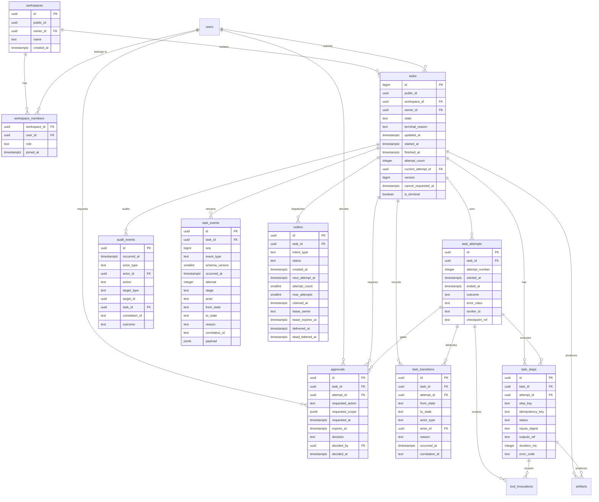

# Database Design Specification

## 1. Status and scope

**Status:** Design specification. **Nothing described here exists.**

Verified against `git ls-files`: 18 tracked files, essentially all Markdown, **no application code, no dependency manifest, no lockfile, no ORM dependency, no migration tooling, no migration files, no tests, no CI**. There is **no provisioned database, no schema, no table, no index, and no migration has been written or run**.

Every table, column, constraint, index, trigger, policy, and window below is a **Proposed design to be implemented**. No SQL block is a migration; each is an **illustrative DDL sketch**. Nothing here is a claim about deployed state or measured behavior.

**Scope of ownership.** This document is authoritative for the data model, migrations, indexing rationale, connection pooling, retention/deletion, backup/restore requirements, and data ownership. It is not authoritative for task states and transitions ([`../SPEC.md`](../SPEC.md)), persistence architecture ([`../ARCHITECTURE.md`](../ARCHITECTURE.md)), product scope ([`../PRD.md`](../PRD.md)), security ([`SECURITY.md`](SECURITY.md)), or verified repository state ([`../PROJECT_CONTEXT.md`](../PROJECT_CONTEXT.md)).

**Consistency obligations.** This document must not contradict `SPEC.md` on lifecycle semantics (states, allowed transitions, terminal states, explicit retries, never silently reopening a terminal task) or `ARCHITECTURE.md` on persistence strategy (PostgreSQL as durable source of truth, transactions for task creation and lifecycle changes, no task loss between commit and dispatch, migrations, connection pooling, indexes justified by measured query patterns, bounded query timeouts). Provisional values are marked **Proposed**; owner choices are marked **Unresolved decision**.

## 2. Data ownership and source-of-truth rules

### 2.1 Durable ownership

PostgreSQL is the durable source of truth for task identity, owner, current state and timestamps (`tasks`); lifecycle history (`task_transitions`); execution attempts, leases and outcomes (`task_attempts`); per-step durable results (`task_steps`); approval requests and decisions (`approvals`); security- and lifecycle-relevant events (`audit_events`); the ordered client-visible **event log used for SSE replay** (`task_events`); and dispatch intent (`outbox`). Artifact metadata and content references (`artifacts`) are **Proposed**.

### 2.2 Redis is never the record of truth

Redis may hold **ephemeral coordination only**: rate-limit counters, bounded-TTL caches of derived read models, deduplication keys, or a dispatcher wake-up hint. Rules:

- Never the only copy of durable task state, transitions, attempts, approvals, audit events, or dispatch intent.
- A Redis flush, eviction, restart, or failover must be survivable by rebuilding every value from PostgreSQL within bounded time.
- Correctness must never depend on a cache hit.

### 2.3 Every derived copy must name its invalidation trigger

| Derived copy | Location | Invalidation trigger |
|---|---|---|
| Task snapshot read model (Proposed) | Redis or materialized view | Written in the same transaction as its `tasks` row, or invalidated on `tasks.version` change |
| Task list page cache (Proposed) | Redis | Invalidated on any `tasks` change for that owner; bounded TTL is a backstop only |
| Dispatcher wake-up signal (Proposed) | Redis channel | Never invalidated — a hint only; the dispatcher always re-queries `outbox` |
| SSE event buffer (Proposed) | In-process | Never invalidated — never authoritative; clients recover by fetching the task snapshot |
| Generated TypeScript contract types | Build artifact | Regenerated on contract change; never hand-edited |

### 2.4 Non-negotiable rules

- **SSE connections and in-memory state are never the record of truth.** A stream delivers already-persisted events; important transitions are persisted independently of a transient connection.
- **Task acceptance is a database commit.** No success response if durable acceptance or dispatch intent failed (`SPEC.md`).
- **Every state change writes its history row in the same transaction.** No code path updates state without the matching `task_transitions` row.
- **The database is a backstop, not the authority** (§4).

## 3. Entity model

All tables are **Proposed**. Primary-key strategy is an **Unresolved decision** (§12); sketches use `uuid` for illustration only.

### 3.1 `tasks` — identity and current lifecycle position

**Purpose:** one row per task; authoritative current state and anchor for all history. Optimized for point reads and owner-scoped list views.

| Column | Type | Null | Constraints / notes |
|---|---|---|---|
| `id` | `bigint` | no | Primary key, `GENERATED ALWAYS AS IDENTITY`. **Internal only — never exposed.** Owner-approved 2026-10-13 (`docs/decisions/0008`) |
| `public_id` | `uuid` | no | **UUIDv7.** UNIQUE. The only identifier exposed in API responses, event payloads, and URLs. A test must assert `id` never appears in a response body |
| `workspace_id` | `uuid` | no | FK → `workspaces.id`. **The isolation boundary** — owner-approved 2026-10-13 (`docs/decisions/0003`). Every query is scoped by it; a client never supplies it |
| `owner_id` | `uuid` | no | FK → `users.id`. The user who submitted the task |
| `title` | `text` | yes | Bounded length (**Proposed**). Optional; may be derived from the prompt |
| `description` | `text` | yes | User-facing description, not the full agent payload |
| `request_payload_ref` | `text` | yes | Reference to the stored request; **Unresolved decision:** inline `jsonb` vs object storage |
| `request_digest` | `text` | yes | Digest of the normalized request; supports idempotent submission |
| `state` | `text` | no | CHECK against the seven states in `SPEC.md` |
| `terminal_reason` | `text` | yes | Machine-readable reason code. **Required (non-null) exactly when `state` is terminal.** See the code set below |
| `state_changed_at` | `timestamptz` | no | When `state` last changed |
| `created_at` | `timestamptz` | no | Default `now()` |
| `updated_at` | `timestamptz` | no | Maintained by application or trigger |
| `started_at` | `timestamptz` | yes | First transition into `running` |
| `finished_at` | `timestamptz` | yes | Set exactly once on entering a terminal state |
| `attempt_count` | `integer` | no | Default `0`; monotonic; never decremented |
| `current_attempt_id` | `uuid` | yes | FK → `task_attempts.id`, added after both tables exist (cycle) |
| `version` | `bigint` | no | Default `0`; optimistic-locking token, incremented on every write |
| `cancel_requested_at` | `timestamptz` | yes | Cancellation **requested**, not confirmed |
| `cancel_requested_by` | `uuid` | yes | FK → `users.id` |

#### `terminal_reason` code set

**Owner-approved 2026-10-13** (`docs/decisions/0010-approval-outcome-transitions.md`). Invariant: `state IN ('completed','failed','cancelled')` ⟺ `terminal_reason IS NOT NULL AND finished_at IS NOT NULL`.

| Code | Terminal state | Meaning |
|---|---|---|
| `completed_verified` | `completed` | Verification passed |
| `completed_partial` | `completed` | Verification passed partially, honestly recorded as such |
| `approval_rejected` | `failed` | An authorized human declined the gated action |
| `approval_expired` | `failed` | The decision window closed with no decision. **Permits no action** |
| `verification_failed` | `failed` | Verification ran and did not pass, with no retry budget left |
| `retries_exhausted` | `failed` | Bounded retries exhausted |
| `budget_exhausted` | `failed` | Step, time, token, or cost ceiling reached |
| `policy_denied` | `failed` | A tool or action was denied by policy and the task could not continue |
| `internal_error` | `failed` | Unrecoverable internal failure |
| `cancelled_by_request` | `cancelled` | Worker confirmed cancellation requested by an authorized principal |

Enforce with a `CHECK` constraint over the allowed code set, and a paired constraint that a terminal `state` requires a non-null `terminal_reason`. Expiry and rejection use **distinct** codes so that timeout is observable as its own outcome rather than hidden inside a generic failure.
| `is_terminal` | `boolean` | no | Default `false`; denormalized for fast non-terminal filtering |
| `correlation_id` | `text` | yes | Request/trace correlation from the API layer |
| `last_error_code` | `text` | yes | Stable machine-readable code; no stack traces or secrets |

**Relationships:** belongs to a user (and tenant, Proposed); has many attempts, transitions, steps, approvals, audit events, outbox rows, and artifacts (Proposed).

**Invariants:** `is_terminal` ⟺ `state IN ('completed','failed','cancelled')`, and `finished_at` is set once and never cleared. `cancel_requested_at` is independent of `state`: an accepted request while `running` does not change state until the worker confirms it (`SPEC.md`). Retry is explicit — it increments `attempt_count` and creates a new attempt; a terminal task is never reopened by a retry.

### 3.2 `task_transitions` — append-only lifecycle history

**Purpose:** the replayable, append-only record of every actual state change, making "state survives restart" auditable rather than asserted.

| Column | Type | Null | Constraints / notes |
|---|---|---|---|
| `id` | `uuid` | no | Primary key |
| `task_id` | `uuid` | no | FK → `tasks.id`, `ON DELETE CASCADE` |
| `attempt_id` | `uuid` | yes | FK → `task_attempts.id`; null when not attempt-scoped |
| `from_state` | `text` | yes | Null only for the initial creation row (`NULL → queued`) |
| `to_state` | `text` | no | CHECK against the seven states |
| `actor_type` | `text` | no | CHECK in (`user`,`system`,`worker`) |
| `actor_id` | `uuid` | yes | FK → `users.id` for `user`; worker identity otherwise |
| `actor_label` | `text` | yes | Display-only description of the actor |
| `reason` | `text` | yes | Required by policy for cancellation, block, failure, approval-gated transitions |
| `occurred_at` | `timestamptz` | no | Default `now()`; logical transition time |
| `correlation_id` | `text` | yes | Joins the transition to its request/worker trace |
| `metadata` | `jsonb` | yes | Small redaction-aware context; no secrets |

**Append-only:** no `UPDATE`, no `DELETE` except by the retention job or `tasks` cascade (§9). Enforced by trigger (§4.3).

**Invalid-transition rejections — decision: do not persist them here. Record them in `audit_events`** (`action = 'transition.rejected'`, with task, from/to states, actor, reason, correlation ID) plus a structured log line and a counter metric. Rationale: (1) this table must stay a faithful replayable history of *actual* changes, or every consumer must filter; (2) a rejected transition is not a lifecycle event — `SPEC.md` rejects and tests invalid transitions; (3) persisting rejections in an append-only table creates unbounded write amplification, letting a buggy or hostile caller degrade every later read of the task. Counter-argument acknowledged: probing attempts are then visible only in `audit_events` and metrics, which is where other security-relevant rejections already live and where rate limiting applies. **Proposed.**

### 3.3 `task_attempts` — explicit retry and lease history

**Purpose:** one row per deliberate execution attempt, carrying the lease identity that makes a claim recoverable after a crash.

| Column | Type | Null | Constraints / notes |
|---|---|---|---|
| `id` | `uuid` | no | Primary key |
| `task_id` | `uuid` | no | FK → `tasks.id` |
| `attempt_number` | `integer` | no | 1-based; unique per task |
| `started_at` | `timestamptz` | no | Default `now()` |
| `ended_at` | `timestamptz` | yes | Null while in flight |
| `outcome` | `text` | yes | CHECK in (`succeeded`,`failed`,`cancelled`,`abandoned`), **Proposed**; null while in flight |
| `error_class` | `text` | yes | **Proposed** taxonomy: `transient`,`permanent`,`policy`,`timeout`,`budget`,`cancelled` |
| `error_code` | `text` | yes | Stable machine-readable code |
| `worker_id` | `text` | yes | Worker/lease identity holding the attempt |
| `checkpoint_ref` | `text` | yes | LangGraph checkpoint reference; checkpointing supports graph recovery but does not guarantee queue delivery (`SPEC.md`) |
| `created_at` | `timestamptz` | no | Default `now()` |

**Constraints:** `UNIQUE (task_id, attempt_number)`; at most one in-flight attempt per task via a partial unique index on `(task_id) WHERE ended_at IS NULL` (**Proposed**, §6).

### 3.4 `task_steps` — durable per-stage results for idempotent resume

**Purpose:** make redelivered or resumed work idempotent at the stage boundary — a step whose idempotency key already succeeded is not re-executed.

| Column | Type | Null | Constraints / notes |
|---|---|---|---|
| `id` | `uuid` | no | Primary key |
| `task_id` | `uuid` | no | FK → `tasks.id`; denormalized so step lookup need not join attempts |
| `attempt_id` | `uuid` | no | FK → `task_attempts.id` |
| `step_key` | `text` | no | Stable stage identity, e.g. `plan`/`execute`/`verify`/`report` — **Proposed** naming |
| `idempotency_key` | `text` | no | Unique; derived from task, step, and inputs digest |
| `status` | `text` | no | CHECK in (`pending`,`running`,`succeeded`,`failed`,`skipped`) |
| `inputs_digest` | `text` | no | Changed digest yields a new idempotency key |
| `outputs_ref` | `text` | yes | Reference to stored outputs; large outputs are never inline |
| `outputs_summary` | `jsonb` | yes | Small redaction-aware summary safe to return to clients |
| `started_at` | `timestamptz` | yes | |
| `finished_at` | `timestamptz` | yes | |
| `duration_ms` | `integer` | yes | Measured server-side duration |
| `error_code` | `text` | yes | |
| `created_at` | `timestamptz` | no | |

**Constraints:** `UNIQUE (idempotency_key)`; `UNIQUE (attempt_id, step_key)` (**Proposed**).

### 3.5 `approvals` — human decision records

**Purpose:** record that a task paused for a human decision, and what that decision was, with the invariant that only a human-authorized actor may decide.

| Column | Type | Null | Constraints / notes |
|---|---|---|---|
| `id` | `uuid` | no | Primary key |
| `task_id` | `uuid` | no | FK → `tasks.id` |
| `attempt_id` | `uuid` | yes | FK → `task_attempts.id`; the attempt that paused |
| `requested_action` | `text` | no | The consequential action awaiting approval |
| `requested_scope` | `jsonb` | no | Bounded, validated description of exactly what is approved |
| `requested_by_type` | `text` | no | CHECK in (`user`,`system`,`worker`) |
| `requested_by` | `uuid` | yes | FK → `users.id` when a user requested it |
| `requested_at` | `timestamptz` | no | Default `now()` |
| `expires_at` | `timestamptz` | yes | An expired request cannot be approved |
| `decision` | `text` | yes | CHECK in (`approved`,`rejected`); null while pending |
| `decided_by` | `uuid` | yes | FK → `users.id`; **must** be a human-authorized user |
| `decided_at` | `timestamptz` | yes | |
| `decision_reason` | `text` | yes | Human-supplied reason; the machine-readable outcome code lives on the task/transition (`approval_rejected`, `approval_expired`) |
| `expired_at` | `timestamptz` | yes | Set when the request expires with no decision; a **system** outcome, never a human one |
| `correlation_id` | `text` | yes | |

**Invariants:** `decision IS NULL` ⟺ `decided_by IS NULL AND decided_at IS NULL`; `expired_at IS NOT NULL` ⟹ `decision IS NULL`. Authorization cannot be expressed as a CHECK, so "only a human-authorized actor may decide" is enforced in domain logic and reinforced by a trigger rejecting `decided_by` values outside the authorized set (**Proposed**) — a service account or worker must never decide. A decision is accepted only when the task is actually in `needs_approval` for that scope (`SPEC.md`, [`TESTING.md`](TESTING.md)). Decisions are immutable; a reversal is a new approval request.

**Approval outcomes and task state.** `SPEC.md`'s current table allows only `needs_approval → running | cancelled | blocked`, so a **rejected** or **expired** approval has no clearly correct destination. [`decisions/0010`](decisions/0010-approval-outcome-transitions.md) **Proposes** `needs_approval → failed` with distinct reason codes for rejection and expiry. That record is **Proposed and not binding**, so this document does not depend on it: `approvals` stores the decision, the decider, the expiry, and the reason, and whichever state the owner approves is written to `tasks` plus its `task_transitions` row with the matching reason code. **Unresolved decision:** the destination state for rejection and expiry. Approval records are retained independently of the task outcome (subject to §9).

### 3.6 `audit_events` — security- and lifecycle-relevant trail

**Purpose:** one append-only stream for policy decisions, tool invocations, approvals, cancellation requests, rejected transitions, and other security-relevant actions, correlated across API, worker, and tools.

| Column | Type | Null | Constraints / notes |
|---|---|---|---|
| `id` | `uuid` | no | Primary key |
| `occurred_at` | `timestamptz` | no | Default `now()` |
| `actor_type` | `text` | no | CHECK in (`user`,`system`,`worker`,`tool`) |
| `actor_id` | `uuid` | yes | FK → `users.id` where applicable |
| `action` | `text` | no | Stable name, e.g. `task.created`, `transition.rejected`, `tool.invoked`, `approval.decided` |
| `target_type` | `text` | no | e.g. `task`, `approval`, `tool_invocation` |
| `target_id` | `uuid` | yes | Not an FK: targets vary by type |
| `task_id` | `uuid` | yes | FK → `tasks.id`; denormalized for task-scoped audit reads |
| `correlation_id` | `text` | yes | Primary trace join key |
| `outcome` | `text` | no | CHECK in (`success`,`denied`,`error`) |
| `payload` | `jsonb` | yes | Redaction-aware structured detail |
| `payload_redacted` | `boolean` | no | Default `true`; documents that no raw sensitive content was stored |

**Raw sensitive content must not be stored by default** (`SECURITY.md`): no prompts, repository contents, tool output, tokens, or credentials in `payload` — store identifiers, digests, sizes, and bounded summaries. Storing raw content requires an explicit owner-approved justification (**Unresolved decision**). **Append-only:** no `UPDATE`/`DELETE` except by the documented retention/erasure procedure (§9); enforced by trigger (§4.3).

### 3.7 `task_events` — durable, ordered progress and lifecycle event log

**Purpose:** persist the ordered per-task event stream that the SSE endpoint replays. Without this table, `GET /api/v1/tasks/{task_id}/events` cannot honour `Last-Event-ID` reconnect or "recover the current task state after reconnect" (`PRD.md` PR-006), and `ARCHITECTURE.md`'s rule that important transitions are persisted independently of a transient connection cannot be satisfied. This table is the durable record; the SSE connection is only a delivery mechanism (`docs/API_CONTRACTS.md` §7).

| Column | Type | Null | Constraints / notes |
|---|---|---|---|
| `id` | `uuid` | no | Primary key |
| `task_id` | `uuid` | no | FK → `tasks.id`, `ON DELETE CASCADE` |
| `seq` | `bigint` | no | **Per-task, strictly increasing, gapless from 1.** UNIQUE (`task_id`, `seq`). This is the SSE `id:` value and the `Last-Event-ID` replay cursor |
| `event_type` | `text` | no | The event name from `docs/API_CONTRACTS.md` §7.3 (for example `task.status_changed`, `approval.requested`, `stage.progress`) |
| `schema_version` | `smallint` | no | Default `1`; lets the payload contract evolve without breaking replay of old rows |
| `occurred_at` | `timestamptz` | no | Default `now()`; the client-visible timestamp |
| `attempt` | `integer` | yes | FK → `task_attempts.attempt_number` semantics; null for task-level events |
| `stage` | `text` | yes | Graph stage that emitted it (`plan`/`execute`/`verify`/`report`), where applicable |
| `actor` | `text` | no | Who caused it: principal id, `worker`, or `system` |
| `from_state` | `text` | yes | Set for lifecycle events |
| `to_state` | `text` | yes | Set for lifecycle events |
| `reason` | `text` | yes | Bounded, machine-readable reason code |
| `correlation_id` | `text` | yes | Joins this event to `audit_events` |
| `payload` | `jsonb` | yes | Bounded and **redaction-aware**: no prompts, repository contents, tool output, tokens, or credentials (`SECURITY.md`). Enforce a maximum serialized size; exceeding it must fail the write rather than truncate silently |

**Invariants and rules:**

- **Append-only.** No `UPDATE`/`DELETE` except by the documented retention/erasure procedure (§9); enforced by trigger (§4.3).
- **`seq` is allocated per task inside the same transaction as the state change it describes.** A state transition and its `task.status_changed` event commit together, so the log can never disagree with `tasks.state`. Do not allocate `seq` from a global sequence: replay and `Last-Event-ID` are task-scoped, and a global sequence would leak cross-tenant event volume through the ordering gap.
- **Gaps are a defect, not a compression opportunity.** A client reconnecting with a stale `Last-Event-ID` must be able to determine whether its view is complete. The `docs/API_CONTRACTS.md` §7.6 `snapshot_required` path is what covers a genuinely unrecoverable case.
- **This is not the audit trail.** `audit_events` (§3.6) records security-relevant decisions; `task_events` records client-visible progress. They overlap deliberately for lifecycle changes and are correlated by `correlation_id`, but they have different retention and different access rules (see §9).
- **Do not use this table as a work queue.** Dispatch intent lives in `outbox` (§3.8).

**Retention note:** this is the most write-heavy table in the schema — one or more rows per stage and per progress update. See §9 for its distinct, shorter retention window and the coalescing guidance in `docs/API_CONTRACTS.md` §7.8.

### 3.8 `outbox` — transactional outbox for dispatch

**Purpose:** hold **dispatch intent** so a task cannot be lost between the database commit and queue dispatch.

**Why it exists.** The naive sequence commits the task and then enqueues the job. If the process crashes, the connection drops, or the broker rejects the message in between, the task is durably accepted — the client already received `202 Accepted` — but no worker will ever run it, and it is silently stranded. `ARCHITECTURE.md` requires dispatch design that avoids exactly this.

**How it closes the window.** The intent row is written **in the same transaction** as the `tasks` row, so the transaction commits both or neither. A separate dispatcher reads unclaimed rows and delivers them. A crash at any point after commit is therefore recoverable, because the intent is durable. Delivery becomes **at-least-once**, which `ARCHITECTURE.md` anticipates; idempotency comes from `task_steps.idempotency_key` and attempt/lease bookkeeping.

| Column | Type | Null | Constraints / notes |
|---|---|---|---|
| `id` | `uuid` | no | Primary key; the deduplication handle |
| `task_id` | `uuid` | no | FK → `tasks.id` |
| `intent_type` | `text` | no | CHECK in (`dispatch`,`cancel`,`resume`) — **Proposed** value set |
| `status` | `text` | no | CHECK in (`pending`,`claimed`,`delivered`,`dead_letter`) |
| `created_at` | `timestamptz` | no | Default `now()`; set in the task-creation transaction |
| `next_attempt_at` | `timestamptz` | no | Default `now()`; backoff schedule |
| `attempt_count` | `smallint` | no | Default `0`; incremented on each claim |
| `max_attempts` | `smallint` | no | Default **Proposed**; exhaustion moves the row to `dead_letter` |
| `claimed_at` | `timestamptz` | yes | |
| `lease_owner` | `text` | yes | Worker/dispatcher identity holding the claim |
| `lease_expires_at` | `timestamptz` | yes | Crash recovery: an expired lease makes the row claimable again |
| `delivered_at` | `timestamptz` | yes | |
| `dead_lettered_at` | `timestamptz` | yes | Set exactly once |
| `last_error_code` | `text` | yes | No stack traces or secrets |
| `payload_hint` | `jsonb` | yes | Small routing hint only; the task row stays authoritative |

**Invariants:** `status = 'claimed'` ⟹ `lease_owner IS NOT NULL AND lease_expires_at IS NOT NULL`; `status = 'dead_letter'` ⟹ `dead_lettered_at IS NOT NULL`. Dead-letter rows are **not** retried automatically: re-drive is a deliberate, audited operation that inserts a **new** outbox row and creates a new explicit attempt — consistent with `SPEC.md`'s rule that retries are explicit and terminal tasks are never silently reopened.

**Reconciliation with [`decisions/0002`](decisions/0002-durable-job-dispatch.md).** That record (**Proposed**, not binding) recommends the same transactional-outbox mechanism and describes the claim step as `pending → dispatched`. This document splits that single name into `claimed` (a lease is held) and `delivered` (the intent is finished), because a claim that is never delivered must be distinguishable from a completed one in order to reclaim expired leases. The two vocabularies must be reconciled in one place when ADR 0002 is accepted; this document owns the column names. ADR 0002 also permits the worker to poll `outbox` directly and treats Redis and `LISTEN`/`NOTIFY` as optional accelerators only, which matches §2.2.

### 3.9 Proposed tables conditioned on unresolved decisions

| Table | Purpose | Key columns (sketch) | Blocking decision |
|---|---|---|---|
| `tenants` | Tenant boundary for ownership and authorization | `id`, `slug`, `name`, `created_at` | Tenancy model; whether row-level security is used |
| `users` | Authenticated actor identity referenced by `owner_id`, `actor_id`, `decided_by` | `id`, `tenant_id`, `external_subject`, `display_name`, `is_active`, `last_seen_at` | Authentication provider; whether users are stored locally at all |
| `tool_invocations` | Per-tool-call governance record: allowlist decision, duration, output size, outcome | `id`, `task_id`, `attempt_id`, `step_id`, `tool_name`, `args_digest`, `decision`, `started_at`, `finished_at`, `output_bytes`, `outcome`, `correlation_id` | Tool-gateway contract; whether this folds into `audit_events` |
| `artifacts` | Result payloads, diffs, test evidence, and their storage references | `id`, `task_id`, `step_id`, `kind`, `content_ref`, `content_digest`, `bytes`, `media_type`, `created_at`, `expires_at` | Whether large outputs live in PostgreSQL, object storage, or both |

These four are **Proposed** and must not be implemented before the corresponding owner decision.

### 3.10 Entity relationship diagram

Entity names are the exact table names above. The attribute lists on the core entities are **key columns only**; every column is specified in the tables above, and columns for the **Proposed** entities appear in §3.9.

**Accepted tenancy change (2026-10-13):** `tenants` is replaced by **`workspaces`** as the isolation boundary, with an owning user. A workspace membership table and its roles are **required before workspace access control is implemented** and are documented as an open item in `docs/decisions/0003-auth-and-tenancy.md`; `workspace_members` is shown below as the anticipated shape.



`tasks.current_attempt_id` participates in a cycle with `task_attempts.task_id`; that constraint must be added after both tables exist (**Proposed**).

## 4. Lifecycle enforcement in the database

**Authoritative transition validation lives in domain logic**, as `SPEC.md` requires (enforced centrally, not only in the UI) and `ARCHITECTURE.md` repeats. The database is **defense in depth**: it makes corruption harder and louder and cannot be bypassed by a buggy code path, but it does not become the state machine.

### 4.1 What the database can and cannot enforce

| Concern | Enforceable in the database | Notes |
|---|---|---|
| State is one of the seven allowed values | Yes — CHECK constraint | §4.2 |
| `actor_type` is `user`/`system`/`worker` | Yes — CHECK constraint | |
| A transition references a real task and attempt | Yes — foreign keys | |
| Transition and audit rows are append-only | Yes — trigger | §4.3 |
| Two writers cannot transition from the same version | Yes — optimistic compare-and-swap | §4.4 |
| The (`from_state`,`to_state`) pair is allowed | Partially — a CHECK could encode the matrix | Recommended **against** for MVP; §4.2 |
| The actor is *authorized* for this transition | No | Domain logic + API authorization |
| A human made the approval decision | Partially — trigger restricting `decided_by` | §3.5 |
| Approval accepted only when truly in `needs_approval` | No | Domain logic, same transaction |
| Retry limits, deadlines, budget policy | No | Domain logic and worker policy |
| A terminal task is not silently reopened | Partially — `is_terminal`/`finished_at` invariant + trigger rejecting terminal→non-terminal | §4.3 |

### 4.2 Enumerating states: enum type vs lookup table vs CHECK

| Option | Advantage | Cost |
|---|---|---|
| PostgreSQL `ENUM` type | DB-native typing, compact storage | Adding a value is a schema type change; ordering semantics invite misuse; renaming/removing is painful; expand/contract becomes awkward |
| Lookup table + FK | Referential integrity; can carry metadata (label, terminality, order); values added by data migration | Extra join on hot paths unless cached; the table must be seeded before the constraint is valid; the domain enum can drift from the table |
| `text` column + `CHECK` | Simple, explicit, portable, trivially reviewable in a migration diff | The allowed list is duplicated in migration SQL and must be replaced (drop/add) to change |

**Recommendation (Proposed):** use a `text` column with an explicit **CHECK** constraint listing the seven states, **generated from the domain enum** so migration and code cannot drift, and add a read-only `task_states` lookup table only if the UI or policy layer needs per-state metadata or the owner requires joinable integrity. Do **not** encode the full transition matrix as a CHECK in MVP: it duplicates the domain rule in a second, harder-to-read place, muddies which layer the "invalid transitions are unit-tested" requirement covers, and forces a constraint rewrite for every lifecycle change. If the owner later wants database-level transition enforcement, a `task_state_transitions(from_state, to_state)` lookup table with a composite FK from `task_transitions` is more maintainable. **Unresolved decision:** the owner may prefer stricter database enforcement.

### 4.3 Append-only enforcement (trigger sketch)

**Illustrative DDL sketch — not a migration, not applied anywhere.**

```sql
-- Sketch only. Identifiers and function bodies are illustrative.
CREATE OR REPLACE FUNCTION reject_history_mutation()
RETURNS trigger
LANGUAGE plpgsql
AS $$
BEGIN
    RAISE EXCEPTION 'append-only table: % cannot be modified', TG_TABLE_NAME
        USING ERRCODE = 'restrict_violation';
END;
$$;

CREATE TRIGGER task_transitions_append_only
    BEFORE UPDATE OR DELETE ON task_transitions
    FOR EACH ROW EXECUTE FUNCTION reject_history_mutation();
```

The same trigger applies to `audit_events` (**Proposed**). **Trade-off:** a blanket trigger must be lifted deliberately, by an owner-approved audited procedure, for the retention/erasure job (§9) and because `ON DELETE CASCADE` from `tasks` fires row triggers. **Proposed:** permit deletes only for a dedicated retention role and route user erasure through that procedure.

A `BEFORE UPDATE` trigger on `tasks` should additionally reject a write that leaves a terminal state or clears `finished_at` once set — the backstop for "never silently reopen a terminal task". It must not judge whether a retry is legitimate; the legitimate path is a new attempt or a new task created by domain logic.

### 4.4 Optimistic concurrency for transitions

**Illustrative statement sketch — not a migration, not applied anywhere.**

```sql
-- Sketch: the transition applies only if the observed version is unchanged.
UPDATE tasks
   SET state            = $3,
       version          = version + 1,
       state_changed_at = now(),
       updated_at       = now(),
       is_terminal      = ($3 IN ('completed','failed','cancelled')),
       finished_at      = CASE WHEN $3 IN ('completed','failed','cancelled')
                               THEN COALESCE(finished_at, now()) ELSE finished_at END
 WHERE id = $1 AND version = $2 AND state = $4;
-- Zero rows affected means a concurrent writer won: re-read and re-validate.
```

The `state = $4` predicate stops a stale reader applying a transition computed from an outdated `from_state`. History and audit inserts share the transaction (§5). A zero-row result is not an error to hide: reload, re-validate against the domain state machine, then retry or return a conflict.

## 5. Transaction boundaries

### 5.1 Operations that must be a single transaction

| Operation | Statements in the transaction | Why one transaction |
|---|---|---|
| Task creation | `INSERT tasks` (`queued`) + `INSERT task_transitions` (`NULL → queued`) + `INSERT audit_events` (`task.created`) + `INSERT outbox` (dispatch intent) | A committed task without dispatch intent is a stranded task that already returned `202`; this closes the commit-then-enqueue window (§3.7) |
| Lifecycle change | `UPDATE tasks ... WHERE id AND version` + `INSERT task_transitions` + `INSERT task_events` (`task.status_changed`, allocating `seq`) + `INSERT audit_events` when security-relevant | History must never disagree with current state; a state change without its history row is unauditable and unrecoverable, and a state change without its event row makes SSE replay lie |
| Approval decision | `UPDATE approvals` (guarded on `decision IS NULL` and `expires_at`) + `UPDATE tasks` out of `needs_approval` + `INSERT task_transitions` + `INSERT task_events` + `INSERT audit_events` + `INSERT outbox` (`resume`) | A decision that does not resume, or a resume with no recorded decision, violates `SPEC.md` and `SECURITY.md` |
| Worker lease claim | `SELECT ... FOR UPDATE SKIP LOCKED` + `UPDATE outbox` (claim/lease) + `UPDATE tasks` (`queued → running`, version check) + `INSERT task_attempts` + `INSERT task_transitions` + `INSERT task_events` + `INSERT audit_events` | A crash must not leave a `running` task with no attempt or an attempt with no state change |
| Cancellation request | `UPDATE tasks SET cancel_requested_at, cancel_requested_by, version` + `INSERT task_events` + `INSERT audit_events` | Records the *request* without changing state, per `SPEC.md` |
| Progress event | `INSERT task_events` (`seq` allocation) with no `tasks` write | Progress must be durable for replay but must **not** bump `tasks.version`, or every progress tick would invalidate a client's optimistic state |
| Step completion | `INSERT task_steps ... ON CONFLICT (idempotency_key) DO NOTHING` + `INSERT task_events` + audit where required | The idempotency key must be durably claimed exactly once before its side effect counts as done |
| Attempt completion | `UPDATE task_attempts` (outcome) + `UPDATE tasks` (terminal) + `INSERT task_transitions` + final `task_steps` + `INSERT task_events` + `INSERT audit_events` + `UPDATE outbox SET status='delivered'` | A half-applied completion leaves a task stuck in `running` forever |

### 5.2 Isolation level

**Proposed: `READ COMMITTED` (PostgreSQL default) for all application transactions, with explicit row locking or compare-and-swap wherever a read-then-write dependency exists.**

- Every transaction above is short, touches a small known row set, and protects itself with optimistic version checks or `FOR UPDATE ... SKIP LOCKED`; under `READ COMMITTED` these are correct and cheap.
- `REPEATABLE READ` is needed only for a multi-statement consistent read set; the model is designed not to have one on a hot path. A genuine need (for example an export) should be an explicit bounded read-only report.
- `SERIALIZABLE` is **not** recommended for the MVP: it adds serialization-failure retry loops, and hidden retry control flow makes "explicit retry" semantics hard to reason about. Correctness already comes from unique constraints, foreign keys, version compare-and-swap, and the outbox. Revisit only with **measured** evidence of a specific anomaly, recorded as an ADR in `docs/decisions/`.
- Maintenance jobs (outbox sweeper, lease reaper, retention) should hold a session advisory lock (`pg_try_advisory_lock`) so one instance runs at a time. That is coordination, never lifecycle enforcement.

### 5.3 Avoiding long-running transactions

- **No connection may be held across a model or tool call.** No LLM, tool, MCP, provider HTTP request, queue publish, or user wait may occur inside an open transaction. Open after inputs are ready; commit and release before the external wait.
- No transaction may block on human approval: `needs_approval` is a persisted state, not an open transaction.
- Set `statement_timeout` and `lock_timeout` per role so a pathological statement fails instead of pinning a connection or lock.
- Set `idle_in_transaction_session_timeout` so leaked transactions are aborted server-side rather than holding snapshots and blocking vacuum.
- Batch maintenance work in bounded chunks with commits between them; never delete an unbounded row set in one transaction.
- Never read-modify-write a large payload inside a lifecycle transaction: store a reference (§3.1) and keep the row small.

### 5.4 Dispatcher claim query (recommended mechanism)

**Illustrative DDL sketch — not a migration, not applied anywhere.**

```sql
-- Sketch: claim a bounded batch of dispatch intents that are claimable now.
WITH claimable AS (
    SELECT id
      FROM outbox
     WHERE status = 'pending'
       AND next_attempt_at <= now()
     ORDER BY next_attempt_at, id
     FOR UPDATE SKIP LOCKED
     LIMIT $1
)
UPDATE outbox o
   SET status           = 'claimed',
       lease_owner      = $2,
       lease_expires_at = now() + $3::interval,
       claimed_at       = now(),
       attempt_count    = o.attempt_count + 1
  FROM claimable c
 WHERE o.id = c.id
RETURNING o.id, o.task_id, o.attempt_count;
```

`FOR UPDATE SKIP LOCKED` lets multiple dispatchers claim disjoint batches without contention or duplicate delivery from the claim step itself.

**At-least-once consequence, stated explicitly.** This guarantees *at least* one delivery attempt, never exactly one: a dispatcher may deliver and crash before committing `delivered`, the lease expires, and the row is claimed again. Therefore **every worker handler must be idempotent**, keyed on `task_steps.idempotency_key` plus attempt/lease bookkeeping; `ARCHITECTURE.md` and `PROJECT_CONTEXT.md` both state that delivery may be at-least-once and that exactly-once must not be promised without a proven mechanism. Expired leases are reclaimed by sweeping `status = 'claimed' AND lease_expires_at < now()`, which increments `attempt_count` and routes the row to `dead_letter` at `max_attempts`. Re-drive of a dead-letter row is an operator action recorded in `audit_events` that creates a **new** outbox row and a new explicit attempt; it never mutates a terminal task's history.

## 6. Indexing

**These are hypotheses, not findings.** `ARCHITECTURE.md` requires indexes to be based on **measured query patterns**; no query workload exists yet, so every index below is **Proposed** and must be validated with `EXPLAIN (ANALYZE, BUFFERS)` against representative data and row counts. Do not add an index merely because a column is filterable.

| # | Proposed index | Table | Justifying query pattern |
|---|---|---|---|
| 1 | `(owner_id, state, updated_at DESC)` | `tasks` | Dashboard/CLI list view filtered by owner and state, newest first |
| 2 | `(state, updated_at)` | `tasks` | Dispatcher/reaper sweeps; detecting tasks stuck in `running` past a deadline |
| 3 | `(finished_at) WHERE is_terminal` | `tasks` | Retention sweeps over terminal tasks by age; a small partial index |
| 4 | `(next_attempt_at, id) WHERE status = 'pending'` | `outbox` | The dispatcher claim query (§5.4); partial index keeps the working set claimable-only |
| 5 | `(lease_expires_at) WHERE status = 'claimed'` | `outbox` | Reclaiming leases expired by a dispatcher or worker crash |
| 6 | `(task_id, created_at DESC)` | `outbox` | Dispatch history for one task; duplicate-dispatch investigation |
| 7 | `(task_id, occurred_at)` | `task_transitions` | Task timeline and lifecycle replay; the most-read task-scoped history |
| 8 | `(correlation_id) WHERE correlation_id IS NOT NULL` | `task_transitions` | Cross-component trace reconstruction from a correlation ID |
| 9 | UNIQUE `(task_id, attempt_number)` | `task_attempts` | Correctness, not only lookup: exactly one row per attempt number |
| 10 | UNIQUE `(task_id) WHERE ended_at IS NULL` | `task_attempts` | Enforces at most one in-flight attempt per task (§3.3) |
| 11 | UNIQUE `(attempt_id, step_key)` | `task_steps` | Resume logic: did this stage already run in this attempt? |
| 12 | UNIQUE `(idempotency_key)` | `task_steps` | Idempotent redelivery: the conflict target that makes duplicates safe |
| 13 | `(task_id, status)` | `task_steps` | Task-detail progress rendering; finding incomplete steps on resume |
| 14 | `(task_id) WHERE decision IS NULL` | `approvals` | "Is a decision pending?" — the check the approval endpoint must make. Partial index keeps it tiny |
| 15 | `(target_type, target_id, occurred_at DESC)` | `audit_events` | Per-target audit history, e.g. every action against one task |
| 16 | `(task_id, occurred_at DESC) WHERE task_id IS NOT NULL` | `audit_events` | Task-scoped audit view; incident investigation |
| 17 | `(correlation_id) WHERE correlation_id IS NOT NULL` | `audit_events` | Trace reconstruction across API, worker, and tools |
| 18 | `(actor_id, occurred_at DESC)` | `audit_events` | "What did this actor do?" security-review queries |
| 19 | UNIQUE `(task_id, seq)` | `task_events` | **Correctness, not only lookup:** guarantees a gapless, duplicate-free per-task sequence, which is what makes `Last-Event-ID` replay trustworthy (`docs/API_CONTRACTS.md` §7.2). Also serves the replay read itself |
| 20 | `(occurred_at) WHERE task_id IS NOT NULL` | `task_events` | Retention pruning of the highest-write table in the schema (§9) |
| 21 | `(correlation_id) WHERE correlation_id IS NOT NULL` | `task_events` | Joining the client-visible stream to `audit_events` for incident reconstruction |

**Further hypotheses, not yet justified:** a tenant prefix on index 1 if tenancy is adopted; `(worker_id)` on `task_attempts` for per-worker diagnostics; `(intent_type, status)` on `outbox` if cancellation/resume intents need separate sweeps. Do not create these speculatively.

### 6.1 Anti-pattern warning

- **Speculative indexing is a defect, not a safety margin.** Every index adds write amplification on the highest-write tables (`tasks`, `outbox`, `audit_events`), consumes cache, and can be chosen by the planner in a way that makes a query slower.
- Never index every column "just in case", and never expect useful selectivity from a low-cardinality column alone on a large table: `state` has seven values, so it is useful only with a selective companion column or as a partial index.
- Do not duplicate a prefix: `(owner_id, state, updated_at)` already serves owner-only lookups, so a separate `(owner_id)` index is usually redundant.
- Every index must name the query it serves and be re-verified when that query changes; an index whose query no longer exists is dropped in a migration.
- Measure before and after, with the specific `EXPLAIN` plan, not a general claim that "indexes made it faster".
- Unused-index and index-bloat checks belong in operational review, not here.

## 7. Connection pooling and query bounds

**Proposed** guidance. Concrete numbers must come from measurement, and no driver, pool configuration, or ORM dependency exists in this repository today.

### 7.1 Sizing and lifetime

- Pool sizes are bounded by database `max_connections`, which is shared with migrations, maintenance, metrics, and operator sessions; application pools must not assume they own every connection.
- The **API pool** and the **worker pool** are sized separately from measured concurrency and per-query latency, each with a small overflow margin. A pool larger than the database can truly serve in parallel increases contention rather than throughput.
- **Bound the acquisition wait** and fail fast with a stable error code when the pool is exhausted, instead of queueing requests past their deadline.
- **Per-request lifetime:** acquire lazily at the first statement, never at request start; release before the response is returned; never hold a connection across an `await` that is not a database operation.
- Monitor pool saturation, wait time, and connection errors as first-class metrics; `PERFORMANCE.md` and `TESTING.md` both require pool-saturation measurement.

### 7.2 The cardinal rule: no connection across a model or tool call

**No database connection and no open transaction may be held while awaiting an LLM, a graph stage, a tool, an MCP server, or any other external call.** Those latencies are seconds to minutes; a handful of such holds exhausts any pool and stalls the API regardless of configuration. The correct pattern is: persist intent and inputs, commit and release, perform the external call, then reacquire to persist the result. `ARCHITECTURE.md` requires short handlers and correct async I/O, and `PERFORMANCE.md` requires API latency to be reported separately from model/tool latency — holding a connection across an external wait is exactly how those become conflated.

### 7.3 Query bounds

- Per-role `statement_timeout` and `lock_timeout` so no statement runs or blocks unbounded.
- `idle_in_transaction_session_timeout` so abandoned transactions are reclaimed.
- An explicit `LIMIT` on every list and sweep query; no unbounded `SELECT` on `tasks`, `task_transitions`, or `audit_events`.
- Bounded result payloads: list queries never select large JSONB or payload columns.
- Long analytical or export queries would run against a read replica if one is ever provisioned — **Unresolved decision**; nothing is provisioned today.

### 7.4 Separate credentials and least privilege

The API role and the worker role are **separate database roles with separate credentials and separate pools** (`ARCHITECTURE.md`, `SECURITY.md`).

- API role: `SELECT`/`INSERT` on `tasks`, `task_transitions`, `approvals`, `audit_events`, `outbox`; `SELECT` on `task_attempts`/`task_steps`; `UPDATE` limited to the columns it legitimately writes (cancellation request, approvals).
- Worker role: `UPDATE` on `tasks` state/attempt columns; `INSERT` on `task_attempts`, `task_steps`, `task_transitions`, `audit_events`; `UPDATE` on `outbox` claim/lease columns.
- Neither role owns tables, may `DROP`/`ALTER`, or may disable triggers. Migrations run under a separate migration role, and a dedicated retention role owns the deletion procedure (§9).
- Credentials come from a secret manager in deployed environments and environment variables locally — **never** from source control (`SECURITY.md`).

## 8. Migrations

**No migration tooling, directory, or file exists in this repository, and this documentation task does not create or run any.**

### 8.1 Requirements

- **Versioned:** every change has an immutable ordered identity, applied exactly once per environment, tracked in a migrations table.
- **Reviewed:** a migration is code — reviewed for correctness, lock behavior, and data-volume impact before it touches a shared environment. Destructive or locking changes require explicit owner awareness.
- **Forward-compatible:** no migration may require schema and application code to change atomically. Deploy order is: schema change both old and new code tolerate, then code, then cleanup.
- **Deterministic:** re-running against an already-migrated database is a no-op by construction.
- **Tested:** applied to a fresh database and to a copy of a populated one; the resulting schema is compared against the model; the previous application version is verified to still work after the expand step.

### 8.2 Expand/contract for zero-downtime changes

The recommended **Proposed** pattern:

1. **Expand:** add the new nullable column/table/index with no application dependence. (`ADD COLUMN` with a non-constant default, or `CREATE INDEX` without `CONCURRENTLY`, can take a long lock; `CREATE INDEX CONCURRENTLY` cannot run inside a transaction block, which constrains how the tool wraps the migration.)
2. **Migrate:** backfill in bounded batches outside one long transaction. Add constraints `NOT VALID` first, then `VALIDATE CONSTRAINT` separately so validation takes a weaker lock.
3. **Switch:** deploy code that reads and writes the new shape and tolerates both.
4. **Contract:** after the old code is gone and the new path is verified, drop the old column/constraint/index in a separate, later migration.

### 8.3 Making destructive changes safe

- Never combine a destructive change and an application change in one step.
- Use add-new / dual-write / backfill / verify / stop-reading-old / drop, and avoid `RENAME COLUMN` during a rolling deploy, which is effectively destructive to old code.
- Dropping a column or table requires proof nothing reads it (code search plus measured query logs), a verified backup, and owner approval.
- Deleting data inside a migration is a retention decision (§9), not a routine schema change.

### 8.4 Rollback policy

- **Roll forward is the default.** Down-migrations are risky because they cannot restore data a forward migration dropped, transformed, or truncated: recreating a dropped column yields an empty column, not the original data.
- Every migration states in its own text whether it is reversible and, if so, what the down path loses.
- Destructive migrations require a tested restore path (§10), not a down-migration.
- Structural changes are made in an expand phase the previous application version tolerates, so "roll back the code, leave the schema" is viable without a down-migration.

### 8.5 Migration tool — **Accepted: Alembic**

**Owner-approved 2026-10-13** ([`decisions/0008`](decisions/0008-database-identity-and-migrations.md)). **Alembic**, with SQLAlchemy 2.x asynchronous models as the schema source ([`decisions/0011`](decisions/0011-data-access-layer.md)). Alternatives considered and not selected:

| Candidate | Strength | Why not selected |
|---|---|---|
| **Alembic (chosen)** | Standard for Python + FastAPI; autogenerate from models; ordered revisions; hand-written SQL allowed | — Adds a SQLAlchemy dependency, which `0011` accepts; **autogenerated diffs must always be reviewed, never trusted** |
| Plain versioned SQL files + a small runner | No ORM coupling; explicit SQL; easy review | Reimplements ordering, tracking, and drift detection; homegrown-tool risk |
| Sqitch / Atlas and similar | Mature change-management semantics; drift detection | Extra toolchain and language dependency |
| Framework-bundled migration system | Fewer moving parts | Couples migration safety to a larger decision |

**The coupled ORM/driver decision is now owned** by [`decisions/0011`](decisions/0011-data-access-layer.md): SQLAlchemy 2.x asynchronous with `asyncpg`. There is no ORM dependency in this repository yet — `pyproject.toml` and `uv.lock` are **Milestone 1** deliverables (plan item T2) and are not created by documentation work.

## 9. Retention, deletion and privacy

**Every number here is a Proposed starting point — not an approved policy and not legal advice.** `SECURITY.md` requires retention and deletion behavior for prompts, repository content, checkpoints, results, and audit events to be defined **before production**; `ARCHITECTURE.md` lists the retention/privacy policy among decisions to record before production. **Retention is an Unresolved decision requiring the owner.**

### 9.1 Data classification

Classification uses the vocabulary from [`decisions/0006`](decisions/0006-data-retention-and-privacy.md) (**Proposed**): Secret, Highly sensitive, Sensitive, Operational. That record defines the classes and the minimization rules; the **per-class window values below are owned by this document**.

| Table / data | Classification | Default handling |
|---|---|---|
| `tasks.title`, `description` | Sensitive | Visible to the owner; not search-indexed in MVP |
| `tasks.request_payload_ref` | Highly sensitive | Stored by reference where possible; access-controlled; subject to retention |
| `tasks.state`, timestamps, counts | Operational | Retained with the task |
| `task_transitions.reason`, `metadata` | Operational | Kept bounded and free of secrets |
| `task_attempts.error_*`, `worker_id`, `checkpoint_ref` | Operational | Retained per policy |
| `task_steps.outputs_summary` | Highly sensitive | Bounded and redaction-aware; pruned before lifecycle rows |
| `task_steps.outputs_ref`, `artifacts.content_ref` | Highly sensitive | **Proposed:** pruned first |
| `approvals.requested_scope`, `decision_reason` | Sensitive | Retained with audit policy |
| `task_events.payload` | Operational, content-free by default | Redacted by construction; **highest write volume**; pruned on its own shorter window |
| `audit_events.payload` | Operational, content-free by default | Redacted by construction; retained longest; append-only by default |
| Credentials, provider keys, tokens | Secret | Prohibited in any table (`SECURITY.md`) |

### 9.2 Proposed retention windows

| Data | Proposed window (from terminal state) | Rationale |
|---|---|---|
| `outbox` rows, `delivered` | 7 days | Operational record; the task row is authoritative |
| `outbox` rows, `dead_letter` | 90 days or until an operator re-drives/rejects | Needs investigation time; still bounded |
| `task_steps.outputs_ref` / `artifacts` content | 30 days | Highest volume, most sensitive; pruned first |
| `task_events` rows | **90 days**, or a per-task row cap, whichever is reached first | The highest-write table in the schema. `Last-Event-ID` replay and incident reconstruction need recent history, not indefinite history; clients recover full state from the snapshot endpoint regardless, so a shorter window does **not** break reconnect correctness — it only narrows replay. Both the window and the cap are **Proposed** |
| `task_steps` rows | 180 days | Supports resume and post-hoc verification |
| `task_attempts` | 365 days | Retry and incident analysis |
| `tasks`, `task_transitions` | 365 days after terminal | Enough history to investigate outcomes and approvals |
| `audit_events` | 730 days (**Proposed**) | Longest, for security investigation; may conflict with erasure rights (§9.4) |
| Redis counters and caches | Minutes to hours, TTL-based | Ephemeral by definition |

**Pruning `task_events` must never break replay correctness.** A client whose `Last-Event-ID` has been pruned must receive the `snapshot_required` signal (`docs/API_CONTRACTS.md` §7.6) and re-fetch `GET /api/v1/tasks/{task_id}` rather than silently receiving a stream with a gap. Test this path explicitly.

**No retention job exists.** These windows describe a job to be implemented, not a running process; it requires an owner decision, a documented procedure, and tests.

### 9.3 Deletion and erasure procedure (Proposed)

1. **Identify** the subject and scope (a task, a user, or a tenant).
2. **Authorize** through an owner-approved, audited operator path — never an ad hoc application endpoint.
3. **Preserve the minimum** required by audit or legal obligation, as described in §9.4.
4. **Delete dependents in dependency order** (verify the final FK order before running anything): `artifacts` → `tool_invocations` → `task_steps` → `approvals` → `task_attempts` → `task_transitions` → `outbox` → `audit_events` → `tasks`, with the append-only triggers deliberately lifted for the retention role only.
5. **Delete external content** referenced by `request_payload_ref`, `outputs_ref`, `content_ref`, and `checkpoint_ref`. A row deletion that leaves the object behind is not an erasure.
6. **Invalidate derived copies:** Redis caches, read models, materialized views, and SSE buffers keyed by the deleted identifiers — every derived copy in §2.3.
7. **Record the deletion** as a minimal, content-free audit event (subject reference or pseudonym, timestamp, operator, scope) so the erasure is provable without retaining what was erased.
8. **Verify** by re-querying for the identifiers and reporting counts; an unverified deletion is untrustworthy.
9. **Chunk the work** into bounded batches with commits between them — never one unbounded delete transaction.

### 9.4 Audit immutability versus deletion rights

- An append-only audit trail is a security requirement (`SECURITY.md` requires enough history to investigate failures and approvals) and erasure is a privacy obligation; they genuinely conflict when an audit row identifies a person.
- **Proposed resolution:** keep audit rows content-free and reference-bearing — actor identifiers as FKs or pseudonymous references, never embedded personal content — so an erasure can **tombstone the reference** (null or pseudonymize `actor_id`, set `payload_redacted = true`, clear `payload`) while the event's existence, action, target type, outcome, and timestamp stay verifiable. The trail remains a sequence of facts; the link to an individual is severed.
- **Proposed alternative:** separate actor identity into its own table so identity erasure and event retention are independent operations. **Crypto-shredding** (per-subject keys, destroy the key) is another option to evaluate; it adds key-management risk and is **Proposed**, not decided.
- **Legal hold** — whether some audit rows are retained indefinitely and exempt from erasure — is an **Unresolved decision**.
- Whatever is chosen must be documented in `SECURITY.md` and approved before production. This document does not make that decision.

### 9.5 Pruning checkpoints and step outputs

- LangGraph checkpoints and large step outputs dominate storage growth and carry the most sensitive content; prune them **aggressively and first** (Proposed: 30 days from terminal).
- Prune only for **terminal** tasks, or attempts that have ended and cannot resume. Never prune the checkpoint of a task still `running`, `needs_approval`, or `blocked`.
- Pruning writes an audit event and nulls the reference rather than deleting the step row, preserving that the step ran, its duration, and its outcome.
- Checkpoint pruning is not queue delivery: `SPEC.md` states that checkpoints support graph recovery but do not by themselves guarantee reliable queue delivery.

## 10. Backup, restore and recovery

**No backup exists.** There is no provisioned database, no backup job, no WAL archiving configuration, no snapshot schedule, and no restore drill in this repository. Everything below is a **requirement** with **Proposed** values.

### 10.1 Requirements

- **Backups (Proposed):** daily full backup plus continuous WAL archiving enabling point-in-time recovery; retain daily 14 days, weekly 8 weeks, monthly 12 months; encrypted at rest and in transit; access restricted to the operator role.
- **Point-in-time recovery (required):** the ability to restore to an arbitrary timestamp within the window — the only viable recovery from an accidental destructive migration or a bad deletion run. A backup without tested PITR does not satisfy this.
- **Restore verification (required): a restore must be tested, not assumed.** Restore to an isolated instance, run a documented verification (row counts and freshness for `tasks`, `task_transitions`, `outbox`, `audit_events`; foreign-key integrity; an application smoke test), and record the date, operator, restore point, and observed result. **Proposed:** quarterly drills, plus a drill after any change to backup tooling or topology.
- **RPO/RTO (Proposed):** RPO 5 minutes via WAL archiving, RTO 4 hours including verification. These are targets to validate in the first drill, not measured results.
- A restore is not the only recovery mechanism: logical corruption from a bad migration is repaired forward, plus a targeted restore into a scratch database, never by restoring over production.

### 10.2 How restore interacts with the outbox and in-flight leases

A restore rewinds time, so everything that depends on "now" must be re-derived rather than trusted:

- **Leases are meaningless after a restore.** Every `outbox` row with `status = 'claimed'` names a `lease_owner` that may no longer exist. Recovery must **expire all claimed leases** (set `lease_expires_at` in the past, or reset to `pending`) before dispatch resumes; otherwise work is either stranded behind a lease that never expires, or double-delivered without the guard the lease provided.
- **In-flight attempts must be closed explicitly.** Any `task_attempts` row with `ended_at IS NULL` describes an attempt whose outcome was lost. Mark it `abandoned` with an error class, correct the task state with a recorded transition if needed, and only then allow a new explicit attempt. A task left `running` with no live worker will otherwise sit forever.
- **Expect a redelivery storm.** A large batch of `pending` rows may become claimable at once; reintroduce dispatch traffic gradually (rate-limited dispatcher, bounded batch size) so a restart does not overwhelm the worker pool or providers.
- **Duplicate work after restore is expected and must be safe** — this is the strongest practical argument for `task_steps.idempotency_key`.
- **Never point a restored copy at production credentials or queues** during verification.
- **Fence after failover:** if a replica is promoted, fence connections to the old primary so two writers cannot both accept tasks; split-brain ownership produces duplicate execution and contradictory history.
- **Recovery is not complete until the audit trail says so.** Record the restore, recovery actions, and lease/attempt reconciliation in `audit_events` with operator identity and correlation ID.

## 11. Performance considerations

No latency target is met until it is **measured**; [`PERFORMANCE.md`](PERFORMANCE.md) is authoritative for budgets and the benchmark protocol, and `PROJECT_CONTEXT.md` records that no performance number has ever been measured for this project.

### 11.1 Expected hot paths

| Path | Access pattern | Design implication |
|---|---|---|
| `POST /api/v1/tasks` | One short transaction: task + transition + audit + outbox | Must stay small and bounded; no external calls inside it |
| `GET /api/v1/tasks/{id}` | Point read by primary key, small row | Never select payload/JSONB blobs; no joins needed for the snapshot |
| Task list | Owner + state + `updated_at DESC` | Served by index 1; keyset pagination, not `OFFSET` |
| SSE event stream | Append-only tail read of persisted events per task | Bounded polling or `LISTEN`/`NOTIFY`; never holds a connection while idle |
| Dispatcher claim | Bounded `FOR UPDATE SKIP LOCKED` batch | Small batches, short transaction (§5.4) |
| Worker step write | Insert with `ON CONFLICT` on the idempotency key | One small transaction per step, no external wait inside it |
| Audit append | High-volume insert-only | Keep the row narrow; do not index every column (§6.1) |
| Task detail timeline | `task_transitions` by `(task_id, occurred_at)` | Served by index 7; paginate long histories |

### 11.2 Avoiding N+1 access from the API

- A list endpoint fetches what it renders in **one** query with the needed columns, or a bounded number of queries batched by identifier — never one query per row for owner, attempt count, or latest state.
- "Latest transition", "current attempt", and "pending approval" are served by denormalized columns on `tasks` (§3.1) or one grouped query, not a per-row subquery loop in application code.
- Batch enrichment by identifier list, capped at the page size.
- Watch for ORM lazy loading: whichever access layer is chosen (**Unresolved decision**, §12), lazy relationship loading on a list endpoint is the most common source of N+1 and must be disabled or explicitly bounded.

### 11.3 Not loading large payloads for list views

- List queries select an explicit column list: never `SELECT *`, never `request_payload_ref` content, `task_steps.outputs_summary`, or `audit_events.payload`.
- Large results live behind references (§3.8) and are fetched only by the detail endpoint that needs them, with authorization checked at that moment.
- If a list needs a preview, store a bounded purpose-built summary column rather than trimming a large document at read time.

### 11.4 Pagination

- **Proposed:** keyset (seek) pagination on `(updated_at, id)` for task lists, matching index 1's ordering — stable under concurrent inserts and not degrading with page depth.
- `OFFSET` is acceptable only for small, stable, admin-facing result sets and must carry an explicit maximum offset.
- Transition and audit timelines paginate on `(occurred_at, id)` with a bounded page size.
- Every paginated response states its ordering key and exposes an opaque cursor built from it, not a raw count.

### 11.5 Read models

- **Do not build a read model, materialized view, or search index speculatively.** None exists and there is no measured need.
- Introduce one only when a specific measured query pattern cannot meet its budget after indexing. The proposal must include the invalidation trigger required by §2.3, the staleness the UI tolerates, and the consistency cost.
- Any read model's consistency rule is explicit: updated in the same transaction as its source (strong), or reconciled on a bounded schedule with documented staleness.

## 12. Open decisions requiring the owner

None may be resolved implicitly in code, and none is resolved by this document. **Decisions 1–4 and 7 were accepted on 2026-10-13** and are recorded here for traceability; the rest remain open.

| # | Decision | Status | Resolution or consequence of deferral |
|---|---|---|---|
| 1 | **ORM / database driver** | **ACCEPTED 2026-10-13** | **SQLAlchemy 2.x asynchronous with `asyncpg`.** Session and transaction conventions are owned by [`decisions/0011`](decisions/0011-data-access-layer.md). See §11.2 for the no-lazy-loading rule |
| 2 | **Migration tool** | **ACCEPTED 2026-10-13** | **Alembic**, with autogenerated revisions always reviewed. See §8 and [`decisions/0008`](decisions/0008-database-identity-and-migrations.md) |
| 3 | **Tenancy model** | **ACCEPTED 2026-10-13** | **A workspace is the isolation boundary, with an owning user.** `tasks.workspace_id` is non-null and every query is scoped by it; a client never supplies it. See [`decisions/0003`](decisions/0003-auth-and-tenancy.md). **Membership roles remain to be documented** before workspace access control is implemented |
| 4 | **Row-level security** | **Open** | Whether RLS is adopted in addition to application-level scoping. If used, every table needs policies and every pooled connection needs correct workspace context — a misconfiguration leaks across workspaces. Not required for the MVP; application-level scoping is the accepted mechanism |
| 5 | **Retention windows** | **Open** — [`decisions/0006`](decisions/0006-data-retention-and-privacy.md) Proposed | `SECURITY.md` requires retention before production; otherwise data accumulates indefinitely and erasure requests cannot be satisfied defensibly |
| 6 | **Audit append-only, with or without legal hold** | **Open** — [`decisions/0006`](decisions/0006-data-retention-and-privacy.md) Proposed | Determines whether erasure requests can be satisfied at all; a compliance question, not an engineering preference |
| 7 | **Primary-key strategy** | **ACCEPTED 2026-10-13** | **Internal `bigint` identity primary key plus a separate public UUIDv7 `public_id`.** The internal key is never exposed. See §3.1 and [`decisions/0008`](decisions/0008-database-identity-and-migrations.md) |
| 8 | **Request/result payload storage** | **Open** | Inline `jsonb` vs object storage by reference vs hybrid by size threshold. Affects backup size, restore time, deletion completeness (§9.3), and retention scope |
| 9 | **Redis usage** | **DEFERRED 2026-10-13** | **Redis is not required for correctness** and is not used in the first implementation. Anything later placed in Redis must stay reconstructible from PostgreSQL (§2.2). See [`decisions/0002`](decisions/0002-durable-job-dispatch.md) |
| 10 | **Checkpoint storage** | **Open** | LangGraph checkpoints in PostgreSQL vs a dedicated store. Affects pruning (§9.5), backup scope, and restore behavior |
| 11 | **Read replica for reporting** | **Open** | Determines whether long analytical queries can be isolated from the task API |
| 12 | **Backup RPO/RTO and drill cadence** | **Open** | The §10 values, or owner-specified. An untested restore is not a recovery plan |

Each remaining decision, once made, should be recorded as an ADR in `docs/decisions/` and the affected sections of this document updated in the same change set. See [`decisions/README.md`](decisions/README.md) for the status vocabulary and the current index: **`0002`, `0003`, `0004`, `0007`, `0008`, `0010`, `0011` are Accepted; `0005`, `0006`, `0009` remain Proposed and are not cited here as settled.**

## 13. Related documents

- [`../SPEC.md`](../SPEC.md) — task states, allowed transitions, terminal states, error semantics; authoritative for lifecycle, and this document must not contradict it.
- [`../ARCHITECTURE.md`](../ARCHITECTURE.md) — persistence strategy, transactions, dispatch durability, migrations, pooling, indexing, timeouts.
- [`../PRD.md`](../PRD.md) — product scope, acceptance criteria, performance budgets.
- [`../PROJECT_CONTEXT.md`](../PROJECT_CONTEXT.md) — verified repository state, source-of-truth map, conflict-resolution order.
- [`API_CONTRACTS.md`](API_CONTRACTS.md) — API conventions, error envelope, correlation IDs, SSE contract.
- [`AGENT_RUNTIME.md`](AGENT_RUNTIME.md) — workflow stages, execution bounds, failure handling, and checkpoint semantics that `task_steps` and `task_attempts` support.
- [`SECURITY.md`](SECURITY.md) — authorization, secrets, redaction, audit expectations, and the requirement to define retention and deletion before production.
- [`THREAT_MODEL.md`](THREAT_MODEL.md) — trust boundaries and residual risk relevant to audit and data ownership.
- [`TESTING.md`](TESTING.md) — test levels for lifecycle, dispatch durability, duplicate delivery, and restart/recovery that validate this data model.
- [`PERFORMANCE.md`](PERFORMANCE.md) — authoritative budgets and benchmark protocol; the indexing and pooling claims here remain hypotheses until measured against it.
