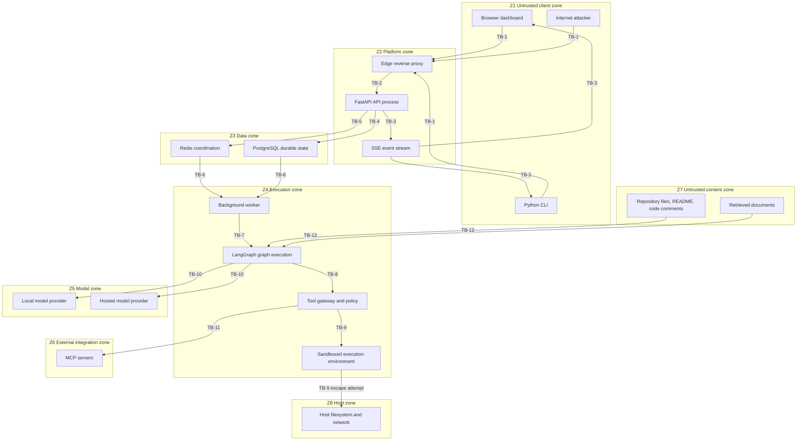

# DevFlow AI — Security Threat Model

**Status:** Design-time analysis, not a security audit. Most controls described here remain unimplemented or unverified. The initial API foundation provides limited, locally tested configuration and health/readiness behavior; it does not implement authentication, workspace authorization, workflow execution, or production security controls.
**Authoritative companions:** [`docs/SECURITY.md`](SECURITY.md) owns the security baseline and review checklist. This document owns the analysis behind it.

---

## 1. Status and scope

### 1.1 What this document is

This is a **design-time threat model for a system whose product workflows are not implemented**. It exists so that security decisions are made deliberately as the system grows, rather than retrofitted after implementation.

Every mitigation below is a **design requirement**, written in the form it must eventually take. Read each against the current evidence status in [`REQUIREMENTS_TRACEABILITY.md`](REQUIREMENTS_TRACEABILITY.md); do not infer that a full control is satisfied from foundation behavior. Current repository state:

- An initial FastAPI application exists under `services/api/`, using Python 3.12, `uv`, Pydantic Settings, asynchronous SQLAlchemy, PostgreSQL, and Alembic with the empty `0001_initial` migration. Automated tests exist. Local verification results, including PostgreSQL acceptance, have been reported passing; these are not CI results. No CI workflow is configured.
- No task lifecycle or product API endpoints, worker, LangGraph graph, tool gateway, MCP integration, dashboard, or CLI exists. The implemented API surface is limited to `/healthz` and `/readyz`.
- Authentication, workspace authorization, workflow execution, agent orchestration, and production security controls remain unimplemented or unverified. Limited local evidence exists for secret-safe configuration errors and generic health/readiness responses; this does not establish production security.
- This document contains no security audit finding or claim of production assurance. It records assumptions, threats, and required controls for the planned system.

Where this document and [`docs/SECURITY.md`](SECURITY.md) overlap, SECURITY.md is authoritative for the baseline rule and this document is authoritative for the reasoning, threat identifiers, and verification expectations. This document must not weaken SECURITY.md. Where a difference is discovered, the conflict-resolution order in [`PROJECT_CONTEXT.md`](../PROJECT_CONTEXT.md) applies and §9 rule 2 of that document (security and safety constraints cannot be weakened silently) governs.

### 1.2 What this document is not

- It is not a penetration test report, an audit, a certification, or a statement of compliance with any standard or regulation. Limited local verification has exercised configuration errors and health/readiness behavior; no comprehensive security assessment has been completed, and production security controls remain unimplemented or unverified.
- It is not a substitute for a security review of the implemented API or future product code. Revisit it as implementation expands, because code introduces threats that design review does not predict.
- It is not a complete enumeration. Threat models are expected to be wrong by omission; the value is in the boundaries and invariants that survive review.

### 1.3 Analytical frame

STRIDE is used as a **lens for organizing threats**, not as a compliance claim. AI-specific threats are handled in a dedicated first-class section (§6) because a general-purpose STRIDE pass underrepresents them in agentic systems.

Severity in this document is assigned on a five-level scale and is justified per threat. Because the software is unbuilt, severity reflects the **impact and likelihood if the system were built as specified without the listed mitigation**, not an observed exploitability:

| Severity | Meaning in this document |
|---|---|
| **Critical** | Boundary failure permits cross-tenant access, host compromise, credential theft, or unattended privileged action. |
| **High** | Boundary failure permits unauthorized action within one tenant, sustained denial of service, or irreversible data loss. |
| **Medium** | Boundary failure permits limited unauthorized disclosure, degraded auditability, or resource waste within bounded scope. |
| **Low** | Boundary failure has minor, recoverable, or largely informational impact. |

### 1.4 Assumed deployment for this analysis

Threat analysis requires a concrete topology to reason about. The following is the **assumed** deployment. **Deployment topology is an unresolved decision** (see §10 and `ARCHITECTURE.md` §12); if the real deployment diverges, this model must be revised rather than projected onto it.

```text
Assumption A1  Browser and CLI clients reach the platform over public HTTPS through an
               edge/reverse proxy that terminates TLS and forwards to the API.
Assumption A2  The FastAPI API process is a distinct process from the worker process and
               runs with its own credentials.
Assumption A3  A background worker process, separate from the API, executes LangGraph
               workflows and may be restarted or replaced at any time.
Assumption A4  PostgreSQL is the durable source of truth. Redis, if present, carries only
               non-durable coordination, cache, rate-limit, or queue data.
Assumption A5  Worker delivery may be at-least-once. Exactly-once execution is not assumed
               and must never be promised without a proven mechanism.
Assumption A6  Tool execution and any shell or repository-modifying operation run inside a
               restricted sandbox rather than with unrestricted host privileges.
Assumption A7  Model inference is reached either through a local provider such as Ollama or
               through a hosted provider, behind a provider/agent adapter.
Assumption A8  At least one MCP server may be integrated as a privileged external
               integration with its own credentials and its own trustworthiness questions.
Assumption A9  Retrieval over repository content and documents is a later milestone, and
               therefore analyzed here as an anticipated boundary rather than a designed one.
Assumption A10 No multi-tenancy model, authentication mechanism, sandbox technology,
               retention policy, or egress policy has been chosen.
```

Assumptions A6, A7, and A8 are load-bearing. If the platform ships with unrestricted host shell access, with a hosted provider as the only inference path, or with MCP servers granted ambient credentials, most of §5 and §6 collapses and the model must be rewritten, not amended.

### 1.5 Scope boundaries

**In scope:** the browser/CLI client surface, the FastAPI process, the API's authorization decisions, the durable task and audit state in PostgreSQL, the Redis layer where used, the worker and LangGraph execution, the tool gateway, the sandbox, model providers both local and hosted, MCP integrations, and retrieved repository or document content as an untrusted input channel.

**Out of scope for this revision:** the security of the hosting platform itself, the security of upstream model providers' own infrastructure, the internal security of an MCP server's own implementation, and physical or personnel security. These are dependencies whose compromise is treated as an assumed threat actor (§4), not as an analyzed component.

---

## 2. Assets

Assets are what an attacker would want, and what the platform must therefore protect. "Value" states why the asset matters in DevFlow AI's actual design, not in the abstract.

| ID | Asset | Why it has value |
|---|---|---|
| **A-01** | Source code and repository contents under analysis | Contains the user's intellectual property, may itself contain embedded credentials, and is writable by agent workflows. Disclosure is a direct confidentiality loss; modification is an integrity loss that can be propagated into the user's real repository. |
| **A-02** | Model provider credentials and API keys | Permit inference billed to the owner, and with a hosted provider may permit access to account-level features. Theft converts directly into spend and into unauthorized capability. |
| **A-03** | Database credentials | Grant read and write access to the durable source of truth: tasks, transitions, approvals, audit events, and any retained prompt or result content. This is the highest-consequence credential in the assumed deployment. |
| **A-04** | Task inputs and outputs | User-submitted intent, generated patches, verification evidence, and error details. May contain proprietary design or code. Cross-task or cross-tenant exposure is a confidentiality breach. |
| **A-05** | Prompts and completions | System prompts encode policy and tool-governance rules; completions encode repository content and reasoning. Prompt disclosure aids targeted injection; completion disclosure leaks repository content. |
| **A-06** | Approval decisions and audit trail | The record of who approved what, when, and within what scope. Its integrity is the precondition for the claim that consequential actions were governed; if it can be forged or deleted, approval stops being meaningful. |
| **A-07** | Tenant and user identity data | Identifiers, membership, roles, and ownership relationships that every authorization decision is evaluated against. Corrupting or disclosing it defeats both isolation and accountability. |
| **A-08** | Compute and spend budget | Inference and tool execution cost real money and real machine time. An attacker who can drive unbounded execution converts the platform into their own compute resource. |
| **A-09** | Host filesystem and network | The substrate under the worker. Escape from the sandbox reaches other workloads, credentials on disk, and anything the host can reach. |
| **A-10** | Worker execution environment | The process that holds the widest set of in-memory credentials and the ability to invoke tools. Compromise here is close to full platform compromise. |
| **A-11** | MCP server credentials | Third-party integration secrets with permissions defined outside the platform's control; frequently over-scoped and difficult to rotate. |
| **A-12** | Verification and test evidence | The basis for the claim that a task completed with honest verification (`PR-009`). Forged evidence causes a user to accept unverified changes. |

**Asset handling consequence.** A-06 and A-12 are integrity-first assets: for them, unauthorized *modification* is worse than disclosure. A-01 and A-05 are confidentiality-first. A-08 is availability-first. Mitigations should be prioritized accordingly rather than uniformly.

---

## 3. Trust boundaries

A trust boundary exists wherever data or control passes between components that do not share the same trust level. Each boundary below is numbered; §5 and §6 reference these numbers.

| # | Boundary | Untrusted side | Trusted side | What the trusted side must never assume about the untrusted side |
|---|---|---|---|---|
| **TB-1** | Public internet → edge/reverse proxy | Any unauthenticated network client | Edge proxy | That the client is honest, well-formed, bounded in volume, or uniquely identified. |
| **TB-2** | Edge proxy → API process | Request metadata that originated outside the platform | FastAPI process | That forwarded headers, client identity, or content length are true. |
| **TB-3** | Client → API authorization decision | Any request bearing a task identifier or event-stream URL | API authorization logic | That possession of `task_id` is authorization. Opaque identifiers are not credentials. |
| **TB-4** | API process → PostgreSQL | Values bound into queries and lifecycle writes | Durable source of truth | That writer-supplied state transitions are legal or authorized. |
| **TB-5** | API/worker → Redis | Coordination payloads and cache entries | Ephemeral coordination layer | That a cached value or queue entry is authentic, current, or the only copy of important state. |
| **TB-6** | Queue/dispatch → worker | A job delivery, which may be duplicated, delayed, or replayed | Worker claim and execution logic | That a delivery is new, unique, or exactly-once. Handlers must be idempotent. |
| **TB-7** | Worker → LangGraph graph execution | Graph state, checkpoint data, and node inputs | Graph runtime | That checkpoint content is trustworthy or that a restored state is still policy-valid. |
| **TB-8** | Graph/model output → tool gateway | Model-proposed tool calls and arguments | Tool gateway policy enforcement | That a proposed call is authorized. **Model output is a proposal, never a permission.** |
| **TB-9** | Tool gateway → sandboxed execution environment | Commands, file operations, and repository mutations | Sandbox | That tool arguments are benign, path-bounded, or non-networking. |
| **TB-10** | Service → model provider, local or hosted | Prompts, context, and provider responses | Adapter and platform | That a provider response is policy-conformant, non-injected, or free of embedded instructions. |
| **TB-11** | Service → MCP server | Requested methods and returned results | MCP client integration | That the server is honest, correctly scoped, or free of malicious tool descriptions and results. |
| **TB-12** | Retrieved repository/document content → model context | File contents, README text, code comments, retrieved documents | Context assembly and policy layer | That content is data. **Content may inform a decision; it can never grant permission or override system policy.** |

**Boundary summary.** TB-8 and TB-12 are the boundaries that distinguish an agentic platform from an ordinary web service, and they are the ones most likely to be implemented incorrectly by treating model output as a trusted internal message. TB-3 is the boundary most likely to be implemented incorrectly by treating an unguessable identifier as sufficient authorization, which `SPEC.md` and SECURITY.md both explicitly forbid.

### 3.1 Boundary and data-flow diagram



The final edge is deliberate: it represents the sandbox escape path that must be **prevented**, not an intended data flow. It is drawn so that the boundary is visible in review, because the most damaging outcome in this system is a tool call that leaves §Z4 and reaches §Z8.

---

## 4. Attacker capabilities and assumed threat actors

Each actor below is stated with what they **can** and **cannot** do at the start of their interaction. Capability statements are about the system as designed; they are the assumptions the mitigations depend on, and if any "cannot" turns out to be false in implementation, the associated threats escalate.

### 4.1 TA-1 — Unauthenticated internet client

- **Can:** reach TB-1, send arbitrary volumes and shapes of HTTP requests, probe for unauthenticated endpoints, attempt credential stuffing against whatever authentication is chosen, and open many long-lived connections.
- **Cannot (assumed):** authenticate, name any task, subscribe to any SSE stream, read any task snapshot, submit a task, or cancel or approve anything.
- **Relevant boundaries:** TB-1, TB-2, TB-3.
- **Why assumed hostile:** any public endpoint is scanned. Whether DevFlow AI is internet-exposed is itself an open decision (§10), and if it is not, this actor degrades to an on-network actor rather than disappearing.

### 4.2 TA-2 — Authenticated low-privilege tenant user

- **Can:** authenticate legitimately, submit tasks within their own tenant or project, read and stream their own tasks, cancel and approve within their own scope, and infer the existence and format of other identifiers from their own.
- **Cannot (assumed):** read another tenant's tasks or event streams, approve on another user's behalf where policy requires a specific approver, change policy, widen a tool allowlist, read audit records they do not own, or reach another tenant's repository content.
- **Relevant boundaries:** TB-3, TB-4, TB-8, TB-9.
- **Why assumed hostile:** this is the actor most likely to be an attacker in practice, because the platform's whole purpose is to let users cause code to be generated and executed. An authorized user is one authorization bug away from being an unauthorized one.

### 4.3 TA-3 — Malicious or compromised repository under analysis

- **Can:** place arbitrary text and structure into files that the workflow reads, including `README` files, code comments, docstrings, issue or config files, test fixtures, and filenames. Can contain hostile shapes such as very large files, deeply nested directories, symlink cycles, unusual encodings, and content designed to be read as instructions.
- **Cannot (assumed):** write outside its checkout root, reach the network from inside the sandbox, obtain platform credentials, or invoke a tool that policy has not allowed.
- **Relevant boundaries:** TB-12, TB-9, TB-8.
- **Why this actor is central:** the user explicitly asks the platform to ingest untrusted code and reason about it. This makes indirect prompt injection a normal operating condition, not an edge case. A repository is simultaneously the input the user wants analyzed and an attacker-controlled channel into the model's context.

### 4.4 TA-4 — Malicious retrieved document

- **Can:** inject instructions or misleading content into any document that retrieval later surfaces into context. Can be nearly indistinguishable from legitimate documentation.
- **Cannot (assumed):** grant permissions, alter the tool allowlist, change the system prompt, or authenticate.
- **Relevant boundaries:** TB-12, TB-8.
- **Note:** retrieval is a later milestone (`ARCHITECTURE.md` §4, `PLAN.md` Milestone 8), so the boundary is anticipated rather than designed. The threat is listed now because provenance and access filtering must be designed before retrieval is implemented, not after.

### 4.5 TA-5 — Malicious or compromised MCP server

- **Can:** return tool results containing embedded instructions, return misleading success or failure, describe tools with plausible but over-broad behavior, emit results far larger than expected, delay responses, and change behavior over time after initially appearing benign.
- **Cannot (assumed):** escalate its own granted scope, reach credentials not explicitly provisioned to it, or act outside the methods the platform allows.
- **Relevant boundaries:** TB-11, TB-8, TB-10.
- **Why this actor is different from TA-1:** an MCP server is an invited integration. It is trusted to be *useful*, not to be *honest*, and the distinction must be enforced in the tool gateway rather than assumed from configuration review.

### 4.6 TA-6 — Malicious LLM response or prompt-injection payload

- **Can:** produce arbitrary text in any field the workflow consumes, including what looks like a tool call, a policy statement, an approval recommendation, an authoritative-sounding system instruction, or a claim about what the user authorized. Can do so as a direct result of TA-3, TA-4, or TA-5 content, or on its own.
- **Cannot (assumed, and this is the hard invariant):** grant, widen, or self-authorize any tool permission; alter server-side policy; approve its own consequential action; or change its own execution bounds. Authorization derives **solely** from server-side policy evaluated against authenticated identity, never from model text.
- **Relevant boundaries:** TB-8, TB-10, TB-12.
- **Why this actor is listed separately from the injection sources:** the model is the component that *launders* untrusted content into something that looks like an instruction from a trusted component. Treating it as its own threat actor keeps the invariant explicit at the point where it is easiest to violate.

### 4.7 TA-7 — Compromised or malicious dependency

- **Can:** execute arbitrary code in the API process, the worker, the dashboard build, or the sandbox image with the privileges of whatever installs it. Can exfiltrate environment variables, including A-02, A-03, and A-11. Can persist across restarts.
- **Cannot (assumed):** be detected by design review alone, because the platform does not exist yet and no dependency set has been chosen.
- **Relevant boundaries:** all. A supply-chain compromise sits *inside* every boundary simultaneously.
- **Note:** the mitigation is process-based (pinning, least privilege, credential separation, locked-down sandbox images) rather than architectural, which is why the credential-separation requirements in §7 matter more than any single control.

### 4.8 TA-8 — Insider with limited access

- **Can:** act within their granted administrative or operational scope: read logs, query the database within their role, inspect queue contents, and operate deployment tooling.
- **Cannot (assumed):** read provider credentials or raw secrets they are not provisioned for, alter audit records without detection, or act outside the platform's own authorization model without leaving a record.
- **Relevant boundaries:** TB-4, TB-5, TB-6.
- **Why included:** the audit trail (A-06) is only meaningful if it constrains privileged users too. An insider threat that is never modeled produces an audit design that only watches ordinary users.

### 4.9 Assumed-false-until-verified list

The strongest statements in §4 are the "cannot" clauses. Each is a **design assumption to be verified**, not an established fact, and each maps to a verification expectation in §8:

```text
AS-1  Possession of a task_id does not confer authorization.        Verify in SR-02 tests.
AS-2  Model output cannot grant or widen a tool permission.         Verify in SR-06 tests.
AS-3  Retrieved content cannot alter policy or approvals.           Verify in SR-06 and SR-14 tests.
AS-4  Sandboxed execution cannot reach the host filesystem or
      arbitrary network destinations.                               Verify in SR-10 tests.
AS-5  Duplicate job delivery cannot produce duplicated effects.     Verify in SR-16 tests.
AS-6  Audit records cannot be altered or deleted by working code.   Verify in SR-09 tests.
AS-7  Tenant-scoped reads cannot return another tenant's data.      Verify in SR-03 tests.
```

---

## 5. STRIDE analysis

Severity per §1.3. "Planned mitigation" is a design requirement, not an existing control. Verification expectations are consolidated in §8.

### 5.1 Spoofing

| ID | Threat | Boundary / component | Severity |
|---|---|---|---|
| TM-S-01 | Unauthenticated access to task, event, cancel, or approval endpoints | TB-2, TB-3, API | Critical |
| TM-S-02 | `task_id` treated as a bearer credential, enabling enumeration or access after identifier leakage | TB-3, API | Critical |
| TM-S-03 | Token or session replay; stolen credential reused without binding to tenant, device, or expiry | TB-1, TB-3, API | High |
| TM-S-04 | SSE stream subscribed under a spoofed or borrowed identity and kept open after the credential is revoked | TB-3, SSE | High |

- **TM-S-01 — Unauthenticated endpoint access.** If any of `POST /api/v1/tasks`, `GET /api/v1/tasks/{task_id}`, `GET /api/v1/tasks/{task_id}/events`, `POST /api/v1/tasks/{task_id}/cancel`, or `POST /api/v1/tasks/{task_id}/approval` is reachable without authentication, an anonymous client submits work, reads results, and cancels or approves tasks. This is the single highest-consequence boundary failure because it enables every other threat without requiring any prior foothold. *Planned mitigation:* authenticate every non-public endpoint as a single enforced dependency rather than per-handler discipline, with a deny-by-default route policy so a newly added endpoint is unauthenticated only by explicit decision. *Residual risk:* route-level policy can drift; new endpoints added without the dependency must fail closed. *Verification:* API integration test enumerating every route in the router and asserting an unauthenticated request is rejected.
- **TM-S-02 — Identifier-as-credential.** `SPEC.md` and SECURITY.md both state that opaque task IDs are not authorization. An opaque but *known* identifier — leaked through a log, a shared URL, a screenshot, a support transcript, or another tenant's error message — must not by itself grant access. *Planned mitigation:* authorize every task read, stream, cancel, and approval against authenticated identity plus tenant/project ownership, evaluated server-side on every request and on every SSE reconnect, never cached client-side as a decision. *Residual risk:* an authorization predicate that is correct for reads but not for the SSE path creates a silent bypass; both paths must share one decision function. *Verification:* API integration test with two distinct identities, asserting identity B receives a not-authorized result for identity A's task across all five endpoints including the stream.
- **TM-S-03 — Token replay.** Without expiry, rotation, audience restriction, or binding to a tenant, a token captured from logs, a proxy, or a compromised dependency remains valid indefinitely and works from anywhere. *Planned mitigation:* short-lived credentials with explicit expiry, audience and issuer validation, rotation on revocation, and no long-lived tokens in URLs or logs. *Residual risk:* revocation latency; a token valid for a short window is still replayable inside that window. *Verification:* unit and API tests asserting expired, wrong-audience, and revoked credentials are rejected.
- **TM-S-04 — Long-lived spoofed stream.** An SSE connection is a persistent authenticated channel. If authorization is evaluated only at connection time, a client whose access is later revoked continues to receive progress events — which may include repository content and result detail. *Planned mitigation:* re-evaluate authorization on reconnect and on credential expiry, bound maximum stream lifetime, and require a fresh authorized request to resume. *Residual risk:* a stream cannot be forcibly terminated without server-side session tracking, which adds state and its own failure modes. *Verification:* API integration test revoking access mid-stream and asserting termination at the bound.

### 5.2 Tampering

| ID | Threat | Boundary / component | Severity |
|---|---|---|---|
| TM-T-01 | Worker writes task state directly, bypassing centralized transition validation | TB-4, worker, task domain | High |
| TM-T-02 | Checkpoint or graph state tampered in durable storage and resumed as valid | TB-4, TB-7, LangGraph | High |
| TM-T-03 | Duplicate job delivery applies a side effect twice because the handler is not idempotent | TB-6, worker | High |
| TM-T-04 | Tool arguments or results modified in transit or in the log pipeline | TB-8, TB-9, tool gateway | Medium |
| TM-T-05 | Verification evidence forged or asserted without being run (`PR-009`) | TB-7, verification stage | High |
| TM-T-06 | Audit events altered or deleted, removing the record of a consequential action | TB-4, A-06 | Critical |

- **TM-T-01 — Lifecycle bypass.** `PR-003` requires centralized validation of transitions, and `ARCHITECTURE.md` §5 states this must be enforced in domain logic, not only in the UI. If the worker can `UPDATE` status directly, an invalid transition such as a terminal task silently returning to `running` becomes possible, and the lifecycle stops being a guarantee. *Planned mitigation:* all state changes go through one domain transition function that validates the allowed edges (`queued` → `running`, `cancelled`, `blocked`; `running` → `needs_approval`, `completed`, `failed`, `cancelled`, `blocked`; `needs_approval` → `running`, `cancelled`, `blocked`; `blocked` → `queued`, `cancelled`; and `completed`, `failed`, `cancelled` terminal), with the worker writing through that function and not holding raw update rights. *Residual risk:* a migration, admin script, or future service that writes directly reopens the bypass. *Verification:* unit tests for every legal and illegal edge; worker integration test asserting a direct invalid write is impossible or rejected.
- **TM-T-02 — Checkpoint tampering.** LangGraph checkpoints enable pause/resume and recovery, which means durable store contents become executable state. If a checkpoint can be modified — through a database-level flaw, an over-broad worker credential, or a restore path — a resumed graph may proceed with altered state, including an altered pending-action set. *Planned mitigation:* checksum or integrity-protect checkpoint payloads, deserialize only through safe typed schemas with no arbitrary object construction, re-validate policy-dependent state on resume rather than trusting the checkpoint, and separate checkpoint write credentials from read credentials where practical. *Residual risk:* a full database compromise defeats integrity protection; the mitigation then reduces to detection. *Verification:* worker integration test with a mutated checkpoint asserting safe failure rather than resumed execution.
- **TM-T-03 — Non-idempotent duplicate effects.** `ARCHITECTURE.md` §4 and `SPEC.md` both state delivery may be at-least-once and that handlers must be idempotent. A duplicated delivery that re-appends a transition, re-emits an approval, or re-runs a repository-mutating tool is a correctness and integrity failure, and in the tool case a destructive one. *Planned mitigation:* idempotency keys per job and per attempt, side effects guarded by a durable deduplication record committed in the same transaction as the state change, and tool invocations treated as side effects requiring the same guard. *Residual risk:* an effect outside the transaction — a network call to a provider or MCP server — can still be duplicated; only its *recorded* consequence can be deduplicated. *Verification:* worker integration test delivering the same job twice and asserting exactly one recorded effect.
- **TM-T-04 — Argument or result modification.** Tool arguments and results cross process, network, and logging boundaries. Tampering in the event pipeline would make the audit trail disagree with what executed. *Planned mitigation:* validate arguments against a schema at the gateway immediately before execution, validate results against a schema immediately after, record both in the audit event, and treat log-derived records as non-authoritative. *Residual risk:* a compromised host can alter anything in memory; the mitigation depends on the audit record being written where working code cannot rewrite it (TM-T-06). *Verification:* unit tests for schema rejection; worker integration test asserting the recorded invocation matches the executed one.
- **TM-T-05 — Forged verification evidence.** `PR-009` requires that results include verification status and test evidence when checks are run. A workflow that reports success without executing checks, or that reports a pass for a check that errored, produces an unverified change presented as verified. *Planned mitigation:* verification outcomes derived only from an executed check's captured exit status and bounded output, stored with the attempt that produced them, and explicitly represent "not run" as distinct from "passed". *Residual risk:* a check may pass while not testing the changed behavior; the platform can report honesty about execution, not truth about correctness. *Verification:* worker integration test with a deliberately failing and a deliberately erroring check, asserting neither can be recorded as passed.
- **TM-T-06 — Audit record alteration.** A-06's value is entirely integrity-dependent. If audit events can be modified or deleted by the same credentials the application uses, then an actor who can reach the database can remove evidence of an approval they bypassed. *Planned mitigation:* append-only audit writes from the application, no application-path delete or update of audit rows, separation of the application credential from any administrative credential, and retention-governed deletion executed only by a distinct privileged path. *Residual risk:* an administrative database compromise remains possible; that becomes a detection and monitoring problem rather than a prevention one. *Verification:* unit and API tests asserting no application code path issues an update or delete against the audit table.

### 5.3 Repudiation

| ID | Threat | Boundary / component | Severity |
|---|---|---|---|
| TM-R-01 | Approval recorded without a trustworthy actor identity | TB-3, TB-4, approval path | High |
| TM-R-02 | Cancellation request treated as confirmed cancellation | TB-3, worker, `POST /cancel` | Medium |
| TM-R-03 | Consequential tool invocation not attributable to a task, attempt, and stage | TB-8, TB-9, audit | Medium |

- **TM-R-01 — Unattributable approvals.** If an approval decision records only that a decision occurred, a user can deny having approved a consequential action. SECURITY.md requires recording actor, decision, timestamp, and scope. *Planned mitigation:* bind every recorded decision to the authenticated subject, the task, the specific pending action, the decision, the timestamp, and the scope of what was authorized; reject a decision that does not match the currently pending action so an old approval cannot be replayed against a new one. *Residual risk:* attribution is only as strong as authentication (TM-S-03); a shared credential produces a shared identity. *Verification:* API integration test asserting the recorded actor matches the authenticated caller and that a stale or mismatched decision is rejected.
- **TM-R-02 — Cancellation overstatement.** `SPEC.md` requires distinguishing an accepted cancellation request from worker-confirmed cancellation. Reporting `cancelled` when the request was merely accepted tells a user that side effects stopped when they may not have — the dangerous case being a repository-mutating tool still running. *Planned mitigation:* represent request acceptance separately from the `cancelled` state, reach `cancelled` only on worker acknowledgement, and have the worker check for cancellation at defined points and record when it observed the request. *Residual risk:* a non-cooperative tool or provider call cannot be interrupted mid-flight; the honest report is "cancellation requested, not yet confirmed". *Verification:* worker integration test asserting state remains non-terminal until the worker acknowledges, and that no side effect is recorded after acknowledgement.
- **TM-R-03 — Unattributable tool invocation.** If a tool call is logged without task, attempt, and stage correlation, there is no way to reconstruct which workflow caused a given effect. `PR-012` requires correlation without leaking secrets. *Planned mitigation:* every tool invocation record carries task identifier, attempt, stage, tool name, validated argument summary, outcome, and correlation identifier, with sensitive values redacted rather than omitted. *Residual risk:* over-redaction reduces investigative value; under-redaction leaks A-01, A-04, or A-05 into logs. This is a deliberate calibration requiring an owner decision on retention (§10). *Verification:* unit test asserting the audit record carries all correlation fields and contains no secret values.

### 5.4 Information disclosure

| ID | Threat | Boundary / component | Severity |
|---|---|---|---|
| TM-I-01 | Cross-tenant or cross-project read through a missing ownership predicate | TB-3, TB-4, API | Critical |
| TM-I-02 | Secrets leaked into logs, errors, or telemetry | TB-10, logging, error envelope | Critical |
| TM-I-03 | Sensitive content retained indefinitely in checkpoints, events, or results | TB-4, TB-7, retention | High |
| TM-I-04 | DTO over-exposure: task snapshot returns internal fields, paths, or provider detail | TB-3, API schemas | Medium |
| TM-I-05 | Database credential over-privilege beyond the application's needs | TB-4, A-03 | High |
| TM-I-06 | Health, readiness, or operational endpoints reveal version, topology, or configuration | TB-1, TB-2, operational routes | Medium |

- **TM-I-01 — Cross-tenant read.** The most direct confidentiality failure and the one most likely to appear as a single missing predicate on one of several read paths — a task snapshot, an event replay, a result detail, a verification log, or a list view. *Planned mitigation:* one shared authorization function used by every task-scoped read, ownership enforced in the query or immediately adjacent to it, and negative tests for each read path. *Residual risk:* a future read path added without the shared function. *Verification:* API integration test covering every task-scoped route with a foreign identity.
- **TM-I-02 — Secret leakage into logs.** Provider keys (A-02), database credentials (A-03), MCP credentials (A-11), and secret-bearing repository content can reach logs through exception messages, request dumps, tool output echoing an environment variable, or a model prompt that includes a config file. *Planned mitigation:* structured logging with a redaction layer applied at the logging boundary rather than at each call site, exception handling that never serializes raw configuration, provider keys never placed into prompts, and a check that tracked files contain no real values — SECURITY.md requires `.env.example` with placeholders only. *Residual risk:* redaction is pattern-based and will miss novel secret shapes; the only durable mitigation is not putting secrets where the workflow can read them. *Verification:* unit test asserting redaction of known secret shapes; a tracked-file scan for credential patterns; worker integration test asserting a task that reads a secret-bearing file does not cause that value to appear in emitted logs.
- **TM-I-03 — Indefinite sensitive retention.** Prompts, completions, repository content, checkpoints, and results accumulate durably (A-05, A-04). Without a defined retention and deletion policy, a breach has unbounded retrospective impact and data-subject or contractual deletion requests cannot be honored. SECURITY.md requires defining retention before production and `ARCHITECTURE.md` §12 lists it as an open decision. *Planned mitigation:* every stored artifact classified with a retention class and a deletion mechanism; deletion that actually removes or irreversibly de-identifies content including derived checkpoints and events; no silent secondary copies in caches or logs. *Residual risk:* deletion across backups and derived artifacts is genuinely hard, and RETENTION POLICY IS UNRESOLVED (§10), so no control can be specified precisely yet. *Verification:* retention test asserting an artifact past its class boundary is no longer retrievable through any read path.
- **TM-I-04 — DTO over-exposure.** `GET /api/v1/tasks/{task_id}` returns "allowed result metadata" per `SPEC.md`. If response models mirror internal persistence models, they leak internal identifiers, absolute host paths, stack-adjacent detail, or provider request identifiers. `SPEC.md` error semantics explicitly forbid leaking stack traces, secrets, internal paths, or provider credentials. *Planned mitigation:* explicit response schemas separate from internal models, an allowlist of exposed fields rather than a blocklist, and error envelopes carrying a stable code, message, and correlation identifier only. *Residual risk:* schema drift as the internal model grows. *Verification:* API integration contract tests asserting response keys match the documented set exactly and that injected internal markers never appear.
- **TM-I-05 — Database credential over-privilege.** A single credential with schema-wide DDL and unrestricted DML means any application compromise reaches all state, including audit rows. *Planned mitigation:* distinct least-privilege roles for API and worker, with the worker unable to perform schema changes and neither role able to modify or delete audit rows (connects to TM-T-06). *Residual risk:* the API and worker roles still hold broad DML within their tables. *Verification:* integration test asserting the worker credential is rejected for schema modification and audit mutation.
- **TM-I-06 — Operational endpoint disclosure.** Health and readiness endpoints frequently enumerate dependency versions, connection targets, queue depth, or internal hostnames, and are frequently left unauthenticated because they must be reachable by infrastructure. SECURITY.md requires protecting them appropriately. *Planned mitigation:* split liveness from detailed readiness, keep detailed output authenticated or bound to an internal interface, and never include secrets, connection strings, or dependency versions in the unauthenticated response. *Residual risk:* infrastructure probing requirements may force some disclosure; the decision should be explicit. *Verification:* API integration test asserting the unauthenticated health response contains no version, host, or configuration data.

### 5.5 Denial of service

| ID | Threat | Boundary / component | Severity |
|---|---|---|---|
| TM-D-01 | Task-submission flooding exhausts queue, worker pool, or database capacity | TB-1, TB-4, submission path | High |
| TM-D-02 | Single long-running or resource-heavy task occupies worker concurrency slots | TB-6, worker | High |
| TM-D-03 | Mass SSE connections exhaust API connections and file descriptors | TB-1, TB-3, SSE | Medium |
| TM-D-04 | Hostile repository content causes pathological processing: huge files, deep trees, symlink cycles, archive bombs | TB-9, TB-12, sandbox | High |
| TM-D-05 | Unbounded tool or model retries amplify a single failure into sustained provider load and spend | TB-6, TB-8, TB-10 | High |
| TM-D-06 | Provider rate limiting or outage blocks all execution and produces silent task stalling | TB-10, worker | Medium |

- **TM-D-01 — Submission flooding.** `POST /api/v1/tasks` is deliberately fast (p95 target under 200 ms in `PRD.md`), which makes it cheap to abuse: the endpoint's own performance goal makes flooding inexpensive. *Planned mitigation:* rate limiting per authenticated identity and per tenant, bounded queue depth with an explicit rejection response when full, request-size limits, and no unauthenticated submission path. *Residual risk:* an attacker with many valid identities can still distribute load; require reputation or quota escalation beyond authentication. *Verification:* load test asserting the rate limit engages and that the queue rejects rather than silently dropping when full.
- **TM-D-02 — Worker slot monopolization.** With bounded concurrency (`ARCHITECTURE.md` §4), one task holding a slot indefinitely starves others. A task that never finishes — an unbounded agent loop (see §6.2, TM-AI-09) or a slow tool — is an availability attack with no malicious intent required. *Planned mitigation:* per-task wall-clock deadlines that terminate execution and record an honest timeout outcome (`PR-008`), per-tenant concurrency quotas so one tenant cannot consume the pool, and fair queueing rather than strict FIFO. *Residual risk:* the deadline must be generous enough to permit legitimate long tasks, which leaves a window for abuse. *Verification:* worker integration test asserting a task exceeding its deadline terminates and frees its slot; load test with a monopolizing tenant asserting other tenants still progress.
- **TM-D-03 — SSE connection exhaustion.** Each stream holds a connection and possibly a server-side subscription. Cheaply opened and long-lived, they are a classic resource-exhaustion vector. *Planned mitigation:* per-identity and per-tenant connection caps, a maximum stream lifetime with required reconnection, heartbeats so dead connections are reaped, and bounded server-side buffering per stream. *Residual risk:* connection caps must not break legitimate clients with many open tasks; the limit is a product trade-off. *Verification:* load test opening many streams from one identity, asserting the cap engages while other identities remain unaffected.
- **TM-D-04 — Hostile repository content.** A repository is attacker-controlled input (TA-3). A very large file, a very deep or wide tree, a symlink cycle, a decompression bomb in an archive, or a file with an adversarial encoding can hang or crash the ingestion and analysis path before any model is invoked. *Planned mitigation:* bound file count, per-file size, total bytes, tree depth, and processing time; refuse symlinks that escape the checkout root; treat archives as untrusted and bound expansion ratio; fail closed with a recorded reason rather than retrying indefinitely. *Residual risk:* bounds may reject legitimate large repositories; the pathological cases must be tested rather than assumed. *Verification:* worker integration test with constructed hostile repositories asserting bounded failure rather than hang or crash.
- **TM-D-05 — Retry amplification.** A retry policy designed for reliability becomes a load amplifier: three retries across three stages with fan-out multiplies a single failure into many provider calls, each billable (A-08). *Planned mitigation:* bounded retries with exponential backoff and jitter, a retry budget per task rather than per call, provider-level and task-level spend ceilings, and immediate non-retry for errors that are definitionally not transient — notably policy denials and validation failures. *Residual risk:* distinguishing transient from permanent failure is imperfect, and a misclassification either wastes spend or fails a recoverable task. *Verification:* worker integration test asserting a permanently failing dependency reaches a terminal `failed` state within a bounded number of calls.
- **TM-D-06 — Provider dependency outage.** With a single configured provider, an outage or rate limit blocks all work, and tasks may appear stuck rather than failed. *Planned mitigation:* classify provider unavailability distinctly, surface it as `blocked` with a recorded reason rather than leaving tasks in `running`, apply bounded retry with backoff, and support the provider/agent adapter abstraction so a second provider can be configured without domain changes (`PROJECT_CONTEXT.md` §3). *Residual risk:* failover quality is not guaranteed; a cheaper fallback provider may produce materially different results. *Verification:* worker integration test with a simulated provider outage asserting tasks reach `blocked` with a reason rather than hanging indefinitely.

### 5.6 Elevation of privilege

| ID | Threat | Boundary / component | Severity |
|---|---|---|---|
| TM-E-01 | Model output interpreted as a command, policy statement, or authorization | TB-8, TB-10, TB-12 | Critical |
| TM-E-02 | Tool allowlist over-broad or default-allow, granting more capability than the task requires | TB-8, tool gateway | Critical |
| TM-E-03 | Sandbox escape to host filesystem or unrestricted network | TB-9, Z8 | Critical |
| TM-E-04 | MCP server over-scoped relative to the task, or its results treated as trusted instructions | TB-11, TB-8 | High |
| TM-E-05 | Path traversal or argument-based scope escape inside the sandbox | TB-9, tool arguments | High |
| TM-E-06 | Approval bypass through an alternate path: CLI, retry, direct worker invocation, or a stale approval | TB-3, TB-6, approval path | Critical |

- **TM-E-01 — Model output as authority.** The defining failure mode of an agentic platform. If any code path treats a model-emitted string as a tool permission grant, as a policy override, or as evidence that the user authorized an action, then an injected repository file (TA-3) or a malicious MCP result (TA-5) has escalated to platform privilege. *Planned mitigation:* the hard invariant that **model output can never itself grant or escalate tool permission; authorization derives solely from server-side policy, evaluated against authenticated identity and task scope, and is never read from model text, tool output, retrieved content, or repository content.** Model output is treated as a *proposal* that must pass the same policy evaluation as any other untrusted input. *Residual risk:* the invariant is easy to state and easy to violate accidentally, for example by letting a model-supplied parameter select the tool, tenant, or approval scope. This requires explicit negative tests, not review alone. *Verification:* adversarial evaluation asserting that injected instructions, in every supported channel, cannot produce a tool invocation that policy would otherwise deny, and that no code path derives permission from model output.
- **TM-E-02 — Over-broad allowlist.** `PR-010` requires tool and MCP execution to be allowlisted, validated, bounded, permissioned, and audited; SECURITY.md and `ARCHITECTURE.md` require deny-by-default. A single shared allowlist spanning all tasks, or a default-allow fallback for unknown tools, turns the gateway into a formality. *Planned mitigation:* deny by default with an explicit allowlist resolved per task and per stage, least privilege per tool, an unknown or unregistered tool name rejected rather than inferred, and new tool registration requiring an explicit reviewable change. *Residual risk:* per-task allowlists require a policy representation and an owner decision about who may widen one. *Verification:* unit tests asserting an unregistered tool and a registered-but-not-permitted tool are both denied; worker integration test asserting denial is recorded as an audit event rather than a silent skip.
- **TM-E-03 — Sandbox escape.** SECURITY.md requires risky operations in a restricted sandbox, not with unrestricted host privileges, and `PRD.md` lists unrestricted autonomous shell or filesystem access as a non-goal. A sandbox that is merely a subdirectory or a `chdir` is not a sandbox. *Planned mitigation:* a real isolation boundary with a read-only or copy-on-write view of the checkout, no host filesystem mount beyond declared paths, egress restricted to an explicit allowlist or denied entirely, no access to the host container runtime socket or metadata service, non-root execution, and dropped Linux capabilities. *Residual risk:* SANDBOX TECHNOLOGY IS UNRESOLVED (§10), so the strength of this control cannot be assessed yet; container isolation is weaker than a virtual machine boundary, and the choice is a real trade-off. *Verification:* security test asserting a sandboxed process cannot read a file outside the declared root, cannot reach a non-allowlisted network destination, and cannot reach the host metadata service.
- **TM-E-04 — MCP over-scope.** MCP servers are privileged integrations (SECURITY.md; `ARCHITECTURE.md` §4). Granting a server ambient credentials, or passing its output into context as though it were trusted instruction, moves that server's trust level inside the platform. *Planned mitigation:* pre-integration review of identity, permissions, transport, and permitted methods; per-server scoped credentials rather than shared secrets; server results treated exactly like other untrusted content under TB-12; per-server timeouts and output bounds; and the ability to disable a server without redeploying the platform. *Residual risk:* an MCP server's own behavior can change after review; a compromised server remains inside TB-11 and could still return misleading results. *Verification:* worker integration test with a stub server returning injected instructions and an oversized result, asserting neither affects policy and the size bound engages.
- **TM-E-05 — Path traversal and argument scope escape.** Even inside a sandbox, a tool argument containing `../` sequences, an absolute path, a symlink pointing outside the checkout, or an unexpected encoding can redirect a permitted operation outside its intended scope. *Planned mitigation:* normalize and validate every path argument against a declared root *after* symlink resolution, reject absolute paths that fall outside the root, disallow following symlinks that escape, validate all arguments against the tool's schema with strict types and bounds, and never construct a shell command by string interpolation. *Residual risk:* correct path validation across platforms and encodings is notoriously error-prone. *Verification:* unit tests with traversal, absolute-path, symlink, and encoding variants, each asserting rejection.
- **TM-E-06 — Approval bypass.** The most subtle elevation path, because it abuses the platform's own features: approving through the CLI rather than the dashboard when the check exists only in the dashboard; replaying an old approval against a newly pending action; retrying a task and skipping the gate; or invoking the worker directly, bypassing the API. *Planned mitigation:* the approval decision is enforced server-side in the domain, not in either client (`PR-004` and `PR-014` require one contract and one set of authorization rules for dashboard and CLI); an approval is bound to a specific pending action and single-use; every resumption path re-checks the gate; and the worker refuses to execute a consequential action without a recorded matching approval. *Residual risk:* any future alternate execution path — an admin tool, a migration script, a debugging endpoint — reopens this unless it shares the domain gate. *Verification:* API integration test exercising approval through both dashboard contract and CLI contract; worker integration test asserting a consequential stage cannot execute without a matching recorded approval, and that a consumed approval cannot be reused.

---

## 6. AI-specific threats

This section is first-class because general STRIDE analysis systematically underrepresents agentic failure modes: the platform deliberately feeds untrusted content to a component whose output is then treated as an action proposal, and the resulting attack surface does not map cleanly onto classic confidentiality, integrity, and availability categories.

### 6.1 The governing invariant

Stated once, precisely, because every mitigation in this section depends on it:

```text
INVARIANT (non-negotiable)
Model output is untrusted data. It may propose an action. It may never authorize one.
Tool permission, scope, and approval requirements are derived exclusively from
server-side policy evaluated against the authenticated identity and task scope.
No code path may read a permission, a policy exception, an approval, or a scope
widening out of model output, tool output, retrieved content, repository content,
or an MCP server response.
```

If this invariant holds, prompt injection is a *usability and correctness* problem: an attacker can influence what the agent tries to do, but not what it is permitted to do. If it fails, prompt injection is a *privilege escalation* problem. All of §6 should be read as an attempt to keep the first case the only case.

### 6.2 AI-specific threat table

| ID | Threat | Primary boundary | Severity |
|---|---|---|---|
| TM-AI-01 | Direct prompt injection through user-supplied task text | TB-2, TB-10 | Medium |
| TM-AI-02 | Indirect prompt injection through repository files, README, code comments, filenames | TB-12, TB-10 | Critical |
| TM-AI-03 | Indirect prompt injection through retrieved documents | TB-12, TB-10 | High |
| TM-AI-04 | Prompt injection through tool results and MCP server responses | TB-11, TB-8 | High |
| TM-AI-05 | Tool-call manipulation: model output attempts a privileged action | TB-8 | Critical |
| TM-AI-06 | Model output used to grant or escalate permission | TB-8, TB-10 | Critical |
| TM-AI-07 | Execution of untrusted generated code as part of verification or tooling | TB-9, verification stage | Critical |
| TM-AI-08 | Data exfiltration via tool calls, network egress, or provider prompts | TB-9, TB-10 | Critical |
| TM-AI-09 | Agent goal drift and loop runaway | TB-6, TB-7 | High |
| TM-AI-10 | Denial of wallet through unbounded model or tool spend | TB-8, TB-10 | High |
| TM-AI-11 | Context or training-data poisoning: untrusted content persisted as trusted context | TB-4, TB-12 | High |
| TM-AI-12 | Over-broad context exposure across tenants or projects | TB-4, TB-12 | Critical |
| TM-AI-13 | Approval fatigue: consequential actions buried in volume | TB-3, approval UX | High |
| TM-AI-14 | Approval bypass or social engineering of the approver | TB-3, TB-8 | Critical |
| TM-AI-15 | Model or provider response leakage back into the user's repository | TB-9, TB-10 | Medium |

### 6.3 Threat detail and required controls

**TM-AI-01 — Direct prompt injection.** A user's own task text is untrusted input by definition. They can attempt to instruct the agent to ignore policy, reveal the system prompt (A-05), invoke tools outside the task's scope, or exfiltrate context. *Required controls:* system and policy instructions must be structurally separate from user content, not concatenated into one string where a user can imitate the surrounding framing; tool availability is decided before the model is invoked, never by the model; the system prompt must be treated as non-secret in the sense that its disclosure must not be the only thing preventing an attack; and injection attempts should be logged as security-relevant events. *Residual risk:* prompt-level defenses are probabilistic and must never be the enforcement point. The enforcement point is the tool gateway.

**TM-AI-02 — Indirect prompt injection via repository content.** This is the highest-likelihood AI-specific threat in DevFlow AI, because ingesting untrusted code is the product's purpose. A `README` line, a code comment, a string literal, a test fixture, a filename, or a commit message can carry instructions. Because the agent is *expected* to read and reason about these files, there is no way to exclude them without defeating the feature. *Required controls:* all repository content enters context as clearly delimited data; content never appears in the instruction position; tool permission is unaffected by anything the repository says; instructions found in content are not executed as instructions; repository-derived text that attempts policy changes is recorded as a security event; and any proposed consequential action is evaluated by policy regardless of its stated justification. *Residual risk:* an injected instruction can still cause the agent to attempt a permitted action for the wrong reason, or to produce a misleading summary. This cannot be eliminated — the mitigation bounds the *privilege* consequence, not the *correctness* consequence. *Verification:* adversarial evaluation with a corpus of repositories containing injected instructions in README, comments, filenames, and test fixtures, asserting no policy-denied tool executes.

**TM-AI-03 — Indirect prompt injection via retrieved documents.** Retrieval (Milestone 8) extends the injection surface to any indexed source, and multiplies it: retrieved content is selected for relevance, which correlates with being placed near the instruction position in context. *Required controls:* retrieval is designed with provenance, access filtering, freshness, and deletion defined before implementation (`ARCHITECTURE.md` §4); retrieved content is labeled with its source and trust level in context; access filtering applies tenant scoping at query time so retrieval cannot surface another tenant's document (link to TM-AI-12); and retrieval results are inert with respect to policy. *Residual risk:* provenance is advisory to the model; a well-crafted document may still be persuasive. Same bounding argument as TM-AI-02.

**TM-AI-04 — Prompt injection via tool results and MCP responses.** Tool output and MCP results are untrusted (SECURITY.md; `ARCHITECTURE.md` §4). An MCP server under attacker influence can return text crafted as an instruction. *Required controls:* tool and MCP results are inserted into context as data with an explicit provenance label; results are schema-validated and size-bounded before entering context; a result containing instruction-like content does not alter tool availability; per-server trust is explicit and revocable. *Residual risk:* see TM-AI-02; the privilege consequence is bounded by the gateway, the correctness consequence is not.

**TM-AI-05 — Tool-call manipulation.** The model emits a call for a tool it should not use, with arguments that are syntactically valid but semantically out of scope, or arguments designed to look benign while reaching a sensitive resource. *Required controls:* every model-proposed call passes the full gateway path — allowlist check, per-task permission check, schema validation, path and argument scope validation, output-size bound, timeout, and audit record — with **no** fast path for calls the model seems confident about; the arguments are validated for *semantic* scope, not just schema conformance; calls to unregistered tools are denied and recorded; and denial is returned to the graph as a structured error so the agent can adapt without the platform retrying. *Residual risk:* a permitted tool invoked with a permitted argument can still cause an unwanted but authorized effect. This is a policy-design problem, which is why the allowlist must be per-task and least-privilege rather than global. *Verification:* adversarial evaluation with a model stub that emits calls to denied tools, out-of-scope paths, and unknown tool names, asserting every case is denied and audited.

**TM-AI-06 — Model output used to grant or escalate permission.** The invariant violation itself. It typically appears in plausible-looking code: a model-reported flag used to skip a check, a "the user already approved this" string trusted as an approval, a model-supplied tool name resolved directly against a registry, a model-supplied tenant identifier used in a query, or a model judgment used to widen its own allowlist for a follow-up step. *Required controls:* the permission decision function takes only authenticated identity, task scope, stage, and tool name — never a model-derived value; tenant and task identifiers always originate from the authenticated request or durable record, never from model output; the tool registry is keyed by a value the model cannot influence beyond selecting from a policy-approved set; approval must be a durable record produced by an authenticated decision, never a claim in text; and there must be no code path where a model-produced string is compared to or substituted for a policy decision. *Residual risk:* this is a code-review and test-coverage property rather than a runtime control, so it depends on explicit negative tests surviving refactoring. It should be a required review item on every change touching the gateway. *Verification:* adversarial evaluation plus a structural check that no policy input is derived from model output.

**TM-AI-07 — Executing untrusted generated code.** `PR-009` requires verification with test evidence, which means running code — and the code under test may have been generated by the model, and the test fixtures may have come from a hostile repository (TA-3). Running it in the platform's own process, or in a sandbox with credentials and network access, is host compromise by design. *Required controls:* verification executes only inside the sandboxed environment (TB-9), with no platform credentials present, no access to the durable store, no host filesystem outside the declared checkout, and no network egress beyond an explicit allowlist; dependency installation for verification is itself treated as untrusted code execution; verification runs with a wall-clock and output bound; and the platform never imports or evaluates model-generated code in the API or worker process. *Residual risk:* sandbox escape is the fallback, so this control is only as strong as TM-E-03, whose technology is unresolved. *Verification:* worker integration test asserting a verification step cannot read platform credentials from its environment, cannot reach the durable store, and cannot reach a non-allowlisted network destination.

**TM-AI-08 — Data exfiltration.** Three distinct channels: (a) tool calls that read sensitive data and write it somewhere reachable from the sandbox; (b) direct network egress from the sandbox; (c) inclusion of sensitive data in prompts sent to a hosted provider. Channel (c) is the one most often overlooked, because it is a normal, intended data flow — if a repository contains a credential and the workflow sends file content to a hosted provider, that credential has left the trust boundary through supported functionality. *Required controls:* egress from the sandbox is denied by default with an explicit allowlist; tool output size is bounded so bulk exfiltration through a tool is impractical; secret scanning or redaction before content enters a prompt; a documented and owner-decided policy on whether hosted providers are permitted at all and for which content classes; per-provider data-handling expectations recorded; and no credentials in the environment of anything that runs untrusted code. *Residual risk:* whether hosted providers are permitted is UNRESOLVED (§10). If they are permitted for arbitrary repository content, no control fully prevents credential exfiltration, because the data flow is the feature. The mitigation becomes detection and user disclosure. *Verification:* adversarial evaluation attempting egress through a tool and through the network, and a test asserting a credentialed file's secret value does not appear in a captured outbound provider payload.

**TM-AI-09 — Goal drift and loop runaway.** An agent that re-plans indefinitely, oscillates between stages, or progressively widens its own objective consumes budget (A-08) and worker capacity (TM-D-02), and may take increasingly consequential actions under a drifting interpretation of the original task. *Required controls:* hard bounds on graph iterations, tool calls per task, tokens, and wall-clock time; a per-task retry budget that spans stages rather than resetting per stage; explicit detection of no-progress cycles; the objective treated as immutable input rather than a mutable graph field; and termination recorded with an honest reason. *Residual risk:* bounds that are too tight break legitimate multi-step tasks; the trade-off needs measured calibration, which requires a working system. *Verification:* worker integration test with a stub model that loops without progress, asserting bounded termination with a recorded reason.

**TM-AI-10 — Denial of wallet.** Unbounded or attacker-influenced spend on inference and tools. With no cost model, a task that is expensive by accident and a task that is expensive by design look identical. *Required controls:* per-task token and cost ceilings enforced before the call rather than reconciled after; per-tenant and per-day budget ceilings; the number of concurrent tasks and tool calls bounded per tenant; hosted provider calls refused once a ceiling is reached rather than degrading silently; and cost recorded per task so ceilings can be calibrated. *Residual risk:* cost accounting depends on provider-reported usage, which may be delayed or approximate; enforcement may therefore lag by a small amount. *Verification:* load test with an expensive stub model asserting the ceiling stops execution and that the task reaches a terminal state with a recorded reason.

**TM-AI-11 — Context and training-data poisoning.** Untrusted content persisted in a durable form — a checkpoint, a cached summary, a stored embedding, a memory or scratchpad the graph writes — becomes trusted-by-provenance on later read. The boundary crossing has already happened; the poisoned value now looks like platform state. This is distinct from per-request injection because it persists. *Required controls:* durable graph state stores references and validated structures rather than raw untrusted text where possible; any persisted model- or content-derived text retains a provenance label and trust level; provenance is preserved across checkpoint and resume; retrieved or cached content is re-evaluated for access and freshness on read rather than trusted because it was stored; and there is no cross-task memory that carries content between users. *Residual risk:* provenance labeling is a design discipline and degrades under time pressure; it deteriorates silently and only matters after a security event. *Verification:* worker integration test asserting a poisoned value written to context in attempt 1 cannot widen policy in attempt 2 after a checkpoint and resume.

**TM-AI-12 — Over-broad context exposure.** Context assembly is a query. If it selects repository content, retrieved documents, prior task outputs, or cached summaries without a tenant and project predicate, it will assemble another tenant's data into this tenant's prompt, and possibly into this tenant's result — which then persists it durably. *Required controls:* context assembly is a tenant-scoped, access-filtered query with the same authorization rigor as an API read, not a convenience function; no global or shared cache keyed only by content; retrieval filters at query time by identity and scope, never after retrieval; and the assembled context is bounded in size so a broad query cannot silently pull in unrelated content. *Residual risk:* caching for performance is the natural place this breaks; a cache key that omits tenant identity is a cross-tenant leak. *Verification:* API and worker integration tests with two tenants asserting no shared content appears in either context, including under cache-warm conditions.

**TM-AI-13 — Approval fatigue.** Approval is the platform's principal human control (`PR-007`), and its effectiveness degrades with volume. A workflow that requests approval for many low-consequence actions trains the approver to click through, at which point the consequential request is approved reflexively. *Required controls:* approval gates are reserved for configured consequential operations rather than requested liberally; the approval prompt states the specific action, its concrete scope, and the expected effect, in a form the approver can evaluate without reading the whole trajectory; requests are rate-limited and deduplicated so repeated identical requests collapse; and the number of concurrent pending approvals per user is bounded. *Residual risk:* this is a human-factors control with no technical guarantee, and it interacts adversely with TM-AI-14. *Verification:* frontend tests asserting the approval surface states action, scope, and effect, and correctly distinguishes the approval-needed state (`PR-015`).

**TM-AI-14 — Approval bypass or social engineering.** Two variants. Technical: reusing a consumed approval, replaying one against a different action, approving via an alternate client path, or bypassing the gate on retry (see TM-E-06). Social: the model's own summary argues that approval is routine, already granted, or merely a formality — which is prompt injection targeting the human instead of the tool gateway. *Required controls:* an approval is bound to a specific pending action, single-use, and consumed transactionally with the action it authorizes; every resumption path re-checks the gate; the recorded approval is queried from durable state rather than reconstructed from conversation; and model-generated text is visually and structurally separated from platform-generated content in the approval UI, so the approver can distinguish what the platform asserts from what the model claims. *Residual risk:* an approver can still be persuaded by a well-crafted summary; the platform's job is to make the distinction visible and the scope explicit. *Verification:* API integration asserting single-use and action-binding; frontend test asserting model text is visually distinct from platform text on the approval surface.

**TM-AI-15 — Response leakage into the user's repository.** A risky but less obvious integrity path: model output containing injected content, unexpected instructions, or reconstructed sensitive values is written back into the user's repository as part of a generated change, where it persists and may later be executed by the user. *Required controls:* generated changes are presented as reviewable diffs and never auto-merged or auto-deployed without explicit policy and approval (`PRD.md` non-goals); generated content is not written outside the declared checkout root; and verification is run on the generated state before it is presented as complete. *Residual risk:* review is the last line of defense, and review quality varies. *Verification:* worker integration test asserting generated changes are confined to the checkout and are presented rather than applied.

---

## 7. Security requirements derived from the analysis

Each requirement is precise and testable. `SR` requirements are **design requirements to be implemented**; none is satisfied today. They are consistent with [`docs/SECURITY.md`](SECURITY.md) and with `PR-010` in [`PRD.md`](../PRD.md), and they must not be weakened by any implementation. Requirements referencing owners or unresolved decisions are marked accordingly.

| ID | Requirement | Derived from |
|---|---|---|
| **SR-01** | Every non-public API endpoint authenticates the caller before any other processing, inside a single shared dependency, and a route added without that dependency fails closed. | TM-S-01 |
| **SR-02** | Every read, stream, cancellation, approval, and result access is authorized per task against authenticated identity and tenant/project ownership, using one shared authorization function; possession of `task_id` never confers authorization. | TM-S-02, TM-I-01 |
| **SR-03** | Cross-tenant isolation is enforced at query time for every durable read, including context assembly and retrieval, and never as a post-retrieval filter. | TM-I-01, TM-AI-12 |
| **SR-04** | State transitions are validated centrally: only the allowed edges are permitted, `completed`, `failed`, and `cancelled` are terminal, and no component other than the domain transition function writes task state. | TM-T-01 |
| **SR-05** | Tool and MCP execution is deny-by-default and allowlisted per task and stage; an unknown, unregistered, or non-permitted tool is denied and recorded, with no default-allow fallback. | TM-E-02 |
| **SR-06** | **Authorization derives solely from server-side policy evaluated against authenticated identity and task scope. No code path reads a permission, policy exception, approval, or scope widening from model output, tool output, MCP output, retrieved content, repository content, or checkpoint text.** | TM-E-01, TM-AI-06 |
| **SR-07** | Every tool argument is validated against a strict schema and, for path or resource arguments, against a declared scope after normalization and symlink resolution, with traversal and absolute-path escape rejected. | TM-E-05 |
| **SR-08** | Every tool invocation enforces a timeout, an output-size bound, and an argument-size bound; exceeding a bound fails the invocation with a recorded reason rather than truncating silently. | TM-D-04, TM-E-02 |
| **SR-09** | Every security-relevant decision and tool invocation is recorded with actor, task, attempt, stage, tool, validated argument summary, outcome, and correlation identifier; audit records are append-only from the application, with no application path that updates or deletes them. | TM-T-06, TM-R-03 |
| **SR-10** | Shell and repository-modifying operations execute only inside a sandbox with a bounded view of the checkout, no platform credentials in its environment, no reachable durable store, and network egress denied by default except an explicit allowlist. | TM-E-03, TM-AI-07, TM-AI-08 |
| **SR-11** | Consequential operations require a durable approval bound to a specific pending action, single-use, recorded with actor, decision, timestamp, and scope, and re-checked on every resumption path. | TM-E-06, TM-AI-14 |
| **SR-12** | Per-task wall-clock deadlines, iteration bounds, per-task retry budgets, and tool-call ceilings are enforced, and exceeding any of them terminates with an honest recorded outcome. | TM-D-02, TM-D-05, TM-AI-09 |
| **SR-13** | Per-task and per-tenant token and cost ceilings are enforced before provider and tool calls; reaching a ceiling stops execution with a recorded reason instead of degrading silently. | TM-AI-10 |
| **SR-14** | Model output, tool output, MCP results, retrieved documents, and repository content are treated as untrusted data in every code path, are delimited as data in context, and are never placed in the instruction position or used to alter policy. | TM-AI-02, TM-AI-03, TM-AI-04 |
| **SR-15** | Secrets — provider keys, database credentials, MCP credentials, and tokens — are absent from tracked files, absent from logs and error envelopes, and redacted at the logging boundary; `.env.example` contains placeholders only. | TM-I-02 |
| **SR-16** | Job handling is idempotent: a duplicated or replayed delivery produces exactly one recorded effect, and side effects are guarded by a durable deduplication record committed with the state change. | TM-T-03 |
| **SR-17** | Cancellation request acceptance is represented distinctly from the `cancelled` state, which is reached only on worker acknowledgement; no side effect is recorded after acknowledgement. | TM-R-02 |
| **SR-18** | Request size, content type, and payload shape are validated before processing, and submission, cancellation, and approval are rate-limited per identity and tenant. | TM-D-01 |
| **SR-19** | Checkpoints and persisted graph state are integrity-protected and deserialized only through safe typed schemas without arbitrary object construction, and policy-dependent state is re-validated on resume rather than trusted. | TM-T-02, TM-AI-11 |
| **SR-20** | Verification results are derived only from an executed check's captured exit status and bounded output, and "not run" is distinguished from "passed"; verification executes only inside the sandbox. | TM-T-05, TM-AI-07 |
| **SR-21** | Health and readiness endpoints expose no version, host, connection, or configuration detail to unauthenticated callers. | TM-I-06 |
| **SR-22** | Database credentials are least-privilege per component: the worker cannot perform schema changes, and no application role can modify or delete audit records. | TM-I-05, TM-T-06 |
| **SR-23** | Retention and deletion are defined per artifact class — prompts, completions, repository content, checkpoints, results, events, and audit records — with a working deletion path that removes or irreversibly de-identifies derived copies. **Requires owner decision on retention policy.** | TM-I-03 |
| **SR-24** | Sandbox egress and the permitted use of hosted model providers are governed by an explicit, documented policy. **Requires owner decision on egress and provider policy.** | TM-AI-08, TM-AI-07 |
| **SR-25** | Approval surfaces present platform-generated content and model-generated content as visually and structurally distinct, state the specific action, scope, and expected effect, and deduplicate repeated identical requests. | TM-AI-13, TM-AI-14 |

**Consistency note.** SR-05, SR-07, SR-08, SR-09, SR-11, and SR-15 restate and operationalize the baseline rules in [`docs/SECURITY.md`](SECURITY.md) and the `PR-010` requirement in [`PRD.md`](../PRD.md). None relaxes them. SR-06 is stated more strongly than any existing document, because the existing documents say retrieved content "cannot grant permissions" without stating the general invariant for all untrusted channels; SR-06 is a strengthening, and should be merged into SECURITY.md's agent and tool boundaries section if the owner approves.

---

## 8. Security test plan

**No test in this table exists.** The table defines what must eventually be written and what would constitute a pass. Test levels follow [`docs/TESTING.md`](TESTING.md), which defines unit, API integration, worker and LangGraph integration, frontend, and performance tests; `adversarial evaluation` and `load` are named here as two additional categories that the security analysis requires.

| Threat | Test level | Test description | Pass condition |
|---|---|---|---|
| TM-S-01 | API integration | Enumerate every registered route and issue an unauthenticated request to each. | Every non-public route rejects with the stable unauthorized error contract; no route is reachable without a credential. |
| TM-S-02 | API integration | With two identities, request identity A's task through all five endpoints, including the SSE stream, using identity B's credential. | Every attempt is rejected and no task data is returned; a not-found or not-authorized result leaks no existence information. |
| TM-S-03 | Unit + API integration | Present expired, wrong-audience, and revoked credentials. | All three are rejected; the rejection occurs before resource lookup. |
| TM-S-04 | API integration | Establish a stream, revoke access, and continue reading. | The stream terminates at the configured bound and does not deliver events after revocation. |
| TM-T-01 | Unit | Exercise every allowed and disallowed transition edge, including all transitions out of terminal states. | Allowed edges succeed; disallowed edges are rejected with a stable error; terminal states never leave terminal. |
| TM-T-01 | Worker integration | Attempt a task state write that bypasses the domain transition function. | The write is impossible or rejected; no code path other than the transition function mutates task state. |
| TM-T-02 | Worker integration | Resume from a checkpoint whose payload has been mutated. | Resume fails safely with a recorded reason instead of executing altered state. |
| TM-T-03 | Worker integration | Deliver the same job twice, and once more after a worker restart. | Exactly one recorded effect and one transition result per logical job. |
| TM-T-04 | Unit + worker integration | Submit arguments failing schema validation; compare the recorded invocation against the executed one. | Invalid arguments are rejected before execution; the recorded invocation matches what executed. |
| TM-T-05 | Worker integration | Run a task whose verification check fails, and one whose check errors, with a stub that reports success. | Neither can be recorded as passed; errored and failing are distinguishable; "not run" is distinguishable from "passed". |
| TM-T-06 | Unit + API integration | Inspect all application code paths for update or delete statements against the audit table. | No application path updates or deletes audit records. |
| TM-R-01 | API integration | Submit an approval decision as a different identity than the authenticated caller; submit a decision for an action that is no longer pending. | The recorded actor is the authenticated subject; mismatched and stale decisions are rejected. |
| TM-R-02 | Worker integration | Request cancellation while a side-effecting stage is running. | State is not terminal until the worker acknowledges; no side effect is recorded after acknowledgement; the reported outcome distinguishes request from confirmation. |
| TM-R-03 | Unit | Assert the audit record schema for a tool invocation. | All correlation fields are present and no secret value appears. |
| TM-I-01 | API integration | Cross-tenant access attempts across every task-scoped read path, list, detail, events, and results. | All attempts rejected; no other tenant's content is returned in any field, including error messages. |
| TM-I-02 | Unit + worker integration | Trigger exceptions carrying configuration; run a task that reads a secret-bearing file. | Known secret shapes are redacted at the logging boundary; no secret value reaches emitted logs, telemetry, or error envelopes; tracked-file scan finds no credential patterns. |
| TM-I-03 | API integration | Age artifacts past each retention class boundary, then attempt to read them from every path. | No retained artifact is retrievable past its boundary, including through checkpoints, events, and caches. |
| TM-I-04 | API integration | Contract-test response keys for every task endpoint; inject internal markers into internal models. | Response keys match the documented set exactly; no internal marker appears in any response. |
| TM-I-05 | API integration | Attempt schema modification and audit mutation with the worker credential. | Both are rejected. |
| TM-I-06 | API integration | Request health and readiness endpoints without a credential. | No version, host, connection, or configuration data is returned. |
| TM-D-01 | Load | Flood task submission from one identity and from a distributed set, beyond the queue bound. | The rate limit engages; the queue rejects with a stable error rather than dropping work silently; the API stays responsive. |
| TM-D-02 | Worker integration + load | Submit a task that never completes; simultaneously submit tasks from a second tenant. | The over-deadline task terminates and frees its slot; the second tenant continues to make progress. |
| TM-D-03 | Load | Open many concurrent streams from one identity. | The per-identity cap engages; other identities are unaffected; dead connections are reaped by heartbeat. |
| TM-D-04 | Worker integration | Construct hostile repositories: very large file, deep tree, symlink cycle, archive bomb, adversarial encoding. | Each fails in bounded time with a recorded reason; no hang, crash, or unbounded resource growth. |
| TM-D-05 | Worker integration | Configure a dependency that always fails permanently. | The task reaches `failed` within the retry budget; no retry occurs for a policy denial or a validation failure. |
| TM-D-06 | Worker integration | Simulate a provider outage or rate limit. | Affected tasks reach `blocked` with a recorded reason within the deadline; no task remains indefinitely in `running`. |
| TM-E-01, TM-AI-06 | Adversarial evaluation + review | Run a corpus of injection payloads across all content channels; structurally verify that no policy input is derived from model output. | No injection payload causes a policy-denied action; no permission, approval, tenant, or scope value originates from model or content output. |
| TM-E-02 | Unit + worker integration | Invoke an unregistered tool; invoke a registered tool not permitted for the task's scope. | Both denied; denial is recorded as a security-relevant audit event, not a silent skip. |
| TM-E-03 | Adversarial evaluation | From inside the sandbox, attempt to read a file outside the declared root, resolve a host path, and reach non-allowlisted network destinations including a metadata service. | Every attempt fails; the sandbox boundary holds under each attempted technique. |
| TM-E-04 | Worker integration | Point the MCP integration at a stub server returning injected instructions, false success, and an oversized result. | Injected content does not alter tool availability or policy; the size bound engages; false success does not produce a passed verification. |
| TM-E-05 | Unit | Path arguments with traversal sequences, absolute paths, escaping symlinks, and encoding variants. | Every variant is rejected after normalization and symlink resolution. |
| TM-E-06 | API integration + worker integration | Approve via the CLI contract and via the dashboard contract; replay a consumed approval; retry a task to reach a consequential stage. | Both clients enforce the same gate; a consumed approval cannot be reused; no resumption path executes a consequential action without a matching recorded approval. |
| TM-AI-01 | Adversarial evaluation | Submit task text attempting to override policy and to disclose the system prompt. | No policy boundary changes; no tool becomes available that policy did not permit; the attempt is recorded as a security event. |
| TM-AI-02 | Adversarial evaluation | Repository corpus with injected instructions in README, code comments, string literals, filenames, and test fixtures. | No policy-denied tool executes; no approval is granted; the repository's instructions never appear in the instruction position. |
| TM-AI-03 | Adversarial evaluation | Indexed document corpus containing injected instructions, retrieved into context. | No policy-denied tool executes; provenance is preserved and visible in the assembled context. |
| TM-AI-04 | Adversarial evaluation | Tool and MCP results containing injected instructions. | Results enter context as labeled data only; tool availability and policy are unchanged. |
| TM-AI-05 | Adversarial evaluation | Stub model emitting calls to denied tools, out-of-scope paths, and unknown tool names. | Every call is denied by the gateway and audited; no fast path permits an unvalidated call. |
| TM-AI-07 | Worker integration | Run verification on generated code that attempts to read platform credentials, reach the durable store, and phone home. | All three fail; verification output is bounded; nothing generated is imported into the API or worker process. |
| TM-AI-08 | Adversarial evaluation | Attempt egress through a tool call and through the network; capture an outbound provider payload for a repository containing a credential. | Egress is denied except for the allowlist; the secret value does not appear in the captured payload, or the provider policy explicitly permits that data class and the outcome is recorded. |
| TM-AI-09 | Worker integration | Stub model that loops without progress and one that oscillates between stages. | Both terminate within the iteration and time bounds with a recorded no-progress or bound-exceeded reason. |
| TM-AI-10 | Load | Stub model with a high per-call cost; submit tasks until ceilings are reached. | Execution stops at the ceiling with a recorded reason; no further provider calls are made; the task reaches a terminal state. |
| TM-AI-11 | Worker integration | In attempt 1, write poisoned content into persisted context; checkpoint, resume in attempt 2 and attempt a consequential action. | The poisoned value cannot widen policy; provenance is preserved across resume; the action is denied if policy does not permit it. |
| TM-AI-12 | API integration + worker integration | Two tenants with cached and uncached context assembly. | No content from one tenant appears in the other's context under any cache condition, including warm cache. |
| TM-AI-13 | Frontend | Render an approval surface; assert stated fields and state handling. | Action, scope, and expected effect are stated; the approval-needed state is distinguishable per `PR-015`; repeated identical requests collapse. |
| TM-AI-14 | API integration + frontend | Replay and mismatch an approval; render a surface where the model argues approval is routine. | Replay and mismatch are rejected; model-generated text is visually and structurally distinct from platform-generated text. |
| TM-AI-15 | Worker integration | Task whose generated change attempts to write outside the checkout root. | The write does not occur; changes are confined to the checkout and are presented as reviewable rather than applied. |
| SR-16 (all) | Load | Run representative concurrency for a sustained period with worker restarts injected. | No duplicated recorded effect; no lost task; recovery behavior matches the documented queue/dispatch guarantee. |

**Test-plan note.** Several pass conditions above cannot be evaluated until unresolved decisions are made: retention tests need a retention policy (SR-23), sandbox tests need a sandbox technology (SR-10), and provider-payload tests need a decision on whether hosted providers are permitted (SR-24). Those rows should be marked blocked on the corresponding owner decision rather than implemented against a guess.

---

## 9. Residual risks and accepted-risk candidates

The following risks cannot be eliminated by design within the described architecture. Each requires an **OWNER DECISION** on whether to mitigate further, monitor, or formally accept. None should be treated as accepted by default.

| ID | Residual risk | Why it cannot be fully eliminated | Recommendation | Owner decision |
|---|---|---|---|---|
| **RR-01** | Indirect prompt injection from repository content can still cause the agent to attempt a permitted action for the wrong reason, or produce a misleading summary | Ingesting untrusted code is the product's purpose; content cannot be excluded without removing the feature, and prompt-level defenses are probabilistic | Mitigate to the extent of the invariant (SR-06, SR-14), monitor for injection-driven attempts, and disclose to users that generated summaries about untrusted repositories are not authoritative | **REQUIRED** |
| **RR-02** | Sandbox escape permits host compromise | Any isolation boundary has a residual escape surface; strength depends on unresolved technology choice | Choose the strongest practical isolation, monitor for anomalies, and treat escape as a critical incident class | **REQUIRED** |
| **RR-03** | Credential exfiltration through hosted provider prompts | Sending repository content to a provider is a supported data flow; if content contains a credential, the credential leaves the boundary by design | Decide whether hosted providers are permitted and for which content classes; add secret scanning before context assembly; disclose the data flow to users | **REQUIRED** |
| **RR-04** | Approval remains a human control and is defeatable by fatigue or persuasion | No technical control can force an approver to evaluate a request carefully | Mitigate with TM-AI-13 and TM-AI-14 controls, monitor approval latency and volume as an operational signal, and bound concurrent pending approvals | **REQUIRED** |
| **RR-05** | Duplicated side effects at an external boundary | A network call to a provider or MCP server cannot be made transactional with local state; only its recorded consequence can be deduplicated | Mitigate with SR-16, accept that external duplication is possible, and document it rather than promising exactly-once | **REQUIRED** |
| **RR-06** | Verification passing does not imply the change is correct | Verification reports the outcome of executed checks; check adequacy is a separate and open problem | Represent verification honestly per SR-20, and never present a passing check as proof of correctness | **REQUIRED** |
| **RR-07** | Compromised dependency holds whatever privileges its host process holds | Supply-chain compromise is a process problem; it cannot be architected away, only bounded | Bound the blast radius through credential least privilege (SR-22) and sandboxing (SR-10); pin and review dependencies; monitor advisories | **REQUIRED** |
| **RR-08** | Insider with administrative access can read or alter durable state | An administrator with database access is outside the application's authorization model | Bound through role separation and append-only audit (SR-09, SR-22), monitor privileged access, and record audited break-glass access | **REQUIRED** |
| **RR-09** | Retention and deletion cannot be guaranteed across backups and derived artifacts | Deletion propagation to backups, caches, and derived checkpoints is genuinely difficult | Define retention per class (SR-23), document deletion limits honestly rather than claiming complete erasure, and decide the backup window | **REQUIRED** |
| **RR-10** | Model may return incorrect, fabricated, or unsafe output within permitted scope | Model reliability is a property of the provider and the prompt, not something the platform can enforce | Bound the consequence through permissions and approval, never present unverified model output as verified, and represent uncertainty honestly | **REQUIRED** |
| **RR-11** | This threat model is incomplete and predates implementation | Design-time analysis always misses threats that implementation introduces | Treat this document as revisable, re-run the analysis when real code exists at Milestone 7, and record newly discovered threats as deltas | **REQUIRED** |

**Note on "accepted" status.** No row above is accepted. Acceptance is an explicit owner action that must be recorded, ideally as an ADR under a decision-record path, along with the rationale and any compensating monitoring. Until then each remains an open risk.

---

## 10. Open questions requiring the owner

These are genuinely decision-shaped: each changes the threat model materially, and none can be resolved by analysis alone. Each is listed with the impact of the decision so the owner can weigh it.

1. **Multi-tenancy model.** Is there one tenant, tenant-per-user, tenant-per-organization, or project-scoped isolation within a tenant? *Impact:* determines whether TM-I-01 and TM-AI-12 are a critical boundary or a simplified one, and whether SR-03's query-time filtering is required everywhere or only at the project level. This is the single most consequential unanswered question in this document.
2. **Authentication mechanism.** Session cookies, opaque bearer tokens, signed tokens, or an external identity provider? *Impact:* determines the feasibility of revocation, expiry, audience restriction, and mid-stream revocation (TM-S-03, TM-S-04).
3. **Sandbox technology.** Container-based isolation, a micro-VM boundary, a restricted process with dropped capabilities, or a remote execution service? *Impact:* determines the actual strength of SR-10 and the residual risk in RR-02. Container isolation and a micro-VM boundary are not equivalent, and the difference is the whole control.
4. **Retention policy.** What is retained, for how long, and what may be deleted on request, for prompts, completions, repository content, checkpoints, results, events, and audit records? *Impact:* determines whether SR-23 is specifiable at all and bounds the impact of any disclosure (TM-I-03, RR-09). Audit records may need different treatment from prompts.
5. **Are hosted model providers permitted at all, and for which content classes?** Local-only, hosted-only, or local-by-default with explicit per-task opt-in for hosted? *Impact:* determines whether TM-AI-08's third channel is a design constraint or an accepted data flow, and whether SR-24 can be written as a prohibition or must be written as a disclosure.
6. **Egress policy.** Is sandbox network access denied entirely, allowlisted per domain, or restricted to model providers and MCP endpoints only? *Impact:* determines the strength of SR-10 and whether tool-based exfiltration (TM-AI-08) is preventable or only detectable.
7. **Tool allowlist ownership and change process.** Who may register a tool, widen a per-task allowlist, or approve a new consequential operation, and what review is required? *Impact:* determines whether SR-05 and SR-11 are enforceable processes or aspirational statements; an allowlist that anyone can widen provides no least privilege (TM-E-02).
8. **Approver model.** Must the approving identity be the task submitter, any member of the tenant, or a designated role for consequential operations? *Impact:* determines the authorization predicate for `POST /api/v1/tasks/{task_id}/approval` and the strength of TM-R-01 and TM-E-06.
9. **Deployment topology and exposure.** Is the platform internet-exposed, network-restricted, or single-user local? *Impact:* determines whether TA-1 is a real actor and recalibrates every availability and authentication threat; also determines whether operational endpoints (TM-I-06) can rely on network position.
10. **Audit retention and access.** How long are audit records kept, and who besides the owner may read them? *Impact:* determines whether SR-09's append-only design is sufficient and whether privileged access to audit records (RR-08) requires its own controls.
11. **Spend ceiling values and enforcement behavior.** What are the per-task, per-tenant, and per-day ceilings, and does exceeding one stop the task, block it, or queue it? *Impact:* determines the concrete behavior of SR-13 and whether denial of wallet (TM-AI-10) is bounded by policy or by the owner's monitoring.
12. **MCP integration policy.** Which MCP servers are permitted, under what scoped credentials, with what review requirement, and can a server be disabled without redeployment? *Impact:* determines whether TB-11 is a controlled integration boundary or an ambient-trust dependency (TM-E-04).

**Resolution process.** Per [`PROJECT_CONTEXT.md`](../PROJECT_CONTEXT.md) §11, each resolved decision is recorded as an ADR with status, context, decision, alternatives, consequences, and date, and this document must then be updated in the same change set so that the threat analysis does not silently diverge from the decisions it depends on. The ADR convention and status vocabulary are defined in [`docs/decisions/README.md`](decisions/README.md).

**Note on decision status.** Proposed ADRs already exist in `docs/decisions/` recommending answers to several of the questions above, notably authentication and tenancy, deployment topology, model provider strategy and spend controls, data retention, and the tool execution sandbox. Per `docs/decisions/README.md`, a **Proposed** record is explicitly **not binding** and must not be cited as settled. Therefore the corresponding items in §10 remain open for the purposes of this threat model, and the requirements that depend on them — SR-10, SR-13, SR-23, and SR-24 — remain unverifiable against a decision. When a record moves to **Accepted**, the affected threats, severities, and requirement wording in this document must be revised in the same change set.

If a decision weakens a control described here, the conflict-resolution order in `PROJECT_CONTEXT.md` §9 applies: security and safety constraints cannot be weakened silently, so the weakening must be explicit and recorded rather than absorbed into an implementation detail.

---

## Related documents

- [`docs/SECURITY.md`](SECURITY.md) — security baseline, identity and authorization rules, secrets handling, agent and tool boundaries, and the security review checklist. Authoritative for the baseline rules that this document analyzes; it does not contain the analysis.
- [`PRD.md`](../PRD.md) — product requirements `PR-001` through `PR-015`, non-goals, acceptance criteria, and the security-relevant requirement `PR-010` (tool governance).
- [`SPEC.md`](../SPEC.md) — task states, allowed transitions, API contract, error semantics, and worker semantics.
- [`ARCHITECTURE.md`](../ARCHITECTURE.md) — components, trust boundaries, tool gateway and MCP design, sandbox expectations, and the decisions to record before production.
- [`PROJECT_CONTEXT.md`](../PROJECT_CONTEXT.md) — verified repository state, source-of-truth model, conflict-resolution order, and the rule that no control or test may be claimed without evidence.
- [`docs/decisions/README.md`](decisions/README.md) — architecture decision records, their format, and the `Proposed` / `Accepted` / `Rejected` status vocabulary. The records that resolve the §10 open questions belong here, and their status determines whether the dependent requirements in §7 are specifiable.
- [`docs/TESTING.md`](TESTING.md) — test levels, quality gates, and the requirement to report exact commands and results. Defines the test categories referenced in §8.
- [`docs/PERFORMANCE.md`](PERFORMANCE.md) — performance budgets and benchmark protocol; relevant to the availability threats in §5.5 and the spend ceilings in §6.
- [`PLAN.md`](../PLAN.md) — milestone sequence; the tool gateway and MCP milestone is where the requirements in §7 become implementable, and Milestone 9 is where the sandbox, tenant isolation, and retention items are scheduled for review.
